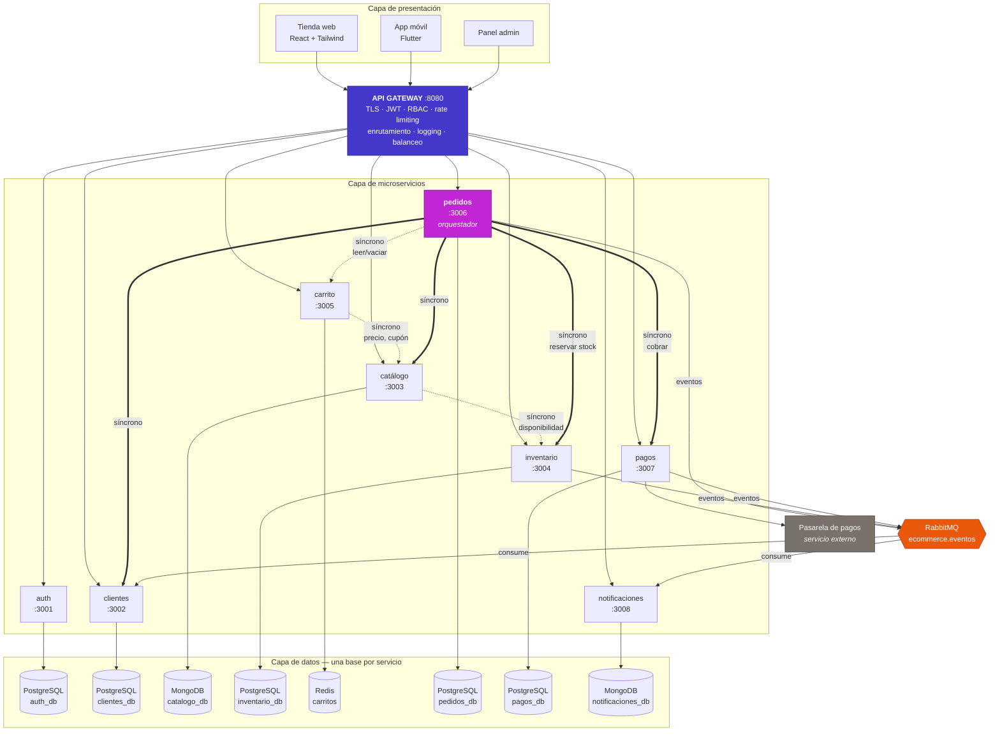

# Arquitectura del sistema

Documenta las Actividades 1, 2, 3 y 6 de la práctica.

---

## Actividad 1 — Componentes y responsabilidades

### 1.1 Cliente web y móvil

Interfaz de los usuarios. Comprende la tienda web (`clients/web`), la app móvil
(`clients/mobile`) y el panel de administración, que vive dentro de la misma
aplicación web y aparece según el rol del usuario.

Ninguno de los dos clientes conoce la existencia de los ocho microservicios:
ambos hablan con `/api/...` contra el gateway. Cambiar la estructura interna del
sistema no obliga a tocarlos.

### 1.2 API Gateway — `services/api-gateway`

Punto único de entrada. Ningún cliente se comunica directamente con los
servicios internos.

| Responsabilidad | Implementación |
|---|---|
| Recibir todas las solicitudes | Express en el puerto 8080 |
| Enrutar hacia el servicio correspondiente | `http-proxy-middleware`, tabla `DESTINOS` |
| Validar el token y autorizar por rol | `verificarAcceso` una sola vez, identidad reenviada en cabeceras |
| Rate limiting | `express-rate-limit` en tres niveles |
| Cabeceras de seguridad y CORS | `helmet` + lista de orígenes permitidos |
| Registro y correlación | `request_id` generado y propagado a toda la cadena |
| Versionado y balanceo | Prefijo `/api`, resolución por nombre de servicio en la red de Docker |

Detalle relevante: el gateway **borra** las cabeceras de confianza
(`x-usuario-rol`, `x-llamada-interna`, `x-internal-token`, …) que lleguen del
exterior antes de escribir las suyas. Sin eso, cualquiera podría enviar
`x-usuario-rol: administrador` y hacerse pasar por personal interno.

### 1.3 Servicio de autenticación — `auth-service`

| Responsabilidad | Implementación |
|---|---|
| Registro e inicio de sesión | `POST /registro`, `POST /login` |
| Hash de contraseñas | bcrypt, 10 rondas |
| Emisión, renovación y revocación de tokens | JWT de 15 min + refresh rotatorio de 7 días, almacenado como hash |
| RBAC | Claim `rol` en el token: `cliente`, `vendedor`, `administrador` |

Extra no exigido pero necesario en la práctica: bloqueo temporal de la cuenta
tras cinco intentos fallidos, y tabla de auditoría de accesos de solo inserción.

### 1.4 Servicio de clientes — `clientes-service`

Equivale al servicio de estudiantes del caso original.

Gestiona perfiles y direcciones de envío y facturación. El historial de compras
es una **proyección** alimentada por los eventos `pedido.confirmado`: este
servicio nunca consulta la base de pedidos.

Expone `GET /:id/validar`, endpoint interno que el orquestador usa en el paso 9
del flujo para obtener en una sola llamada que el cliente exista, esté activo y
tenga dirección de envío.

### 1.5 Servicio de catálogo — `catalogo-service`

Equivale al servicio de cursos del caso original.

| Responsabilidad | Implementación |
|---|---|
| Registrar y actualizar productos | `POST /productos`, `PATCH /productos/:sku` |
| Búsqueda y filtrado | Índice de texto en español con pesos, filtros por categoría, marca y precio |
| Precios, descuentos y promociones | Campo `descuento_porcentaje`, colección `promociones` |
| Exponer disponibilidad | Consulta **síncrona** a inventario, en lote |

MongoDB es la elección correcta aquí porque cada categoría tiene atributos
distintos: un portátil tiene RAM y procesador; una camiseta, talla y color. Un
esquema relacional rígido obligaría a decenas de columnas nulas.

### 1.6 Servicio de inventario — `inventario-service`

Cumple la función que en el caso original desempeñaba la verificación de cupos.
Es el servicio crítico del sistema.

| Responsabilidad | Implementación |
|---|---|
| Consultar stock por producto y bodega | `GET /disponibilidad`, `GET /stock/:sku` |
| Reservar unidades y liberarlas si el pago falla | `POST /reservas`, `POST /reservas/:id/liberar` |
| Descontar definitivamente al confirmar | `POST /reservas/:id/confirmar` |
| Registrar movimientos | Tabla `movimientos`, solo inserción |
| Alertas de reposición | Evento `inventario.stock_minimo` |

Separa explícitamente `cantidad_disponible` de `cantidad_reservada`. Una reserva
mueve unidades de la primera a la segunda; la confirmación las retira de
reservada; la liberación las devuelve a disponible. El `CHECK >= 0` de la tabla
es la última línea de defensa.

### 1.7 Servicio de carrito — `carrito-service`

| Responsabilidad | Implementación |
|---|---|
| Agregar, modificar y eliminar ítems | `POST/PATCH/DELETE /:clienteId/items` |
| Subtotales, impuestos y envío estimado | IVA 19%, envío gratis sobre 500.000 |
| Cupones y descuentos | Validados contra el catálogo |
| Persistir entre sesiones y dispositivos | Clave por `cliente_id`, no por sesión, con TTL de 7 días renovado en cada escritura |

El precio de un ítem **nunca** lo envía el cliente: se consulta al catálogo, que
es su propietario.

### 1.8 Servicio de pedidos — `pedidos-service`

Equivalente directo del servicio de matrículas. Actúa como **orquestador**.

Recibe el checkout, valida cliente y precio, solicita la reserva de stock,
registra el pedido, pide el cobro y actualiza el estado. Gestiona las
transiciones del ciclo de vida: `creado → pagado → en_preparacion → enviado →
entregado`, con `cancelado` como salida desde los tres primeros.

Es el único servicio que escribe en la base de pedidos.

### 1.9 Servicio de pagos — `pagos-service`

| Responsabilidad | Implementación |
|---|---|
| Iniciar la transacción con la pasarela | `POST /cobros` |
| Autorizar y capturar | Tarjeta, PSE, Efecty (pasarela simulada de forma determinista) |
| Informar el resultado a pedidos | Respuesta síncrona + evento asíncrono |
| Reembolsos y anulaciones | `POST /transacciones/:ref/reembolsar` |
| Conservar solo referencias tokenizadas | La tabla **no tiene** columnas de número de tarjeta ni CVV |

### 1.10 Servicio de notificaciones — `notificaciones-service`

Único servicio puramente asíncrono: no expone ningún endpoint para enviar
mensajes. Reacciona a los eventos del broker (`pedido.*`, `pago.rechazado`,
`inventario.stock_minimo`, `carrito.abandonado`), renderiza la plantilla
correspondiente y envía.

Deduplica por `clave_dedupe` con índice único: RabbitMQ garantiza entrega *al
menos una vez*, así que sin esto el cliente podría recibir dos correos.

### 1.11 Bases de datos

| Servicio | Información | Motor | Por qué |
|---|---|---|---|
| Autenticación | Usuarios, credenciales, roles, tokens | PostgreSQL | Datos estructurados con integridad estricta |
| Clientes | Perfiles, direcciones, historial | PostgreSQL | Relaciones claras, consultas por cliente |
| Catálogo | Productos, categorías, precios, promociones | MongoDB | Atributos heterogéneos + búsqueda de texto |
| Inventario | Stock, reservas, movimientos | PostgreSQL | **Transacciones y bloqueos**: es lo que evita la sobreventa |
| Carrito | Carritos activos, ítems, cupones | Redis | Dato efímero, acceso muy frecuente, expiración nativa |
| Pedidos | Pedidos, ítems, estados | PostgreSQL | Consistencia fuerte sobre el dato de negocio |
| Pagos | Transacciones, referencias tokenizadas | PostgreSQL | Auditoría y cumplimiento PCI-DSS |
| Notificaciones | Mensajes, plantillas, estados | MongoDB | Documentos de forma variable, alto volumen de escritura |

**Base de datos por servicio**: cada microservicio es el único propietario de
sus datos. En este proyecto se materializa como bases separadas con **usuario
propio y sin permisos cruzados**, de modo que la separación está impuesta por el
motor y no solo por convención.

No hay claves foráneas entre servicios. Las referencias son por identificador
(`cliente_id` en `pedidos`), y la integridad se mantiene por contrato de API.

---

## Actividad 2 — Diagrama de arquitectura



Líneas gruesas: llamadas síncronas del orquestador, indispensables para
completar la compra. Líneas punteadas: llamadas síncronas de apoyo. Flechas al
broker: comunicación asíncrona por eventos.

---

## Actividad 3 — Responsabilidades, entradas y salidas

| Componente | Responsabilidad | Entrada | Salida |
|---|---|---|---|
| Cliente web / móvil | Interacción con el usuario | Datos y acciones del usuario | Solicitudes HTTP |
| API Gateway | Enrutamiento y seguridad | Solicitud HTTP con token | Solicitud enrutada / respuesta |
| Autenticación | Validar la identidad | Usuario y contraseña | Token de acceso (JWT) |
| Clientes | Gestionar la información del cliente | Identificador del cliente | Perfil y dirección de envío |
| Catálogo | Gestionar productos y precios | Criterio de búsqueda o SKU | Producto, precio y promoción |
| Inventario | Controlar existencias | SKU, cantidad, clave de idempotencia | Disponibilidad / reserva confirmada |
| Carrito | Mantener la selección | Producto y cantidad | Carrito actualizado y totales |
| Pedidos | Registrar y orquestar la compra | Cliente + ítems del carrito | Pedido con número y estado |
| Pagos | Cobrar el valor del pedido | Pedido y medio de pago | Transacción aprobada o rechazada |
| Notificaciones | Informar eventos al cliente | Evento del broker | Correo, SMS o notificación push |
| Bases de datos | Persistencia | Datos de cada servicio | Datos almacenados y consultados |

---

## Actividad 6 — Características del sistema distribuido

### a. Distribución

Cada servicio corre como **proceso independiente en su propio contenedor**, con
su propia base de datos, y se comunica con los demás únicamente por la red
mediante interfaces definidas. No comparten memoria ni almacenamiento: no hay
un solo objeto en memoria ni un archivo que dos servicios lean a la vez.

En `docker-compose.yml` esto es literal: nueve contenedores, cuatro motores de
datos, una red interna. El catálogo podría desplegarse en otra región y el
sistema seguiría funcionando como unidad lógica frente al cliente.

### b. Independencia

Autenticación, clientes, catálogo, carrito y notificaciones funcionan de forma
autónoma: cada uno se desarrolla, prueba, despliega y actualiza sin detener a
los demás. Se puede comprobar deteniendo uno cualquiera y observando que los
otros siguen respondiendo:

```bash
docker compose stop notificaciones-service
npm run test:salud        # los otros ocho siguen en OK
```

**Pedidos es el de mayor dependencia**, exactamente como anticipa el documento:
actúa como orquestador y necesita clientes, catálogo, inventario y pagos. Sus
cuatro dependencias están declaradas en `pedidos-service/src/dependencias.ts`,
cada una con su propio circuit breaker y timeout calibrado.

### c. Escalabilidad

El **catálogo** es el primer candidato: concentra la mayor parte del tráfico, en
una proporción cercana a diez consultas por cada compra. Le siguen inventario y
pedidos durante las campañas promocionales.

Se escala solo ese servicio, sin replicar toda la aplicación:

```bash
docker compose up -d --scale catalogo-service=3
```

(Requiere quitar `container_name` y la publicación de puertos de ese servicio.)

Esto es posible porque los servicios son **sin estado**: toda su información
vive en su base de datos o en el token, nunca en memoria del proceso. El carrito
parece una excepción, pero su estado está en Redis, no en el servicio.

### d. Disponibilidad

Si notificaciones deja de funcionar, el cliente **sigue comprando con
normalidad**. Los eventos publicados quedan en la cola duradera del broker y,
al restablecerse el servicio, los consume y envía los mensajes pendientes.

Esto funciona porque:

- El exchange y las colas son `durable` y los mensajes `persistent`.
- La conexión al broker se marca como dependencia **no crítica** en el `/health`
  de los servicios que publican: su ausencia no los declara caídos.
- `bus.publicar()` registra el fallo y devuelve `false` en lugar de lanzar: una
  notificación no puede tumbar una venta ya confirmada.

El impacto se limita a un retraso en la comunicación, no a la pérdida de la
venta. Comprobable con el escenario 5.1 de [`../PLAN.md`](../PLAN.md).

### e. Seguridad

| Nivel | Medida | Dónde |
|---|---|---|
| Tránsito | TLS en todo el tráfico externo | Terminación en el gateway (en producción, tras un balanceador) |
| Entrada | Validación del JWT y RBAC centralizados | `api-gateway/src/index.ts` |
| Entrada | Rate limiting general, de login y de checkout | `express-rate-limit`, tres niveles |
| Credenciales | bcrypt con sal, 10 rondas | `auth-service` |
| Credenciales | Bloqueo temporal tras 5 intentos fallidos | `auth-service` |
| Tokens | Vigencia corta + refresh rotatorio revocable | `auth-service`, tabla `tokens_renovacion` |
| Autorización | Mínimo privilegio a nivel de dato | `exigirPropiedad` en clientes, carrito, pedidos, pagos |
| Pagos | PCI-DSS: sin datos de tarjeta en la plataforma | `pagos_db` no tiene esas columnas |
| Interno | Autenticación mutua entre servicios | Secreto compartido + `x-llamada-interna` |
| Interno | Saneamiento de cabeceras de confianza | El gateway las borra si vienen de fuera |
| Registros | Enmascaramiento de campos sensibles | `shared/src/logger.ts` |
| Auditoría | Tablas de solo inserción | `auditoria_accesos`, `auditoria_pasarela`, `movimientos` |

### f. Tolerancia a fallos

| Mecanismo | Implementación |
|---|---|
| **Circuit breaker** | `shared/src/circuit-breaker.ts`, uno por servicio destino; estado visible en `/health` |
| **Timeouts y reintentos** | Espera exponencial con jitter; solo en errores de red y 5xx |
| **Idempotencia** | Clave única en reservas, cobros, checkout, confirmación y liberación |
| **Redundancia** | Varias réplicas por servicio tras el balanceador; `HEALTHCHECK` en cada imagen |
| **Degradación elegante** | El catálogo se muestra sin indicador de stock si inventario cae |
| **Colas persistentes + DLQ** | Exchange y colas duraderas; los eventos que fallan 3 veces van a `<cola>.fallidos` |
| **Saga con compensación** | `pedidos-service/src/saga-checkout.ts`: si el pago se rechaza tras reservar, se liberan las unidades |

Sobre los reintentos: se aplican **solo** a errores de red y respuestas 5xx. Un
`409 STOCK_INSUFICIENTE` es una respuesta de negocio válida y reintentarla no
cambiaría el resultado. El cobro, además, no se reintenta en absoluto: un
reintento a ciegas sobre un pago es un riesgo que se prefiere resolver por
conciliación.

Sobre la compensación: hay un caso deliberadamente **no** compensado hacia
atrás. Si el pago se aprueba y luego falla la confirmación de la reserva, el
cliente ya pagó; compensar significaría devolverle el dinero a alguien que sí
compró. Se registra el fallo en la bitácora de la saga para resolverlo hacia
adelante con un ajuste manual de inventario.
