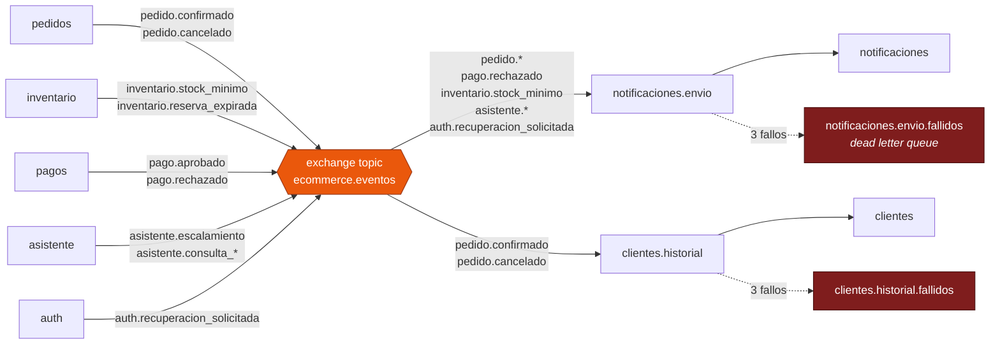

# Comunicación entre servicios — Actividad 5

Análisis de las dos alternativas de comunicación, su justificación y la
asignación concreta por conexión.

---

## Comparación de las alternativas

| Criterio | Opción A: síncrona | Opción B: asíncrona |
|---|---|---|
| **Protocolo** | HTTP/REST sobre TLS (gRPC para llamadas internas de alto rendimiento) | AMQP con RabbitMQ mediante un message broker |
| **Tipo** | Petición–respuesta bloqueante: el emisor espera el resultado | Publicación–suscripción no bloqueante basada en eventos |
| **Ventajas** | Respuesta inmediata; el resultado se conoce en el momento; flujo simple de implementar y depurar; consistencia inmediata del dato | Bajo acoplamiento; el emisor no depende de la disponibilidad del receptor; absorbe picos de carga; varios consumidores del mismo evento; mejor tiempo de respuesta percibido |
| **Desventajas** | Alto acoplamiento temporal; una falla o lentitud del destino propaga el error; el tiempo total es la suma de todas las llamadas; requiere timeouts, reintentos y circuit breaker | Consistencia eventual: el efecto no es inmediato; mayor complejidad operativa; hay que administrar broker, reintentos y dead letter queue; depuración y trazabilidad más difíciles |
| **Implementación** | `packages/shared/src/cliente-servicio.ts` | `packages/shared/src/bus-eventos.ts` |

---

## ¿Cuándo usar cada una?

### Opción A — síncrona

Se aplica estrictamente en **procesos transaccionales críticos**, donde el
resultado del servicio destino es un requisito indispensable para completar la
acción actual.

**En este sistema:** las conexiones `Pedidos → Inventario` y `Pedidos → Pagos`.
El sistema no puede, bajo ninguna circunstancia, confirmar un pedido sin que
inventario valide en tiempo real que existen unidades disponibles, ni sin que
pagos confirme que la transacción fue autorizada. Vender un producto agotado o
despachar un pedido no pagado son errores que el negocio no puede asumir.

### Opción B — asíncrona

Se aplica en **procesos secundarios o de soporte** que no impiden la continuidad
inmediata del flujo del usuario y cuyo procesamiento puede completarse en
segundo plano.

**En este sistema:** la conexión `Pedidos → Notificaciones` y, del mismo modo,
hacia facturación electrónica, analítica y recomendaciones. Una vez que el
pedido está guardado de forma segura y el pago aprobado, el cliente puede seguir
navegando. Si el correo de confirmación tarda diez segundos o dos minutos por
saturación del proveedor, la experiencia principal de compra no se ve afectada en
absoluto.

---

## Asignación por conexión

| Conexión | Tipo | Justificación | Implementación |
|---|---|---|---|
| Cliente → API Gateway | Síncrona (HTTPS) | El usuario espera una respuesta en pantalla | `fetch` en web y móvil |
| API Gateway → Autenticación | Síncrona | Sin token válido no puede continuar la solicitud | Validación en el gateway |
| Catálogo → Inventario | Síncrona | La disponibilidad mostrada debe ser la real | `catalogo/controlador.ts` |
| Pedidos → Clientes / Catálogo | Síncrona | Validar cliente y precio antes de crear el pedido | pasos 9 y 10 de la saga |
| Pedidos → Inventario | Síncrona | La reserva de stock es condición para confirmar la venta | paso 11 |
| Pedidos → Pagos | Síncrona | El resultado del cobro determina el estado del pedido | paso 12 |
| Pedidos → Notificaciones | **Asíncrona** (evento) | No condiciona la compra; se procesa en segundo plano | `pedido.confirmado` |
| Pedidos → Facturación / Analítica | **Asíncrona** (evento) | Procesos posteriores que toleran consistencia eventual | mismo evento, otros consumidores |
| Inventario → Reposición | **Asíncrona** (evento) | La alerta de stock mínimo no bloquea ninguna operación | `inventario.stock_minimo` |

---

## Comunicación síncrona: cómo se controla el acoplamiento

La desventaja de lo síncrono es real: si pagos tarda diez segundos, pedidos tarda
diez segundos, y el gateway también. Tres mecanismos lo acotan.

### Timeouts calibrados por servicio

Darle el mismo timeout a todas las dependencias produce falsos negativos: una
pasarela externa es intrínsecamente más lenta que una consulta de precio.

```typescript
// services/pedidos-service/src/dependencias.ts
clientes    → 2 s
catalogo    → 2 s
inventario  → 3 s   (1 reintento: no prolongar el bloqueo sobre el SKU)
carrito     → 2 s
pagos       → 10 s  (0 reintentos)
```

### Reintentos selectivos

Solo en **errores de red y respuestas 5xx**, con espera exponencial más jitter:

```
intento 1 → 100 ms + jitter
intento 2 → 200 ms + jitter
```

El jitter evita que todas las instancias reintenten sincronizadas durante un
incidente, convirtiendo un problema en una avalancha.

Un `409 STOCK_INSUFICIENTE` **no se reintenta**: es una respuesta de negocio
válida y repetirla no cambiaría el resultado. El cobro no se reintenta en
absoluto: aunque es idempotente por clave, un reintento a ciegas sobre un pago
es un riesgo que se prefiere resolver por conciliación.

### Circuit breaker

Uno por servicio destino. Tras cinco fallos consecutivos el circuito se abre y
las llamadas siguientes fallan de inmediato durante quince segundos, en lugar de
esperar el timeout completo. Eso evita el efecto dominó.

```
cerrado ──5 fallos──> abierto ──15 s──> semiabierto ──2 éxitos──> cerrado
                          ▲                   │
                          └───── 1 fallo ─────┘
```

Estado observable en tiempo real:

```bash
curl -s localhost:8080/api/health | python3 -m json.tool | grep -A4 circuito
```

---

## Comunicación asíncrona: topología del broker



Un exchange de tipo `topic` y una cola duradera por consumidor. Que dos
servicios distintos consuman `pedido.confirmado` sin conocerse entre sí es la
ventaja concreta del bajo acoplamiento: agregar mañana un servicio de analítica
no requiere tocar el de pedidos.

### Garantías y sus consecuencias

**Entrega al menos una vez.** El broker puede entregar el mismo evento dos veces
si el ack se pierde. Por eso notificaciones deduplica con un índice único sobre
`clave_dedupe`: sin eso, el cliente recibiría dos correos por el mismo pedido.

**Persistencia.** Exchange y colas `durable`, mensajes `persistent`. Si
notificaciones está caído, los eventos se acumulan y se procesan al
restablecerse. Esa es la base de la disponibilidad descrita en la Actividad 6.

**Dead letter queue.** Un evento que falla tres veces pasa a `<cola>.fallidos`
en lugar de bloquear la cola principal o perderse. Queda ahí para inspección.

**Publicación tolerante a fallos.** `bus.publicar()` registra el error y devuelve
`false` en lugar de lanzar: una notificación no puede tumbar una venta ya
confirmada y cobrada.

---

## Eventos del sistema

| Evento | Publica | Consume | Efecto |
|---|---|---|---|
| `pedido.confirmado` | pedidos | notificaciones, clientes | Correo de confirmación; actualiza el historial |
| `pedido.cancelado` | pedidos | notificaciones, clientes | Correo de cancelación; actualiza el historial |
| `pedido.direccion_cambiada` | pedidos | notificaciones | Correo con la dirección nueva (F5b) |
| `pago.aprobado` | pagos | — | Disponible para facturación y analítica |
| `pago.rechazado` | pagos | notificaciones | Aviso al cliente |
| `inventario.stock_minimo` | inventario | notificaciones | Alerta de reposición a operaciones |
| `inventario.reserva_expirada` | inventario | — | Trazabilidad de reservas devueltas |
| `asistente.escalamiento` | asistente | notificaciones | Ticket de un visitante al buzón de operaciones |
| `asistente.consulta_nueva`, `asistente.consulta_mensaje` | asistente | notificaciones | Consulta del cliente al buzón de operaciones (campana y correo del personal, F5c) |
| `asistente.consulta_respondida` | asistente | notificaciones | Respuesta del vendedor a la campana y al correo del cliente (F5c) |
| `auth.recuperacion_solicitada` | auth | notificaciones | Correo con el enlace para restablecer la contraseña (F5d). El campo `enlace` va en `secretos`: notificaciones lo envía pero no lo guarda |
| `carrito.abandonado` | — (declarado; ningún servicio lo publica aún) | notificaciones | Punto de extensión: recordatorio al cliente cuando se implemente la detección de carritos inactivos |

Los eventos sin consumidor están declarados a propósito: muestran los puntos de
extensión donde encajarían facturación electrónica, analítica o el motor de
recomendaciones sin modificar ningún servicio existente.

---

## Consistencia eventual: dónde se acepta y dónde no

| Dato | Consistencia | Por qué |
|---|---|---|
| Stock disponible | **Inmediata** | Es la condición para no sobrevender |
| Resultado del pago | **Inmediata** | Determina si se despacha mercancía |
| Estado del pedido | **Inmediata** | El cliente lo consulta al instante |
| Historial de compras del cliente | Eventual | Que tarde un segundo en reflejar el último pedido no molesta a nadie |
| Notificación al cliente | Eventual | Un correo que llega treinta segundos después sigue sirviendo |
| Alerta de reposición | Eventual | Operaciones no reabastece en el mismo segundo |
| Tableros de analítica | Eventual | Se consultan con periodicidad diaria |

La regla que ordena la tabla: **si el usuario o el negocio toman una decisión
inmediata con ese dato, la consistencia debe ser inmediata.** En todo lo demás,
la consistencia eventual compra desacoplamiento y capacidad de absorber picos, y
ese intercambio vale la pena.
