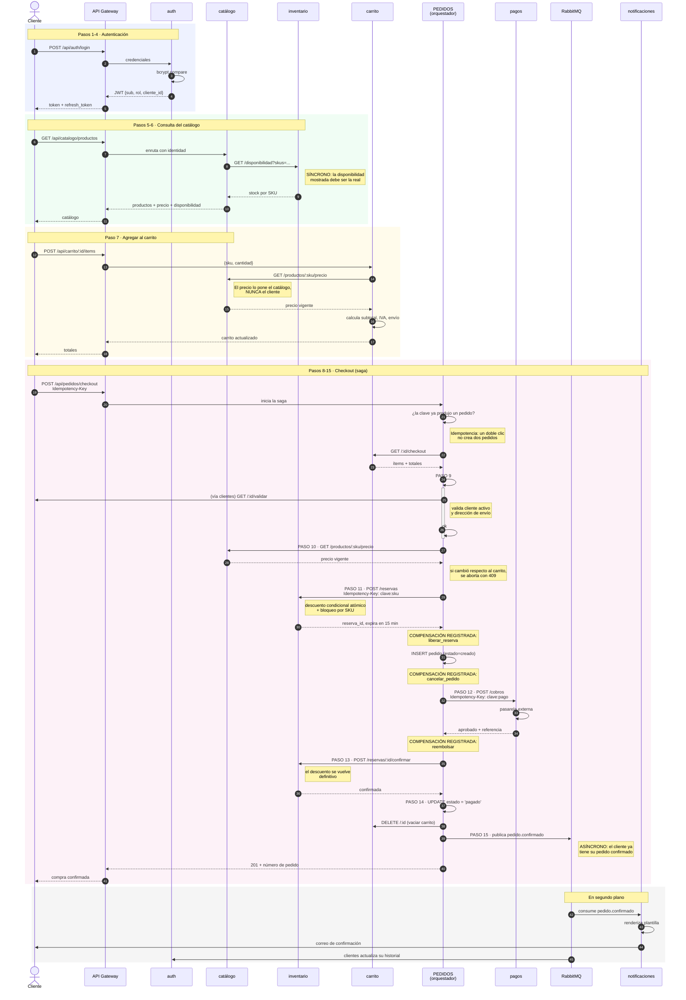
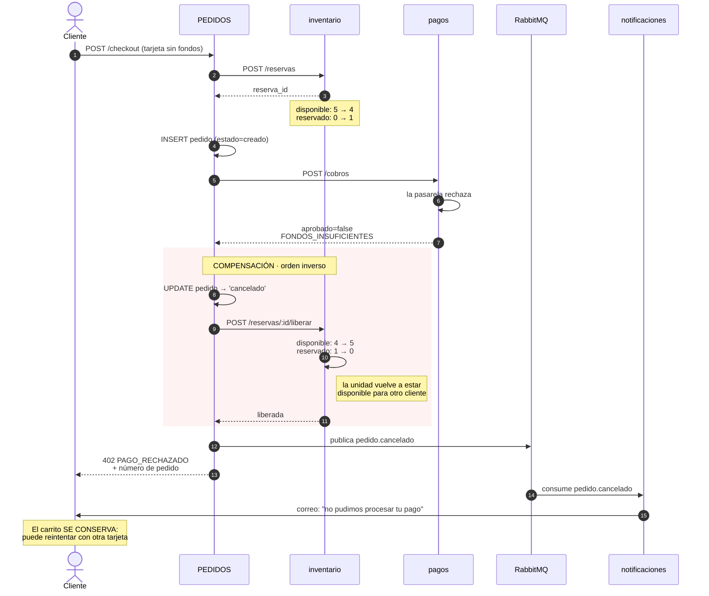

# Flujo de compra — Actividad 4

Diagrama de secuencia del escenario completo: un cliente inicia sesión, consulta
productos, agrega uno al carrito, confirma la compra y paga.

La implementación está en
[`services/pedidos-service/src/saga-checkout.ts`](../services/pedidos-service/src/saga-checkout.ts).

---

## Camino feliz: compra completada



---

## Camino de fallo: pago rechazado y compensación

Este es el escenario que justifica la saga. El pago se rechaza **después** de
haber reservado el stock, así que hay efectos laterales que deshacer.



Lo importante del resultado: el cliente recibe un `402` con el número de pedido,
sabe que no se le cobró nada, su carrito sigue intacto, y las unidades ya están
disponibles para quien las quiera.

---

## Los quince pasos y su implementación

| # | Paso del documento | Servicio | Dónde |
|---|---|---|---|
| 1 | El cliente inicia sesión | web / móvil | `Login.jsx`, `login_pantalla.dart` |
| 2 | Envía credenciales al gateway | gateway | ruta pública `/api/auth/login` |
| 3 | El gateway solicita la validación | gateway | proxy a `auth-service` |
| 4 | Se valida y se emite el token | auth | `controlador.ts → login` |
| 5 | Consulta del catálogo | catálogo | `listarProductos` |
| 6 | El catálogo consulta existencias | catálogo → inventario | `consultarDisponibilidad` (síncrono) |
| 7 | Agrega un producto al carrito | carrito | `agregarItem`, precio releído del catálogo |
| 8 | Confirma la compra | pedidos | `checkout` → `ejecutarCheckout` |
| 9 | Valida cliente y dirección | pedidos → clientes | paso `validar_cliente` |
| 10 | Verifica el precio vigente | pedidos → catálogo | paso `verificar_precios` |
| 11 | Verifica y reserva el stock | pedidos → inventario | paso `reservar_stock` |
| 12 | Solicita el cobro | pedidos → pagos | paso `cobrar` |
| 13 | Registra el pedido y descuenta | pedidos + inventario | paso `confirmar_reserva` |
| 14 | Actualiza el estado y publica | pedidos | `UPDATE estado='pagado'` |
| 15 | Envía la notificación | broker → notificaciones | evento `pedido.confirmado` |

---

## Por qué este orden

**Reservar antes de cobrar.** Cobrar y luego descubrir que no hay unidades
obliga a un reembolso. Para el cliente es mucho mejor un "producto agotado"
antes de pedirle la tarjeta que un cobro seguido de una devolución que tarda
días en reflejarse.

**Releer el precio del catálogo.** Si el precio viniera del carrito o del
cliente, cualquiera podría comprar un portátil por mil pesos manipulando la
petición. Y si cambió desde que lo agregó, se le muestra el nuevo en lugar de
cobrarle algo que no aceptó.

**Reserva con vigencia, no descuento directo.** Mientras el cliente introduce su
tarjeta, las unidades están apartadas: nadie más puede comprarlas. Si abandona
el pago, el barrido automático las devuelve al minuto. Sin la vigencia, un
carrito abandonado dejaría producto bloqueado indefinidamente.

**Confirmar la reserva después del pago.** Hasta ese momento el descuento es
reversible. Esa reversibilidad es exactamente lo que hace posible la
compensación.

---

## Bitácora de la saga

Cada paso se registra en la tabla `saga_pasos` con su estado (`iniciado`,
`completado`, `fallido`, `compensado`). Consultable:

```bash
curl -s localhost:8080/api/pedidos/42/saga \
  -H "Authorization: Bearer $TOKEN_ADMIN" | python3 -m json.tool
```

Salida de una compra con pago rechazado:

```
validar_cliente               completado
leer_carrito                  completado
verificar_precios             completado
reservar_stock                completado
crear_pedido                  completado
cobrar                        fallido      {"codigo": "FONDOS_INSUFICIENTES"}
cancelar_pedido               compensado   {"motivo": "pago_rechazado"}
liberar_reserva:SKU-TEC-004   compensado   {"motivo": "pago_rechazado"}
```

Esta bitácora es la respuesta práctica a la mayor desventaja que el documento
atribuye a la arquitectura distribuida: la dificultad de depuración. Junto con
el `request_id` propagado en los registros de los seis servicios, permite
reconstruir con precisión qué pasó en una compra concreta.
