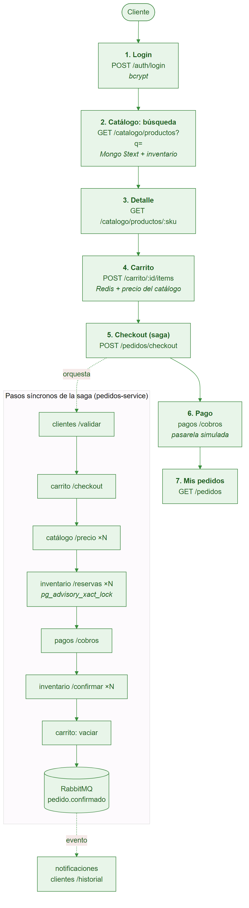
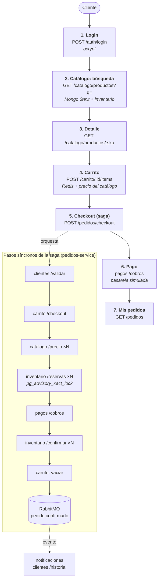

# Inventario de rutas y flujos (Paso 1.2)

> Extraído del código, no de memoria:
> `grep -n "router\.(get|post|patch|delete)" services/*/src/index.ts`, la tabla
> `DESTINOS` y la lista blanca `RUTAS_PUBLICAS` de
> [`services/api-gateway/src/index.ts`](../../services/api-gateway/src/index.ts).
> La especificación equivalente para herramientas está en
> [`docs/openapi/openapi.yaml`](../openapi/openapi.yaml).

## 1. Cómo enruta el gateway

| Prefijo público | Servicio | Puerto | Datos |
|---|---|---|---|
| `/api/auth` | auth-service | 3001 | PostgreSQL `auth_db` |
| `/api/clientes` | clientes-service | 3002 | PostgreSQL `clientes_db` |
| `/api/catalogo` | catalogo-service | 3003 | MongoDB `catalogo_db` |
| `/api/inventario` | inventario-service | 3004 | PostgreSQL `inventario_db` |
| `/api/carrito` | carrito-service | 3005 | Redis |
| `/api/pedidos` | pedidos-service | 3006 | PostgreSQL `pedidos_db` |
| `/api/pagos` | pagos-service | 3007 | PostgreSQL `pagos_db` |
| `/api/notificaciones` | notificaciones-service | 3008 | MongoDB `notificaciones_db` |

El gateway quita el prefijo (`pathRewrite`) y reenvía la petición. Antes de eso, en este orden:

1. Borra las cabeceras de confianza que llegan del exterior (invariante 10).
2. Asigna el `x-request-id`.
3. Aplica el rate limiting en tres niveles:
   - Login: 10 intentos fallidos cada 15 min, por IP.
   - Checkout: 10 por minuto, por usuario.
   - General: 300 por minuto, por usuario o, sin token, por IP.
4. Valida el JWT, salvo en las rutas de la lista blanca.

Cada servicio vuelve a validar el token y aplica `requiereRol`. Es defensa en profundidad.

**Rutas públicas** (`RUTAS_PUBLICAS`), las únicas que no exigen token:
- `POST /api/auth/login|registro|renovar`
- `POST /api/clientes`
- `GET /api/catalogo/productos[/:sku]`
- `GET /api/catalogo/categorias`
- `GET /api/health`

## 2. Tabla de endpoints

Leyenda de la columna Rol:
- **cualquiera**: basta un token válido (`requiereRol()` sin argumentos).
- **propietario**: el recurso debe pertenecer al `cliente_id` del JWT (`exigirPropiedad`). El personal interno puede ver el de otros.
- **interno**: la ruta existe para que la llame la saga, pero también responde a un usuario con el rol indicado.

| Método | Ruta pública | Servicio | Rol requerido | ¿Pública? | Dependencias síncronas que dispara |
|---|---|---|---|---|---|
| GET | `/api/health` | gateway | — | Sí | `/health` de los 8 servicios en paralelo (2 s de timeout) |
| POST | `/api/auth/login` | auth | — | Sí | `auth_db` (SELECT del usuario + **bcrypt.compare** + auditoría) |
| POST | `/api/auth/registro` | auth | — | Sí | `auth_db` (**bcrypt.hash**) |
| POST | `/api/auth/renovar` | auth | — | Sí | `auth_db` (rotación del refresh token) |
| POST | `/api/auth/logout` | auth | cualquiera | No | `auth_db` |
| GET | `/api/auth/perfil` | auth | cualquiera | No | `auth_db` |
| POST | `/api/auth/verificar` | auth | cualquiera | No | — |
| POST | `/api/auth/usuarios` | auth | administrador | No | `auth_db` (bcrypt) |
| POST | `/api/clientes` | clientes | — | Sí | `clientes_db` |
| GET | `/api/clientes/:id` | clientes | propietario | No | `clientes_db` |
| PATCH | `/api/clientes/:id` | clientes | propietario | No | `clientes_db` |
| GET | `/api/clientes/:id/direcciones` | clientes | propietario | No | `clientes_db` |
| POST | `/api/clientes/:id/direcciones` | clientes | propietario | No | `clientes_db` |
| GET | `/api/clientes/:id/historial` | clientes | propietario | No | `clientes_db` (proyección alimentada por eventos) |
| GET | `/api/clientes/:id/validar` | clientes | administrador, vendedor (interno) | No | `clientes_db` |
| GET | `/api/catalogo/productos` | catálogo | — (token opcional) | Sí | MongoDB (`$text`, `countDocuments`) → **inventario `/disponibilidad`** (circuit breaker) |
| GET | `/api/catalogo/productos/:sku` | catálogo | — (token opcional) | Sí | MongoDB → inventario `/disponibilidad` |
| GET | `/api/catalogo/categorias` | catálogo | — (token opcional) | Sí | MongoDB |
| GET | `/api/catalogo/productos/:sku/precio` | catálogo | cualquiera (interno) | No | MongoDB |
| GET | `/api/catalogo/promociones/:codigo` | catálogo | cualquiera (interno) | No | MongoDB |
| POST | `/api/catalogo/productos` | catálogo | administrador, vendedor | No | MongoDB |
| PATCH | `/api/catalogo/productos/:sku` | catálogo | administrador, vendedor | No | MongoDB |
| GET | `/api/inventario/disponibilidad` | inventario | cualquiera | No | `inventario_db` |
| GET | `/api/inventario/stock/:sku` | inventario | cualquiera | No | `inventario_db` |
| GET | `/api/inventario/movimientos/:sku` | inventario | administrador, vendedor | No | `inventario_db` |
| GET | `/api/inventario/alertas` | inventario | administrador, vendedor | No | `inventario_db` |
| POST | `/api/inventario/stock/:sku/entrada` | inventario | administrador, vendedor | No | `inventario_db` |
| POST | `/api/inventario/reservas` | inventario | administrador, vendedor (interno) | No | `inventario_db` (`reservar_stock`, `pg_advisory_xact_lock`) |
| GET | `/api/inventario/reservas/:id` | inventario | administrador, vendedor | No | `inventario_db` |
| POST | `/api/inventario/reservas/:id/confirmar` | inventario | administrador, vendedor (interno) | No | `inventario_db` |
| POST | `/api/inventario/reservas/:id/liberar` | inventario | administrador, vendedor (interno) | No | `inventario_db` |
| GET | `/api/carrito/:clienteId` | carrito | propietario | No | Redis → catálogo `/promociones/:codigo` si hay cupón |
| POST | `/api/carrito/:clienteId/items` | carrito | propietario | No | Redis → **catálogo `/productos/:sku/precio`** (invariante 2) |
| PATCH | `/api/carrito/:clienteId/items/:sku` | carrito | propietario | No | Redis → catálogo `/precio` |
| DELETE | `/api/carrito/:clienteId/items/:sku` | carrito | propietario | No | Redis |
| POST | `/api/carrito/:clienteId/cupon` | carrito | propietario | No | Redis → catálogo `/promociones/:codigo` |
| DELETE | `/api/carrito/:clienteId/cupon` | carrito | propietario | No | Redis |
| DELETE | `/api/carrito/:clienteId` | carrito | propietario | No | Redis |
| GET | `/api/carrito/:clienteId/checkout` | carrito | administrador, vendedor (interno) | No | Redis |
| POST | `/api/pedidos/checkout` | pedidos | cliente, administrador, vendedor | No | **Saga:** clientes `/validar` → carrito `/checkout` → catálogo `/precio` ×N → inventario `/reservas` ×N → pagos `/cobros` → inventario `/confirmar` ×N → carrito `DELETE` → RabbitMQ (`pedido.confirmado`) |
| GET | `/api/pedidos` | pedidos | cualquiera (los propios; el personal interno ve todos) | No | `pedidos_db` (`JOIN`, `LIMIT 100`) |
| GET | `/api/pedidos/:id` | pedidos | propietario | No | `pedidos_db` |
| GET | `/api/pedidos/:id/saga` | pedidos | administrador | No | `pedidos_db` (`saga_pasos`) |
| POST | `/api/pedidos/:id/cancelar` | pedidos | propietario | No | pagos `/reembolsar` → inventario `/entrada` ×N → RabbitMQ |
| PATCH | `/api/pedidos/:id/estado` | pedidos | administrador, vendedor | No | `pedidos_db` → RabbitMQ |
| POST | `/api/pagos/cobros` | pagos | administrador, vendedor (interno) | No | `pagos_db` → pasarela simulada (`PASARELA_LATENCIA_MS`=150) |
| POST | `/api/pagos/transacciones/:referencia/reembolsar` | pagos | administrador, vendedor | No | `pagos_db` → pasarela |
| GET | `/api/pagos/transacciones` | pagos | cualquiera (las propias) | No | `pagos_db` |
| GET | `/api/pagos/transacciones/:referencia` | pagos | propietario | No | `pagos_db` |
| GET | `/api/notificaciones/mensajes` | notificaciones | cualquiera (los propios) | No | MongoDB |
| GET | `/api/notificaciones/plantillas` | notificaciones | administrador | No | MongoDB |
| PATCH | `/api/notificaciones/plantillas/:clave` | notificaciones | administrador | No | MongoDB |

**Total: 52 endpoints públicos del gateway** (51 de los servicios más `/api/health`), de los cuales **8 no exigen token**. El gateway expone además `GET /health`, su *liveness* para el healthcheck del contenedor, que no forma parte de la API.

## 3. Flujo principal del negocio

> **Registro.** No figura en el flujo porque la web no tiene pantalla de registro: las cuentas se crean con `POST /api/clientes` y `POST /api/auth/registro`, en ese orden. Así lo hace `scripts/sembrar-datos-carga.ts`.

## 4. Endpoints críticos para la carga

Los candidatos salieron del análisis del código y se **confirmaron con una medición exploratoria**: 30 peticiones secuenciales por endpoint, sin concurrencia, con el sistema ya poblado. La medición está en la [sección 5](#5-medición-exploratoria-línea-base-sin-concurrencia). La caracterización completa bajo carga es el Módulo 1.

| Endpoint | Por qué es crítico | Decisión |
|---|---|---|
| `GET /api/catalogo/productos?q=` | Es la ruta pública de mayor tráfico (sin token, también para bots). Hace búsqueda `$text` y `countDocuments` en MongoDB, más una llamada síncrona a inventario `/disponibilidad`, protegida con circuit breaker. Es la única ruta pública que toca dos servicios. | **Se somete a carga** |
| `POST /api/auth/login` | bcrypt es costoso en CPU a propósito, y Node lo ejecuta en el *threadpool* de libuv (4 hilos por defecto). Bajo concurrencia, el login se encola. | **Se somete a carga** |
| `POST /api/pedidos/checkout` | **Es el más pesado.** Una saga de 8+ llamadas síncronas a 5 servicios, que toca 4 bases (clientes, Redis, Mongo, inventario con `pg_advisory_xact_lock`, pagos) y publica en RabbitMQ. Incluye la latencia simulada de la pasarela (150 ms). | **Se somete a carga** |
| `GET /api/pedidos` | Listado con `JOIN` y `LIMIT 100` por cliente. Crece con el historial. | **Descartado como escenario aislado** (10,9 ms sin carga; ver la sección 5). Se mide dentro del flujo completo |
| Flujo completo (login → búsqueda → carrito → checkout → mis pedidos) | Es la carga mixta más realista: reparte la presión entre todos los servicios. | **Se somete a carga** |

### Qué no se somete a carga y por qué

| Endpoints | Motivo |
|---|---|
| Administración: `POST/PATCH /catalogo/productos`, `/inventario/stock/:sku/entrada`, `/inventario/alertas`, `/inventario/movimientos`, `/pedidos/:id/estado`, `/pedidos/:id/saga`, `/auth/usuarios`, `/notificaciones/plantillas` | Tienen bajo tráfico (lo usan pocos empleados). Su riesgo es de **seguridad**, no de rendimiento: se cubren en el Módulo 3 (RBAC, IDOR). |
| Rutas internas de la saga: `/inventario/reservas*`, `/pagos/cobros`, `/clientes/:id/validar`, `/carrito/:id/checkout`, `/catalogo/productos/:sku/precio` | Ya se ejercitan **dentro** del checkout. Cargarlas por separado mediría un tráfico que no existe en producción. La concurrencia de `reservar_stock` ya la cubre `test:concurrencia`. |
| `POST /auth/registro`, `POST /clientes` | Es una operación de una sola vez por usuario. Su costo (bcrypt) se mide en el login. |
| `POST /pedidos/:id/cancelar`, reembolsos | Son de baja frecuencia y tienen efectos irreversibles en los datos de prueba. Su corrección funcional la cubre `test:e2e`. |
| `GET /api/health` | Es para monitoreo. Se consulta antes y después de cada corrida como evidencia, no como carga. |

## 5. Medición exploratoria (línea base sin concurrencia)

**Cómo se midió**

- Script: [`scripts/medicion-exploratoria.ts`](../../scripts/medicion-exploratoria.ts).
- Salida literal: [`02-medicion-exploratoria.txt`](../evidencia/no-funcionales/02-medicion-exploratoria.txt).
- 30 peticiones secuenciales por endpoint, con 1 de calentamiento previo, todas a través del gateway.
- Servicios en contenedores, con la base poblada.

| Endpoint | Promedio | p50 | p95 | Máx. | Estados |
|---|---:|---:|---:|---:|---|
| `POST /pedidos/checkout` (saga, `tok_ok`) | **307,6 ms** | 308,5 | 353,4 | 367,3 | 201 ×30 |
| `POST /auth/login` (bcrypt) | **128,0 ms** | 124,8 | 181,7 | 193,5 | 200 ×30 |
| `GET /catalogo/productos` (sin filtro) | 20,1 ms | 18,6 | 28,0 | 29,2 | 200 ×30 |
| `POST /carrito/:id/items` | 16,8 ms | 15,2 | 23,7 | 25,2 | 200 ×30 |
| `GET /carrito/:id` | 16,1 ms | 14,4 | 31,6 | 38,5 | 200 ×30 |
| `GET /catalogo/productos?q=` | 15,0 ms | 14,4 | 19,7 | 21,9 | 200 ×30 |
| `GET /catalogo/categorias` | 13,2 ms | 12,9 | 16,3 | 16,7 | 200 ×30 |
| `GET /catalogo/productos/:sku` | 13,0 ms | 12,9 | 14,0 | 15,1 | 200 ×30 |
| `GET /pedidos` (cliente) | 10,9 ms | 10,5 | 13,0 | 13,4 | 200 ×30 |

**Lectura.** Sin concurrencia, dos endpoints se separan con claridad del resto:

- **Checkout:** unos 15 veces más lento que cualquier lectura. Unos 150 ms de sus ~308 son la latencia simulada de la pasarela (`PASARELA_LATENCIA_MS=150`). El resto son las 8 o más llamadas síncronas de la saga.
- **Login:** unos 6 veces más lento. Es el costo de bcrypt, intencional.

Esto **confirma** que checkout y login son críticos.

El catálogo es rápido en aislamiento (p95 < 30 ms). Sigue siendo crítico por **volumen**, no por costo unitario: es la ruta pública de mayor tráfico, y cada página dispara además una consulta a inventario. Bajo concurrencia, la pregunta es si se sostiene el throughput y si el circuit breaker se mantiene cerrado. Eso lo responde el Módulo 1.

`GET /pedidos` es barato hoy porque cada cliente de carga tiene 1 o 2 pedidos. **Se descarta como escenario aislado** y se mide dentro del flujo completo, donde el historial crece con cada compra.

> **Limitación del entorno.** El generador de carga (k6) y los 13 contenedores comparten la misma máquina (4 núcleos y 8 hilos; 7,7 GB asignados a Docker, ver [`00-entorno.txt`](../evidencia/no-funcionales/00-entorno.txt)). Por eso las cifras absolutas son **cotas inferiores** del sistema real. Son válidas para comparar escenarios y para medir el *antes y después* de las correcciones, que es lo que pide la Fase 3.
