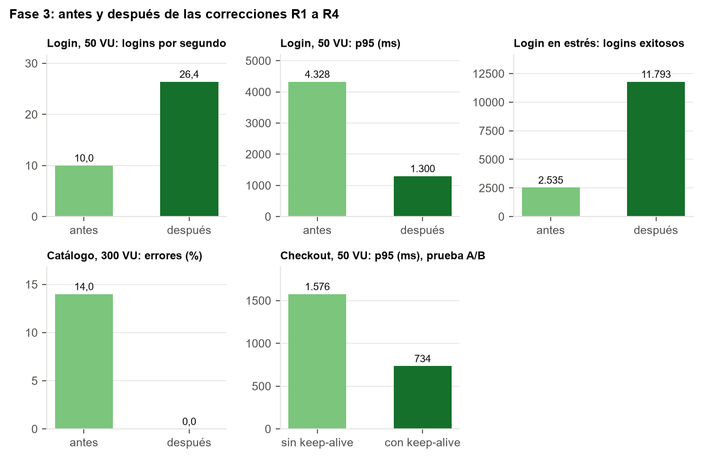
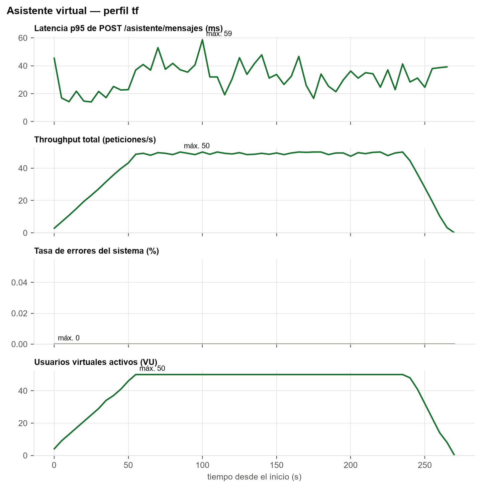
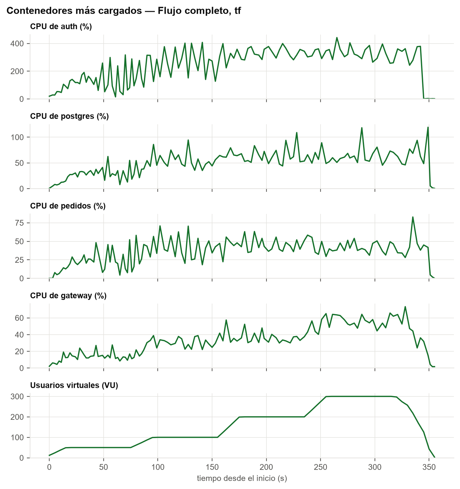
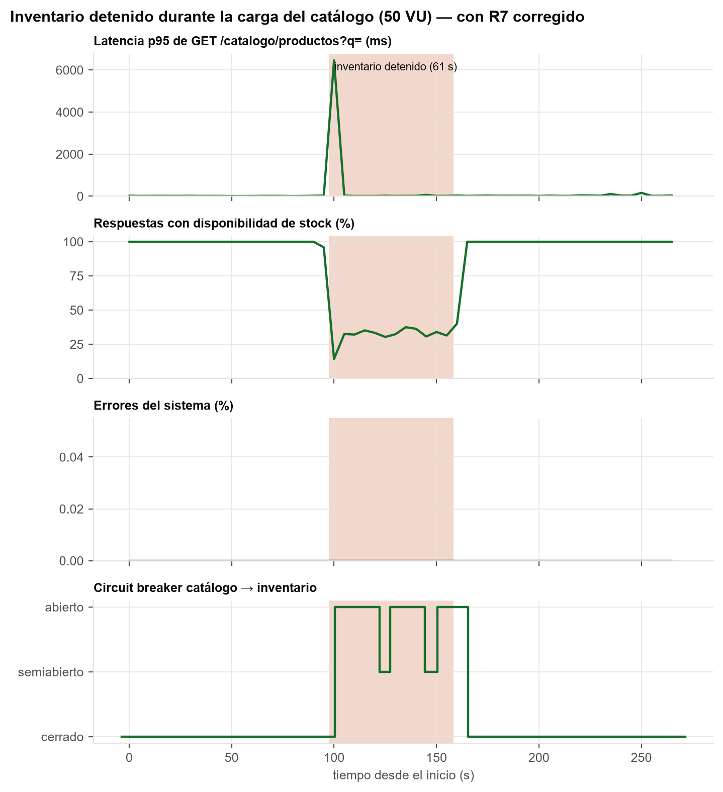
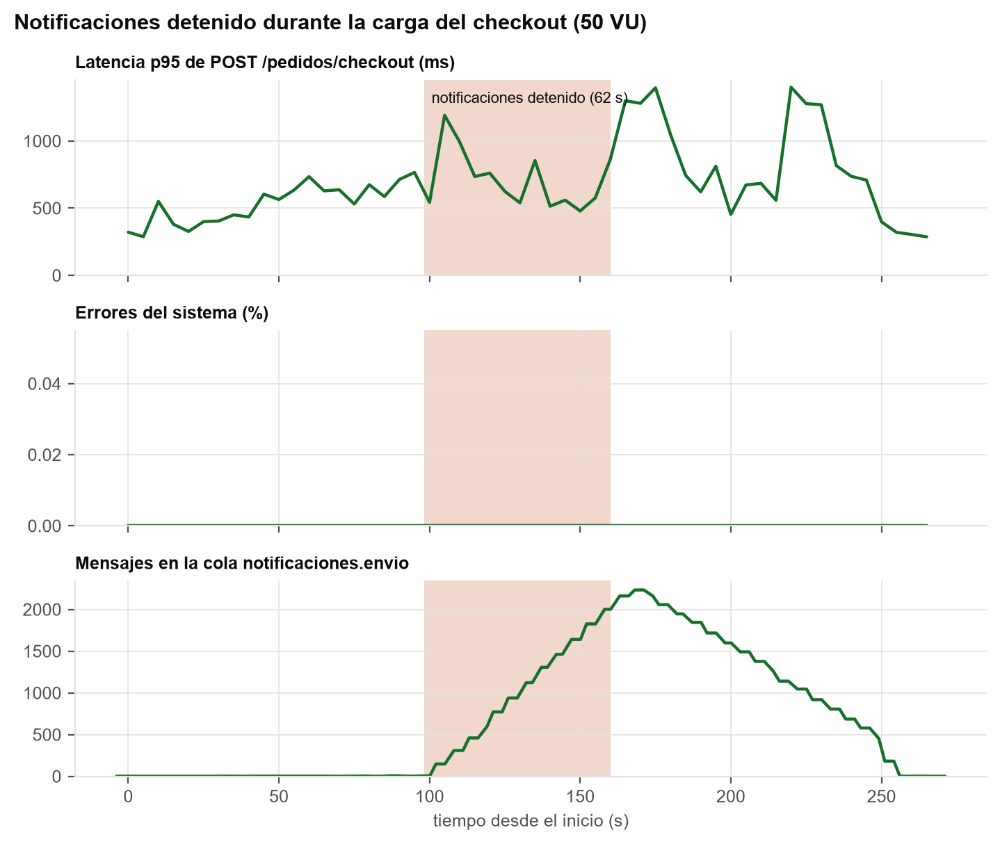
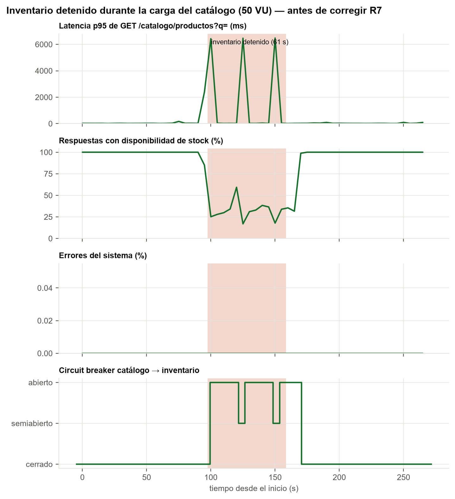

# Módulo 1 — Pruebas de rendimiento

> Evidencia cruda en [`docs/evidencia/no-funcionales/rendimiento/`](../evidencia/no-funcionales/rendimiento/) y gráficas en [`graficas/`](../evidencia/no-funcionales/graficas/). Las cifras de este documento salen de `resumen-metricas.json`, que genera `scripts/graficas/rendimiento.py` a partir de los resúmenes y las series de k6.

## 1. Herramienta: k6 (y no JMeter)

| Criterio | k6 | JMeter |
|---|---|---|
| Lenguaje de los scripts | JavaScript, el mismo ecosistema del proyecto | XML generado por una interfaz gráfica |
| Versionado | Los scripts viven en `tests/rendimiento/` junto a las demás pruebas y se revisan en un PR como cualquier código | Los `.jmx` son difíciles de leer en un *diff* |
| Criterios de aceptación | Umbrales (`thresholds`) declarativos: la corrida falla con código 99 si no se cumplen | Hacen falta *assertions* y *listeners* adicionales |
| Exportación | `--summary-export` (JSON) y `--out json` (serie temporal), que se grafican con un script propio | Archivos JTL o CSV y un reporte HTML |
| Consumo del generador | Un binario en Go, liviano. Importa porque el generador comparte la máquina con el sistema bajo prueba (sección 2) | JVM, con un consumo de memoria notablemente mayor |

Versión usada: **k6 v1.5.0** (ver [`00-entorno.txt`](../evidencia/no-funcionales/00-entorno.txt)).

## 2. Entorno y condiciones de medición

| Aspecto | Valor |
|---|---|
| Equipo | Intel Core i5-9300H (4 núcleos y 8 hilos), 15,8 GB de RAM, Windows 11 |
| Docker Desktop (WSL2) | 8 CPU y 7,7 GB de RAM asignados |
| Despliegue | `docker compose` con los 9 servicios y los 4 motores, todos en contenedores (`npm run infra:carga`). Sin `tsx watch` ni recarga |
| Perfil de entorno | [`.env.carga`](../../.env.carga): `LIMITE_GENERAL`, `LIMITE_LOGIN` y `LIMITE_CHECKOUT` en 100 000 y `LOG_LEVEL=warn`. Así se mide la capacidad del sistema y no la del limitador. Los valores por defecto del código no se tocan (sección 4.5) |
| Datos | 70 productos, 303 clientes (300 cuentas de carga, una por VU) y stock de 10 000 unidades en los 5 SKU de carga, repuesto antes de cada escenario que compra |
| Generador | k6 nativo en el mismo equipo, contra `http://localhost:8080` |
| Condición previa | Solo el contenedor escucha en el 8080. Se cerraron las aplicaciones de fondo que cargaban la CPU ([`00-condicion-equipo.txt`](../evidencia/no-funcionales/rendimiento/00-condicion-equipo.txt)) |

> **Limitación.** El generador de carga y los 13 contenedores compiten por los mismos 4 núcleos físicos. Las cifras absolutas son, por tanto, **cotas inferiores** de lo que el sistema rendiría en hardware dedicado. Son válidas para comparar escenarios entre sí y para medir el *antes y después* de las correcciones de la Fase 3, que se ejecutan en las mismas condiciones.

## 3. Diseño del plan

### 3.1 Escenarios (Paso 2.1.1)

| Script | Qué hace cada iteración | Endpoint principal |
|---|---|---|
| [`catalogo-busqueda.js`](../../tests/rendimiento/catalogo-busqueda.js) | Un visitante anónimo busca por texto. A veces filtra por categoría (30 %) o pasa a la página 2 (20 %) | `GET /catalogo/productos?q=` |
| [`login.js`](../../tests/rendimiento/login.js) | Inicia sesión con una cuenta distinta en cada iteración | `POST /auth/login` |
| [`checkout.js`](../../tests/rendimiento/checkout.js) | Con la sesión del VU, agrega 1 unidad de un SKU de carga y compra con `tok_ok_*` | `POST /pedidos/checkout` |
| [`flujo-completo.js`](../../tests/rendimiento/flujo-completo.js) | Login → búsqueda → detalle → carrito → checkout → mis pedidos | todos |

Partes comunes ([`lib/comun.js`](../../tests/rendimiento/lib/comun.js)):

- **Una cuenta `cargaNNN` por VU** (`__VU`). El rate limiting y el carrito son por usuario: con una sola cuenta se mediría el limitador, y los VU se vaciarían el carrito entre sí.
- **Clave de idempotencia nueva por intento** de checkout (`crypto.randomUUID()`), que el invariante 4 hace obligatoria.
- **El 409 de stock y el 402 de pago rechazado se marcan como respuestas esperadas** (`responseCallback`), así que no cuentan en `http_req_failed`: son respuestas de negocio válidas (invariante 7). El check exige 201 o 200 **y** que el pedido quede en estado `pagado`.
- **El login inicial de cada VU** lleva la etiqueta `fase:preparacion` y se excluye de las gráficas del checkout.
- **Pausa de 1 s entre acciones**: modelo cerrado (`ramping-vus`), en el que cada VU es un usuario con tiempo para pensar.

### 3.2 Perfiles de carga (Paso 2.1.2)

Definidos en [`lib/perfiles.js`](../../tests/rendimiento/lib/perfiles.js) y elegidos con `-e PERFIL=`:

| Tipo | Perfil | Propósito |
|---|---|---|
| **Humo** | 2 VU, 30 s | Que el script funcione; línea base sin carga |
| **Carga** | 0 → 50 VU en 1 min, 3 min sostenidos, bajada en 30 s | Comportamiento esperado en una hora pico |
| **Estrés** | Escalones de 50 → 100 → 200 → 300 VU, 2 min cada uno (rampas de 20 s) | Encontrar el punto de quiebre |
| **Pico** | 10 → 300 VU en 10 s, 1 min sostenido, y bajada | Reacción ante un evento tipo "día sin IVA" |

### 3.3 Umbrales (criterios de aceptación)

| Umbral | Valor | Justificación |
|---|---|---|
| `http_req_failed` | < 1 % | Errores del sistema (5xx, timeouts, 4xx inesperados). Los 409 y 402 de negocio no cuentan |
| `checks` | > 99 % | Respuestas correctas, incluido el pedido `pagado` |
| p95 de la búsqueda en el catálogo | < 500 ms | Ruta de navegación: más de medio segundo se percibe como lentitud al teclear o filtrar |
| p95 del checkout | < 1500 ms | Acción de una vez por compra, y la saga incluye 150 ms de pasarela simulada |
| p95 del login | < 1000 ms | Ocurre una vez por sesión (el JWT dura 15 min). Más de un segundo ya se percibe como lento |
| p95 de agregar al carrito y de mis pedidos | < 500 ms | Interacciones frecuentes de navegación |

Los umbrales se fijaron antes de la carga y se contrastaron con el humo: en reposo, todos los endpoints quedan muy por debajo. En estrés y pico **se espera** que algún umbral falle, porque eso es lo que se busca. k6 termina entonces con código 99, pero exporta el resumen igual.

### 3.4 Ejecución y recolección (Paso 2.1.3)

[`ejecutar.sh`](../../tests/rendimiento/ejecutar.sh) corre un escenario y deja por cada corrida:

- El resumen (`<nombre>.json`) y la serie temporal (`<nombre>-serie.json.gz`).
- La salida de consola.
- `/api/health` y `/health` del catálogo **antes y después** de la corrida, con el estado del circuit breaker `circuito_inventario`.
- Las líneas 5xx o `ERROR` del gateway durante la corrida.
- En estrés y pico, **`docker stats` en un CSV** cada ~2 s, con la CPU y la memoria por contenedor. Solo en esos perfiles, porque en Windows el propio muestreo consume CPU y sesgaría la línea base.

[`bateria.sh`](../../tests/rendimiento/bateria.sh) encadena los perfiles y escenarios, repone el stock antes de los escenarios que compran y deja 30 s de enfriamiento entre corridas.

```bash
npm run infra:carga                        # sistema con el perfil .env.carga
CLIENTES_CARGA=300 npm run sembrar:carga   # 300 cuentas y stock
npm run test:carga:catalogo -- humo        # un escenario y un perfil (humo si se omite)
bash tests/rendimiento/bateria.sh          # carga, estrés y pico de los cuatro escenarios
python scripts/graficas/rendimiento.py     # gráficas y resumen-metricas.json
```

La batería completa se ejecutó el 14/11/2026 entre las 21:57 y las 23:15 ([`00-bateria-log.txt`](../evidencia/no-funcionales/rendimiento/00-bateria-log.txt)). Dos corridas se repitieron (sección 4.4) y se añadió una corrida con los límites normales (sección 4.5).

## 4. Resultados

Convenciones de las tablas:

- Latencias en milisegundos del **endpoint principal** de cada escenario.
- *rps* es el throughput de todas las peticiones de la corrida.
- *Errores* es `http_req_failed`, que no incluye los 409 ni los 402 de negocio.
- ✅ o ❌ indica si se cumplieron **todos** los umbrales de la corrida.

### 4.1 Línea base (humo, 2 VU)

| Escenario | p50 | p95 | p99 | Errores | Umbrales |
|---|---|---|---|---|---|
| Catálogo (búsqueda) | 28 | 52 | 67 | 0 % | ✅ |
| Login | 598 | 822 | 855 | 0 % | ✅ |
| Checkout | 400 | 497 | 499 | 0 % | ✅ |
| Flujo completo (checkout) | 397 | 485 | 487 | 0 % | ✅ |

Con apenas 2 VU, el login ya tarda más del doble que en la medición secuencial de la Fase 1, donde la mediana fue de 264 ms ([`INVENTARIO-RUTAS.md`](INVENTARIO-RUTAS.md), sección 5). Fue la primera señal del cuello de botella de la sección 5.1.

### 4.2 Carga (50 VU sostenidos)

| Escenario | Endpoint | p50 | p95 | p99 | rps | Errores | Umbrales |
|---|---|---|---|---|---|---|---|
| Catálogo | `GET /catalogo/productos?q=` | 24 | 146 | 333 | 39,6 | 0 % | ✅ |
| Login | `POST /auth/login` | 3 860 | **4 294** | 4 433 | 9,5 | 0 % | ❌ p95 < 1000 |
| Checkout | `POST /pedidos/checkout` | 340 | 546 | 700 | 60,1 | 0 % | ✅ |
| Checkout | `POST /carrito/items` | 16 | 57 | 88 | | | ✅ |
| Flujo completo | `POST /pedidos/checkout` | 279 | 495 | 885 | 31,6 | 0,01 % (1 de 8 730) | ❌ (login) |
| Flujo completo | `POST /auth/login` | 1 158 | **3 337** | 7 543 | | | ❌ p95 < 1000 |
| Flujo completo | `GET /pedidos/mios` | 19 | 49 | 93 | | | ✅ |

**Lectura:**
- Con la carga esperada, el catálogo y la compra cumplen sus umbrales con holgura, y las 8 092 compras del checkout quedaron en estado `pagado`.
- **El login no cumple ni siquiera con 50 VU.** Sirve unas 9,5 peticiones por segundo y no más (sección 5.1).

Gráficas: [`serie-catalogo-busqueda-carga.png`](../evidencia/no-funcionales/graficas/serie-catalogo-busqueda-carga.png), [`serie-login-carga.png`](../evidencia/no-funcionales/graficas/serie-login-carga.png), [`serie-checkout-carga.png`](../evidencia/no-funcionales/graficas/serie-checkout-carga.png), [`serie-flujo-completo-carga.png`](../evidencia/no-funcionales/graficas/serie-flujo-completo-carga.png).

### 4.3 Estrés (escalones de 50 → 300 VU)

Las cifras por escalón salen solo de los intervalos de meseta, sin las rampas (`por_escalon` en `resumen-metricas.json`).

**Catálogo** ([`escalones-catalogo-busqueda-estres.png`](../evidencia/no-funcionales/graficas/escalones-catalogo-busqueda-estres.png)):

| VU | p50 | p95 | rps | Errores |
|---|---|---|---|---|
| 50 | 22 | 93 | 47 | 0 % |
| 100 | 44 | 193 | 92 | 0 % |
| 200 | 64 | 645 | 171 | 0,01 % |
| 300 | 320 | 829 | 223 | 14,0 % (*) |

(*) Los 4 061 errores son todos del **generador**, no del sistema. Windows se quedó sin puertos locales (`connectex: Only one usage of each socket address`), porque el gateway cierra la conexión después de cada respuesta (sección 5.3). El gateway no registró ningún 5xx.

**Checkout** ([`escalones-checkout-estres.png`](../evidencia/no-funcionales/graficas/escalones-checkout-estres.png)):

| VU | p50 | p95 | rps (agregar + comprar) | Errores |
|---|---|---|---|---|
| 50 | 629 | 1 062 | 57,8 | 0 % |
| 100 | 1 478 | 2 116 | 77,1 | 0,01 % |
| 200 | 3 975 | 4 990 | 77,1 | 0 % |
| 300 | 6 419 | **7 155** | 78,0 | 0 % |

**Login** ([`escalones-login-estres.png`](../evidencia/no-funcionales/graficas/escalones-login-estres.png)):

| VU | p50 | p95 | rps | Errores |
|---|---|---|---|---|
| 50 | 4 809 | 5 210 | 8,6 | 0 % |
| 100 | 10 880 | 11 469 | 8,4 | 0 % |
| 200 | 15 002 | 15 009 | 12,4 | **96,5 %** |
| 300 | 15 004 | 15 022 | 18,7 | **100 %** |

**Flujo completo:**
- Hasta 100 VU, todos los pasos funcionan (p95 del checkout de 398 ms).
- En 200 VU fallan el 79 % de las peticiones y en 300 VU el 100 %. **Todas** son logins que no responden.
- Los pasos posteriores, como búsqueda, checkout y mis pedidos, siguen rápidos para los pocos VU que consiguen sesión (p95 del checkout de 444 ms en toda la corrida).

### 4.4 Pico (10 → 300 VU en 10 s)

| Escenario | p95 a 10 VU | p95 a 300 VU | Errores a 300 VU | Observación |
|---|---|---|---|---|
| Catálogo | 44 | 686 | 0 % | Absorbe el pico sin errores |
| Checkout | 456 | 2 501 | 0 % en las compras | Pero **929 de los 1 031 logins iniciales** fallaron (los 300 VU inician sesión a la vez), así que solo compraron los VU que obtuvieron sesión |
| Login | 15 005 (*) | 15 033 | 93,9 % | El pico satura auth en segundos |
| Flujo completo | 900 | 936 | 71,7 % | Todos los fallos son del login |

(*) En la meseta de 10 VU del pico el p95 ya es de 15 s. Son los 10 VU que siguen esperando las peticiones encoladas durante la subida a 300.

> **Corridas repetidas.** En la batería original, `login-pico` y `flujo-completo-pico` empezaron con auth todavía saturado por la corrida de estrés anterior: el `/api/health` previo lo marcaba como `inalcanzable` ([`login-pico-salud.json`](../evidencia/no-funcionales/rendimiento/login-pico-salud.json)), y ambas dieron 0 % de éxito. Se repitieron esperando primero a que un login respondiera en menos de 1 s ([`00-bateria-repeticion-picos.txt`](../evidencia/no-funcionales/rendimiento/00-bateria-repeticion-picos.txt)). Las cifras de esta sección son las de la repetición, y los resultados de la primera ejecución quedan en el log de la batería. Que auth siguiera ocupado después de terminar la carga es en sí un hallazgo (sección 5.2).

### 4.5 Con los límites normales del gateway

Se reinició el gateway sin `.env.carga` (`LIMITE_GENERAL=300` por minuto, `LIMITE_CHECKOUT=10` por minuto) y se repitieron dos escenarios de carga ([`00-limites-normales.txt`](../evidencia/no-funcionales/rendimiento/00-limites-normales.txt)):

| Escenario (50 VU) | Respuestas | Latencia de las respuestas | 5xx en el gateway |
|---|---|---|---|
| Catálogo (anónimo) | 1 200 × 200 y **8 193 × 429** | p50 3 ms, p95 27 ms | 0 |
| Checkout | 850 × 201, **4 897 × 429** en la meseta (5 870 en la corrida) y 715 × 402 | p95 del checkout 1 870 ms | 0 |

- **El limitador protege al sistema sin tumbarlo.** Los 429 responden en ~3 ms, ninguna petición llegó a fallar con 5xx y el sistema siguió sano.
- En el catálogo, todos los VU anónimos comparten la IP 127.0.0.1, así que es el peor caso posible: en producción cada visitante tendría su propia IP.
- **Los 402 son un artefacto del script, no un defecto.** Cuando el checkout recibe 429, el carrito no se vacía y la iteración siguiente le agrega otra unidad. El total acaba por superar el tope por transacción de la pasarela simulada (`MONTO_EXCEDE_LIMITE`), y la saga compensa correctamente: libera la reserva y cancela el pedido. En la batería con `.env.carga` **los 35 538 checkouts respondieron 201**, sin ningún 402 ni 409.

## 5. Análisis: cuellos de botella

### 5.1 El login: bcryptjs en el hilo principal de auth

| Evidencia | Valor |
|---|---|
| CPU de `ecom_auth` en `login-estres` | **99,5 % de media** durante los 10 minutos ([`cpu-tiempo-login-estres.png`](../evidencia/no-funcionales/graficas/cpu-tiempo-login-estres.png)). Es un núcleo completo, mientras los otros 7 asignados a Docker quedan casi libres |
| Mismo patrón en `login-pico` y `flujo-completo-estres` | 99,3 % y 98,7 % |
| Throughput máximo del login | **8,4 a 10 peticiones/s** en todas las corridas, sin importar si hay 50, 100 o 300 VU |
| Latencia mínima de un login | ~100 ms, el coste de una comparación bcrypt de 10 rondas |

**Causa.** `auth-service` usa `bcryptjs`, una implementación en JavaScript puro. A diferencia del paquete nativo `bcrypt`, no delega el cálculo al *threadpool* de libuv: cada comparación ocupa el **hilo principal** de Node durante ~100 ms. Por eso el servicio atiende como máximo 1 / 0,1 s ≈ **10 logins por segundo**, y todo lo demás se encola.

La ley de Little confirma que el modelo explica las mediciones. Con N usuarios, un throughput X ≈ 9 logins/s y 1 s de pausa, la latencia esperada es R = N/X − 1:

| VU | R predicha | p50 medida |
|---|---|---|
| 50 | 50 / 9,5 − 1 ≈ **4,3 s** | 3,9 s (carga) y 4,8 s (estrés) |
| 100 | 100 / 8,5 − 1 ≈ **10,8 s** | 10,9 s |
| 200 | ≈ 22 s | supera el corte de 15 s del gateway, de modo que **casi todas** fallan |

Se trata de un límite de capacidad **por diseño**, no de una falla aleatoria: el servicio no aprovecha más de un núcleo aunque tenga 8 disponibles.

### 5.2 Trabajo huérfano: auth sigue calculando para clientes que ya se fueron

A partir de 200 VU, auth sigue con la CPU al 100 % y completa ~8,5 hashes por segundo, pero **ninguno llega a tiempo**. El gateway ya cortó la conexión a los 15 s, así que el throughput útil cae a cero mientras el servicio sigue ocupado ([`serie-login-estres.png`](../evidencia/no-funcionales/graficas/serie-login-estres.png)).

Al terminar la carga, auth tarda **entre 30 y 40 s** en volver a responder, el tiempo que necesita para vaciar la cola de peticiones abandonadas (ver la espera en [`00-bateria-repeticion-picos.txt`](../evidencia/no-funcionales/rendimiento/00-bateria-repeticion-picos.txt)). No hay ningún mecanismo de **descarte de carga** (*load shedding*): el servicio no comprueba si el cliente sigue conectado ni rechaza peticiones cuando la cola ya garantiza un timeout.

### 5.3 Dos defectos del gateway que la carga dejó a la vista

1. **`Connection: close` en todas las respuestas.** El gateway no configura un `agent` HTTP en `http-proxy-middleware`. Sin `agent`, la librería fuerza `Connection: close` hacia el servicio y reenvía esa cabecera al cliente:

   ```
   $ curl -D - localhost:8080/api/catalogo/productos?q=teclado   ->  connection: close
   $ curl -D - localhost:3003/productos?q=teclado                ->  Connection: keep-alive
   ```

   Cada petición abre por tanto **dos** conexiones TCP nuevas, una entre el cliente y el gateway y otra entre el gateway y el servicio. En el lado del cliente, a 223 rps y con el `TIME_WAIT` de 120 s de Windows, eso suma 223 × 120 ≈ 26 800 puertos ocupados, por encima de los 16 384 del rango dinámico. Es la causa del 14 % de errores del catálogo con 300 VU.

2. **Cierre abrupto (EOF) en lugar de un 503.** La opción `timeout` de http-proxy se aplica al socket **entrante**: cuando vence a los 15 s, destruye la conexión del cliente sin enviar respuesta. Por eso los 4 561 fallos de `login-estres` son `EOF` (estado 0 en k6) y no el JSON `SERVICIO_NO_DISPONIBLE` que el gateway tiene programado, y por eso el gateway solo registró 556 líneas de error para esos 4 561 fallos. Un cliente real ve un error de red en lugar de un mensaje en español.

### 5.4 El checkout: saturación sin errores, con Postgres como recurso limitante

Desde 100 VU, el throughput del checkout se estanca en **~78 peticiones/s**, unas 39 compras por segundo. A partir de ahí, cada VU adicional solo añade espera: la latencia crece en proporción a los usuarios, de 2,1 s a 100 VU a 7,2 s a 300 VU. **No hubo ni un solo error en 20 910 compras**, ni pedidos sin pagar, ni stock negativo.

| Contenedor (`checkout-estres`) | CPU media | CPU máxima |
|---|---|---|
| `ecom_postgres` | **97,4 %** | 217 % |
| `ecom_pedidos` | 81,8 % | 118 % |
| `ecom_gateway` | 38,6 % | 109 % |
| `ecom_rabbitmq` | 33,2 % | 173 % |

Postgres es el recurso más cargado. Cada compra hace varias transacciones:
- La reserva, con `pg_advisory_xact_lock` por SKU.
- La confirmación.
- El pedido y los `saga_pasos`.
- El cobro.

Además, la carga se concentra en solo 5 SKU, lo que serializa las reservas que compiten por el mismo producto. Distinguir cuánto pesan la CPU de Postgres, el pool de 10 conexiones y la serialización por SKU exigiría una prueba adicional (por ejemplo, repartir la compra entre más SKU), que queda como **hipótesis no verificada**.

Lo relevante para la calidad es que el sistema **se degrada con elegancia**: más lento, pero correcto. Los mecanismos de concurrencia (invariantes 3 y 4) se mantienen bajo 300 compradores simultáneos.

### 5.5 El catálogo y el circuit breaker

- El catálogo escala casi linealmente hasta 200 VU (171 rps, p95 645 ms) y llega a **223 rps** con 300 VU.
- Ningún contenedor llega a saturarse por sí solo (catálogo 69 %, gateway 54 %, Mongo 45 % de media). A ese nivel, el límite real es la CPU compartida del equipo, incluido el propio k6.
- El circuit breaker `circuito_inventario` se mantuvo **cerrado** en las 18 corridas (`-salud.json`): inventario respondió a tiempo las consultas de disponibilidad, incluso con 300 VU.

### 5.6 Resumen

| # | Hallazgo | Tipo | Severidad | Evidencia |
|---|---|---|---|---|
| R1 | Login limitado a ~10/s por bcryptjs en el hilo principal | Capacidad | **Alta**: con 50 usuarios ya incumple el umbral | 5.1 |
| R2 | Sin descarte de carga en auth: trabajo huérfano y 30–40 s de recuperación | Resiliencia | Media | 5.2 |
| R3 | Gateway sin keep-alive (`Connection: close`) | Eficiencia | Media | 5.3 |
| R4 | Gateway corta con EOF en lugar de responder 503 | Robustez y experiencia de uso | Media | 5.3 |
| R5 | Checkout saturado en ~39 compras/s, con Postgres como recurso limitante | Capacidad | Baja: sin errores, y por encima de la carga esperada | 5.4 |
| R6 | Notificaciones consume ~10 eventos/s (`prefetch(1)` y 100 ms por envío), menos de lo que produce el checkout | Capacidad (asíncrona) | Media: los correos llegan con minutos de retraso | 7.4 |

R1 a R4 se corrigieron en la Fase 3 (sección 7). R5 y R6 quedan registrados como mejoras pendientes.

## 7. Correcciones de la Fase 3: antes y después

Las correcciones se confirmaron con el equipo antes de implementarlas. Todas se midieron con los mismos escenarios, perfiles, cuentas y entorno (`.env.carga`) que la batería original; las corridas del después llevan el sufijo `-despues`.

### 7.1 Qué se cambió

| # | Corrección | Archivos |
|---|---|---|
| R1 | bcrypt se ejecuta en un pool de `worker_threads` (`AUTH_HILOS_HASH`, por defecto hasta 4 hilos) en lugar del hilo principal. No hay dependencias nuevas ni cambia el formato de los hashes | `auth-service/src/pool-hash.ts`, `trabajador-hash.ts` y `controlador.ts` |
| R2 | Cola acotada (`AUTH_COLA_HASH`, 25 tareas por hilo): si se llena, `503 SERVICIO_SATURADO` con `Retry-After: 2`. Las tareas de clientes que ya cerraron la conexión se descartan sin calcularse. El estado del pool se publica en `/health` (`metricas.pool_hash`) | `pool-hash.ts` |
| R3 | `http.Agent` con keep-alive en el gateway. Los servicios mantienen las conexiones ociosas 65 s, y el gateway no reenvía la cabecera de salto `Keep-Alive` | `api-gateway/src/index.ts` y `shared/src/servicio.ts` |
| R4 | Se quitó la opción `timeout` de `http-proxy`. Si vence `proxyTimeout`, el cliente recibe `504 TIEMPO_AGOTADO` con un mensaje en español | `api-gateway/src/index.ts` |

La regresión completa pasa ([`04-regresion-fase3-rendimiento.txt`](../evidencia/no-funcionales/04-regresion-fase3-rendimiento.txt)): typecheck, salud de los 9 servicios, 65/65 casos HTTP, concurrencia sin sobreventa, 49/49 comprobaciones e2e y build de la web. Los defectos quedan registrados como 4.10 a 4.12 en [`PRUEBAS.md`](../PRUEBAS.md).

### 7.2 Resultados



**Login (R1 y R2)**

| Métrica | Antes | Después | Cambio |
|---|---|---|---|
| Throughput con 50 VU (meseta) | 10,0 logins/s | **26,4 logins/s** | ×2,6 |
| p95 con 50 VU (meseta) | 4 328 ms | **1 300 ms** | −70 % |
| p95 con 100 VU (estrés) | 11 469 ms | **4 169 ms** | −64 % |
| Logins exitosos en todo el estrés (10 min) | 2 535 | **11 793** | ×4,7 |
| Fallos en estrés | 4 561 EOF tras **15 s** de espera | 31 658 × `503` en **~100 ms** (mediana) | Fallo rápido y explícito |
| CPU de `ecom_auth` en estrés | 99,5 % (1 núcleo) | 408 % (4 núcleos) | El servicio usa los hilos |
| Salud de auth al empezar la corrida siguiente | `inalcanzable` | sano | Sin trabajo huérfano |

Con 50 usuarios, el login **sigue sin cumplir** su umbral de p95 < 1000 ms (1 300 ms). La corrección eleva el techo de ~10 a ~26 logins/s, pero bcrypt sigue siendo deliberadamente caro: es su función de seguridad, y bajar las rondas no es aceptable. El siguiente paso sería escalar auth horizontalmente (`--scale auth-service=N`), algo que ahora sí rinde porque cada réplica aprovecha varios núcleos.

**Gateway (R3 y R4)**

| Métrica | Antes | Después |
|---|---|---|
| Errores del catálogo con 300 VU | 14,0 % (agotamiento de puertos) | **0 %** |
| p95 del catálogo con 50 / 100 / 200 VU | 93 / 193 / 645 ms | **34 / 79 / 327 ms** |
| Conexiones TCP para 3 peticiones seguidas | 3 | **1** |
| Respuestas sin código (EOF, estado 0) en todas las corridas | 4 561 en `login-estres`, 2 517 en `flujo-estres`… | **0** en las 9 corridas del después |
| Servicio que no responde | EOF a los 15 s | `504 TIEMPO_AGOTADO` a los 15,07 s (verificado con `docker pause ecom_auth`) |

El p95 del catálogo con 300 VU no cambia (829 frente a 836 ms): a ese nivel el límite es la CPU compartida del equipo, no las conexiones.

**Flujo completo en estrés.** El throughput pasó de 26 a **79 peticiones/s** y las compras completadas en toda la corrida de 1 874 a **6 162** (×3,3). Como ahora muchos más usuarios superan el login, la carga llega al checkout, y su p95 sube de 444 ms a 3,7 s. **El cuello de botella se desplazó de auth a la compra**, que es justamente R5 (sección 5.4).

### 7.3 Checkout: una regresión aparente y cómo se descartó

La primera medición del checkout después de las correcciones dio un p95 **peor** (735 ms frente a 546 ms). Antes de aceptar o descartar el dato, se investigó:

| Corrida | Condición | Mediana | p95 | Lectura |
|---|---|---|---|---|
| `checkout-carga` | Antes, batería original | 340 | 546 | Línea base |
| `-despues` (intento 1) | Carritos heredados de la corrida anterior | — | — | **4 120 de 5 548 compras dieron 402**: inválida (ver abajo) |
| `-despues` | Carritos vaciados | 412 | 735 | |
| `-despues-r2` | 10 533 eventos pendientes en la cola de notificaciones | 1 445 | 2 380 | Contaminada por R6 |
| `-despues-r3` | Cola vacía al empezar | 386 | 786 | |
| `-despues-r4-saga-vacia` | `saga_pasos` vaciada (tenía 901 227 filas) | 380 | 734 | La tabla de auditoría **no** es la causa |
| `-ab-sin-keepalive` | **Código de `develop` sin R3**, mismas condiciones que r4 | 633 | **1 576** | |

1. **Carritos heredados.** Los carritos viven en Redis y sobreviven entre corridas. Un VU que heredaba productos superaba el tope por transacción de la pasarela (`MONTO_EXCEDE_LIMITE`, 402), y como tras un 402 el carrito no se vacía, ese VU quedaba rechazado en todas las iteraciones siguientes. Los scripts ahora vacían el carrito al iniciar sesión y después de cada 402 o 409 ([`lib/comun.js`](../../tests/rendimiento/lib/comun.js)).
2. **Cola de notificaciones (R6, sección 7.4).** Se drena a ~10 eventos/s, así que una corrida que empieza con la cola llena compite por CPU con el consumidor. `ejecutar.sh` registra ahora la profundidad de la cola antes y después, y `bateria.sh` espera a que esté vacía.
3. **Prueba A/B.** Con el gateway y `servicio.ts` de `develop`, en las mismas condiciones, el p95 fue de **1 576 ms**, frente a **734 ms** con keep-alive. **R3 reduce a la mitad la latencia del checkout.** El mismo código de `develop` dio 546 ms en la batería original y 1 576 ms en esta, así que la diferencia frente a la línea base es una degradación del entorno: el equipo llevaba más de 4 horas de carga sostenida. No es un efecto de las correcciones.

En reposo (humo, 2 VU), el checkout del después mide p50 330 ms y p95 482 ms, frente a 400 y 497 ms antes.

> **Lección de método.** Una medición de antes y después en un equipo compartido solo es comparable si el estado también lo es: carritos, colas asíncronas, tamaño de las tablas y temperatura del equipo. Ante una diferencia inesperada, la prueba A/B intercalada en las mismas condiciones es lo único que permite atribuirla al código.

### 7.4 Hallazgo nuevo: R6, la cola de notificaciones

`notificaciones-service` consume con `prefetch(1)` y simula 100 ms por envío (`LATENCIA_ENVIO_MS`), así que procesa como máximo ~10 eventos por segundo (medido: 211 mensajes en 20 s). El checkout bajo carga publica varios eventos por compra, y la cola crece sin límite: tras 5 minutos de `checkout-carga` quedan entre 3 700 y 5 300 eventos pendientes, que tardan de 6 a 9 minutos en drenarse. Tras el estrés llegó a 10 533.

No afecta la corrección de las compras: la publicación es asíncrona (invariante 12) y ningún mensaje se perdió. Sí afecta la experiencia del cliente, porque el correo de confirmación llega con minutos de retraso.

La corrección natural es subir el `prefetch` para procesar varios envíos en paralelo: la espera es de E/S y no de CPU. Queda **propuesta y sin implementar**, pendiente de confirmación.

## 8. Limitaciones

- **El generador comparte el equipo** con los 13 contenedores (sección 2). En las corridas de 300 VU, k6 compite por CPU con el sistema, así que las latencias son cotas superiores.
- **Puertos efímeros de Windows.** Los errores de conexión del catálogo con 300 VU son del cliente. El defecto R3 los provoca, pero no se observarían con un generador en Linux con `tcp_tw_reuse`.
- **Un solo nodo por servicio.** No se probó el escalado horizontal (`docker compose --scale`), que es la respuesta natural a R1 y R5.
- **Datos acotados.** Hay 70 productos y 5 SKU de carga. Un catálogo de miles de productos cambiaría el coste de la búsqueda en Mongo.
- **Deriva del entorno.** Una laptop bajo carga sostenida durante horas no rinde igual al principio que al final (sección 7.3). Por eso la atribución de la mejora del checkout se basa en la prueba A/B intercalada, y no en la comparación con la batería original.
- **Una sola corrida por condición.** No se repitió cada corrida varias veces para estimar la varianza. Las diferencias de R1 a R4 (×2,6, ×4,7, del 14 % al 0 % de errores, la mitad del p95) superan con holgura la variación observada entre repeticiones; diferencias menores al 20 % no deberían interpretarse.
- **Modelo cerrado.** Con `ramping-vus`, cuando el sistema se ralentiza los VU también envían menos peticiones. Con usuarios reales (modelo abierto) la cola de auth crecería todavía más rápido.

---

## 9. Trabajo Final: nueva versión, asistente y fallos inyectados

Fase 4 del Trabajo Final. Se volvieron a ejecutar los scripts de k6 sobre la versión final, que incluye el ORM, el correo SMTP y el asistente, y se amplió el alcance en tres frentes:
- un escenario nuevo para el asistente;
- la carga con un servicio detenido a mitad de la corrida;
- la identificación del cuello de botella entre servicios.

Mismo equipo y mismo perfil de entorno (`.env.carga`, al que se agregó `LIMITE_ASISTENTE`). Registro completo: [`00-bateria-tf-log.txt`](../evidencia/no-funcionales/rendimiento/00-bateria-tf-log.txt); las corridas llevan la etiqueta `-tf`.

### 9.1 Carga sostenida (50 VU)

| Escenario | Endpoint | p50 | p95 | p99 | rps | Errores | Práctica, después (p95) |
|---|---|---|---|---|---|---|---|
| Catálogo | `GET /catalogo/productos?q=` | 11 | **74** | 187 | 40,6 | 0 % | 146 (antes de las correcciones) |
| Login | `POST /auth/login` | 665 | **981** | 1 396 | 25,5 | 0 % | 1 280 |
| Checkout | `POST /pedidos/checkout` | 342 | **621** | 862 | 60,1 | 0 % | 735 |
| Checkout | `POST /carrito/items` | 13 | 40 | 73 | | | 55 |
| Flujo completo | `POST /pedidos/checkout` | 272 | 392 | 655 | 38,6 | 0 % | — |
| Flujo completo | `GET /pedidos` | 10 | 28 | 58 | | | — |
| **Asistente** 🆕 | `POST /asistente/mensajes` | 12 | **36** | 55 | 41,0 | 0 % | — |
| Asistente, solo FAQ | ídem | 7 | 22 | 33 | | | — |

- **Todos los escenarios cumplen sus umbrales**, incluido el del login (p95 < 1 000 ms), que en la práctica no se alcanzaba. Por muy poco: 981 ms. Con el criterio de la sección 8 (diferencias menores al 20 % no se interpretan), la conclusión prudente es que **el login quedó en el límite**, no que lo supere con holgura.
- **El ORM no empeoró el login.** Antes de Drizzle, la meseta daba 1 280 ms; ahora, 981 ms. La consulta adicional no pesa frente a bcrypt.
- **El asistente es el endpoint más barato del sistema** después de las consultas directas.
  - Las FAQ no salen del servicio: p95 de 22 ms.
  - La búsqueda y los pedidos suman una llamada al catálogo o a pedidos: p95 de 36 ms.
  - Las 25 871 comprobaciones pasaron: la intención reconocida siempre fue la esperada, un cliente con sesión nunca recibió «inicia sesión» y el segundo turno resolvió el pedido correcto.



### 9.2 Cuello de botella entre servicios (estrés del flujo completo)

`flujo-completo` en estrés, con escalones de 1 minuto (`ESCALON=1m`) y `docker stats` cada ~2 s. Los escalones de la práctica eran de 2 minutos: con mesetas más cortas, las colas tienen menos tiempo de crecer, así que las cifras de 200 y 300 VU **no son comparables uno a uno** con la sección 7.2.

| VU | rps | p95 del checkout | Errores |
|---|---|---|---|
| 50 | 44,4 | 718 | 0 % |
| 100 | 79,2 | 1 414 | 0 % |
| 200 | 90,4 | 1 647 | 0,3 % |
| 300 | 142,6 | 3 271 | 48,3 % |

| Contenedor | CPU promedio | CPU máxima |
|---|---|---|
| **auth** | **237 %** | 442 % |
| postgres | 49 % | 119 % |
| pedidos | 35 % | 83 % |
| gateway | 31 % | 73 % |
| rabbitmq | 28 % | 143 % |
| mongo | 26 % | 109 % |

**El primer servicio que se satura sigue siendo auth.** bcrypt es caro a propósito, y el pool de hilos (R1) ocupa varios núcleos. Los 5 549 errores del escalón de 300 VU son **todos** `503` de `POST /auth/login` ([`flujo-completo-estres-tf-gateway-5xx.log`](../evidencia/no-funcionales/rendimiento/flujo-completo-estres-tf-gateway-5xx.log)): es la cola acotada de R2 descartando carga a propósito, no conexiones cortadas.

Detrás de auth está el camino del checkout: PostgreSQL y pedidos (R5). El asistente no aparece entre los consumidores relevantes. La respuesta para más capacidad de login es escalar auth horizontalmente; no se hizo, por la limitación de la sección 8 (un solo equipo).



### 9.3 Fallo inyectado: inventario detenido durante la búsqueda en el catálogo

`tests/rendimiento/fallo-inyectado.sh inventario`:
- carga de 50 VU sobre el catálogo;
- `docker stop ecom_inventario` a los 102 s y `docker start` a los 163 s (61 s caído);
- el circuit breaker de catálogo → inventario se muestrea cada 2 s.



| Momento | Qué pasó |
|---|---|
| +2 s tras el `stop` | El circuito se **abre** (15 fallos consecutivos) |
| Cada ~22 s | Pasa a semiabierto, la prueba falla y se vuelve a abrir |
| +12 s tras el `start` | El circuito se **cierra** (RNF-07: recuperación < 30 s ✅) |
| Toda la corrida | **10 287 respuestas 200, 0 errores**; con el circuito abierto, el catálogo responde sin datos de stock (degradación elegante) |

**Hallazgo nuevo R7: el estado semiabierto deja pasar todas las peticiones.**
- **El efecto.** El p95 del catálogo salta a **6,4 s** tres veces: al caer inventario y en cada paso a semiabierto.
- **La causa.** En semiabierto, `CircuitBreaker.ejecutar()` no limita las llamadas de prueba. Las ~40 peticiones por segundo del catálogo van todas contra inventario caído, y cada una espera la falla de conexión (la resolución del nombre del contenedor detenido en la red de Docker, o el timeout de 2 s) y dos reintentos con espera exponencial (`HTTP_REINTENTOS=2`).
- **El impacto.** Un minuto de caída se traduce en tres ráfagas de ~5 s en las que el catálogo tarda 6 s, cuando un circuito abierto existe precisamente para no esperar.
- **La corrección propuesta.** Una sola llamada de prueba en semiabierto, y las demás con la alternativa.

Nota sobre la medición: el panel de disponibilidad no baja a 0 % porque las búsquedas sin resultados pasan la comprobación (no hay productos que evaluar). La degradación real alcanzó a todas las respuestas con productos.

### 9.4 Fallo inyectado: notificaciones detenido durante el checkout

`tests/rendimiento/fallo-inyectado.sh notificaciones`:
- carga de 50 VU sobre el checkout;
- `docker stop ecom_notificaciones` a los 102 s y `docker start` a los 164 s (62 s caído);
- la profundidad de la cola `notificaciones.envio` se muestrea cada 2 s.



- **Las compras no se enteran** (RNF-08 ✅): **7 429 compras pagadas, 0 errores**. La publicación es asíncrona (invariante 12).
- **Los eventos esperan en RabbitMQ**: la cola crece unos 32 mensajes/s hasta un máximo de **2 233** y se vacía **84 s** después del pico, sin perder ninguno.
- **Mientras se drena la cola, el checkout se vuelve más lento**: el p95 por tramo sube a ~1,4 s, porque notificaciones compite por CPU y por Mongo. Sigue por debajo del umbral de 1,5 s.
- **R6 cambió con la Fase 2.** El consumidor procesa ahora unos **50 mensajes/s**, estimados porque la cola bajó 2 233 mensajes en 84 s mientras seguían entrando ~32/s. En la práctica eran ~10/s. La diferencia está en el envío: entonces se simulaba con 100 ms fijos por mensaje (`LATENCIA_ENVIO_MS`); ahora es SMTP real contra Mailpit, que responde en milisegundos. El `prefetch(1)` sigue igual, así que con un proveedor real más lento el problema volvería. R6 queda abierto con prioridad más baja (ver la matriz).

### 9.5 Escenarios de calidad (RNF) medidos

| RNF | Escenario | Medida | Resultado |
|---|---|---|---|
| RNF-01 | 50 usuarios buscan en el catálogo | p95 < 500 ms; errores < 1 % | ✅ 74 ms; 0 % |
| RNF-02 | 100 compradores concurrentes | p95 del checkout < 1 500 ms | ✅ 1 414 ms (escalón de 1 min del estrés; en el límite) |
| RNF-03 | 50 usuarios inician sesión | p95 < 1 000 ms | ✅ 981 ms (en el límite) |
| RNF-04 | Agregar al carrito y mis pedidos | p95 < 500 ms | ✅ 40 ms y 28 ms |
| RNF-05 | Escalones hasta 300 VU | 0 respuestas sin código; salud verde al terminar | ✅ los errores son 503 explícitos; el sistema sigue sano |
| RNF-07 | Inventario cae durante la carga | 0 errores 5xx del catálogo; recuperación < 30 s | ✅ 0 errores; se cierra 12 s después del arranque (con el defecto R7 en la latencia) |
| RNF-08 | Notificaciones cae durante el checkout | 0 compras fallidas; todos los eventos consumidos | ✅ 7 429 compras; cola vacía 84 s después del pico |
| RNF-06 | Escalado horizontal del catálogo | Throughput con 1 y con N réplicas | No medido (sección 8) |

### 9.6 Corrección de R7: antes y después

**Qué se cambió** (`packages/shared/src/circuit-breaker.ts`). En semiabierto, `ejecutar()` deja pasar **una sola** llamada de prueba (`pruebaEnCurso`). Las demás reciben la alternativa al instante, o un 503 si no hay alternativa, igual que con el circuito abierto. Cuando la prueba termina, la siguiente llamada vuelve a probar; con dos éxitos seguidos, el circuito se cierra. Hay dos pruebas unitarias nuevas en `circuit-breaker.test.ts`: tres llamadas concurrentes con una prueba en vuelo, y el caso sin alternativa. La invariante 14 de `CLAUDE.md` documenta el comportamiento.

**Medición.** La misma corrida de la sección 9.3: inventario detenido 61 s en plena meseta de 50 VU. El antes se guardó con el sufijo `-antes`.

| | Antes | Después, corrida 1 | Después, corrida 2 |
|---|---|---|---|
| Respuestas del catálogo | 10 287 | 10 596 | 10 849 |
| Errores | 0 | 3 (504 a los 15 s) | **0** |
| p50 / p95 / p99 | 7 / 28 / **6 373** ms | 9 / 97 / 360 ms | 7 / 25 / **76** ms |
| Promedio | 94 ms | 58 ms | **37 ms** |
| Ráfagas de p95 > 6 s | 3: al caer y en **cada** paso a semiabierto | 1, al caer | **1, al caer** |
| Recuperación tras el `start` | 12 s | 7 s | 7 s |




**La corrida 1 del después no es representativa, y se reporta igual.** Se hizo justo después de reiniciar el entorno desde cero (`docker compose down -v`, necesario tras el escaneo destructivo de ZAP), con la caché de MongoDB fría: el p95 fue más alto **durante toda la corrida**, no solo en la caída.

Sus tres errores son 504 que el gateway emitió a los 15 s, con el circuito ya abierto. El catálogo no llegó a registrarlos, porque el perfil de carga registra solo advertencias, así que no se pudo atribuir su causa. La corrida 2, en las mismas condiciones y con el sistema ya caliente, no los reprodujo: 0 errores en 10 849 respuestas. Si reaparecen, el siguiente paso es repetir con `LOG_LEVEL=info` para seguirlos por `request_id`.

**Lo que queda.** Persiste el pico de ~6,5 s de los primeros 2 segundos, antes de que el circuito acumule los 5 fallos que lo abren. Ningún breaker lo evita, porque necesita fallos para decidir. La palanca sería el timeout y los reintentos del cliente hacia inventario (`HTTP_TIMEOUT_MS`, `HTTP_REINTENTOS`). No se tocan: también protegen frente a fallos transitorios, y queda anotado como mejora.

**Hallazgo lateral: arranque en frío frágil.** El primer `infra:carga` tras `down -v` falló: RabbitMQ, con el volumen nuevo, superó la ventana de su healthcheck, y Compose dejó el gateway y notificaciones sin arrancar ([`00-arranque-en-frio-fallido-log.txt`](../evidencia/no-funcionales/rendimiento/00-arranque-en-frio-fallido-log.txt)). El segundo intento funcionó. Es el problema del arranque robusto que la Fase 5 debe resolver (RNF-11): reintentos en la conexión inicial del bus y un healthcheck de RabbitMQ con más margen.
