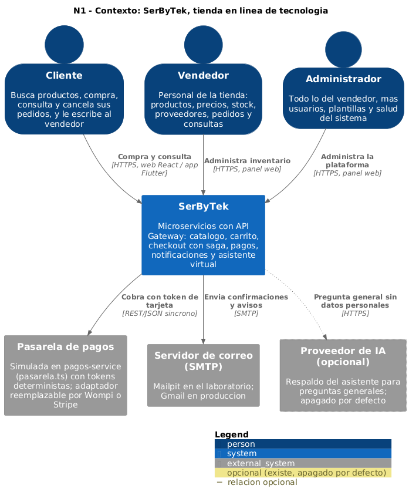
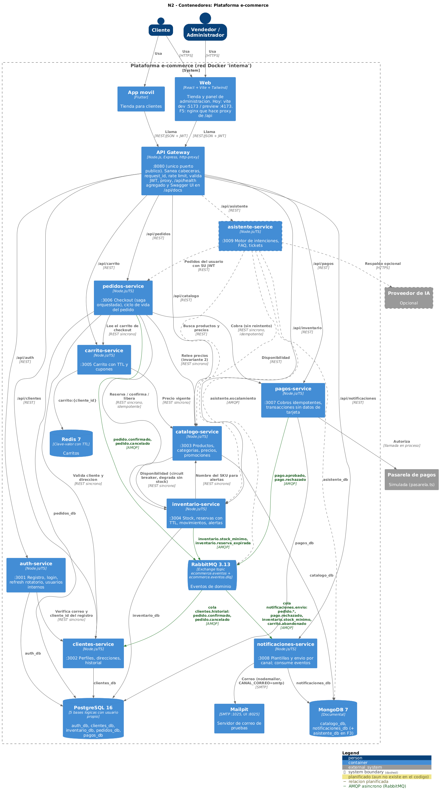
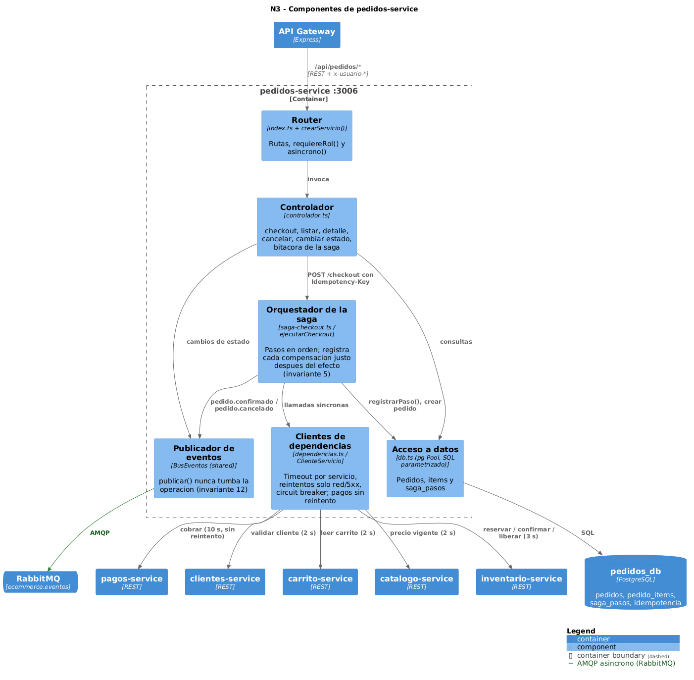
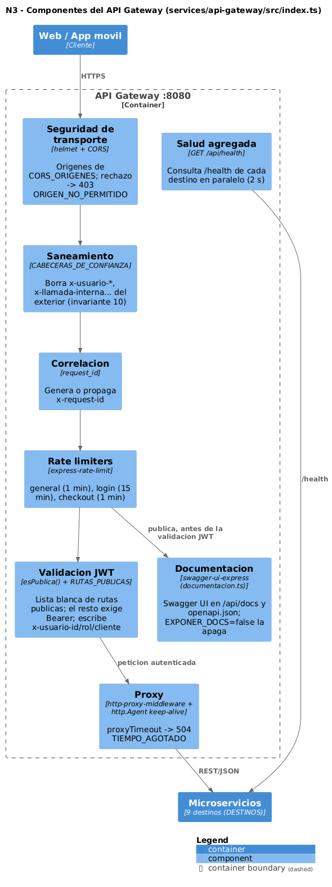
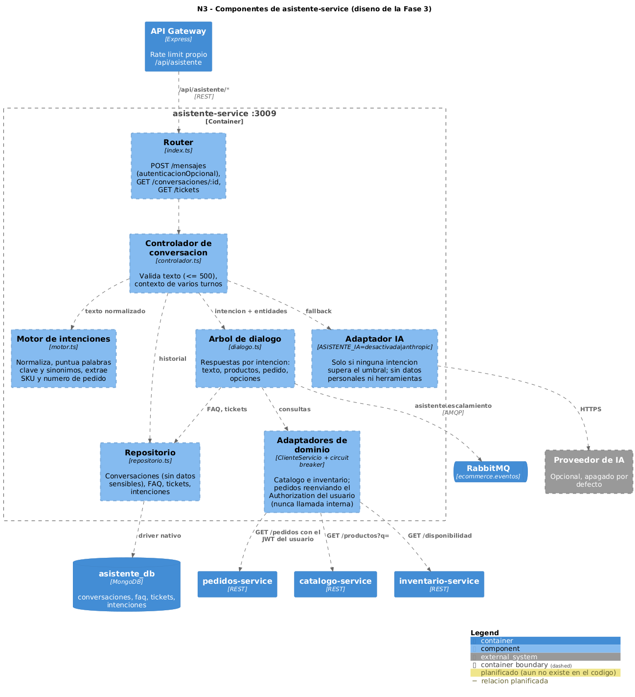
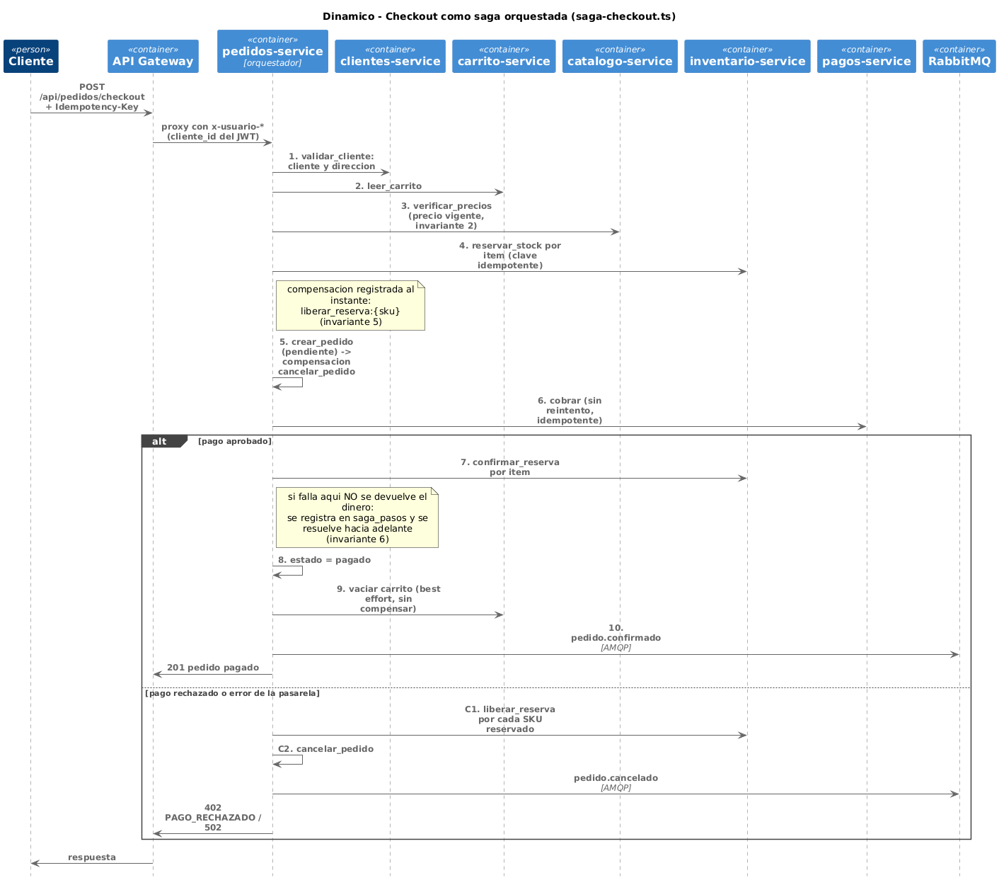
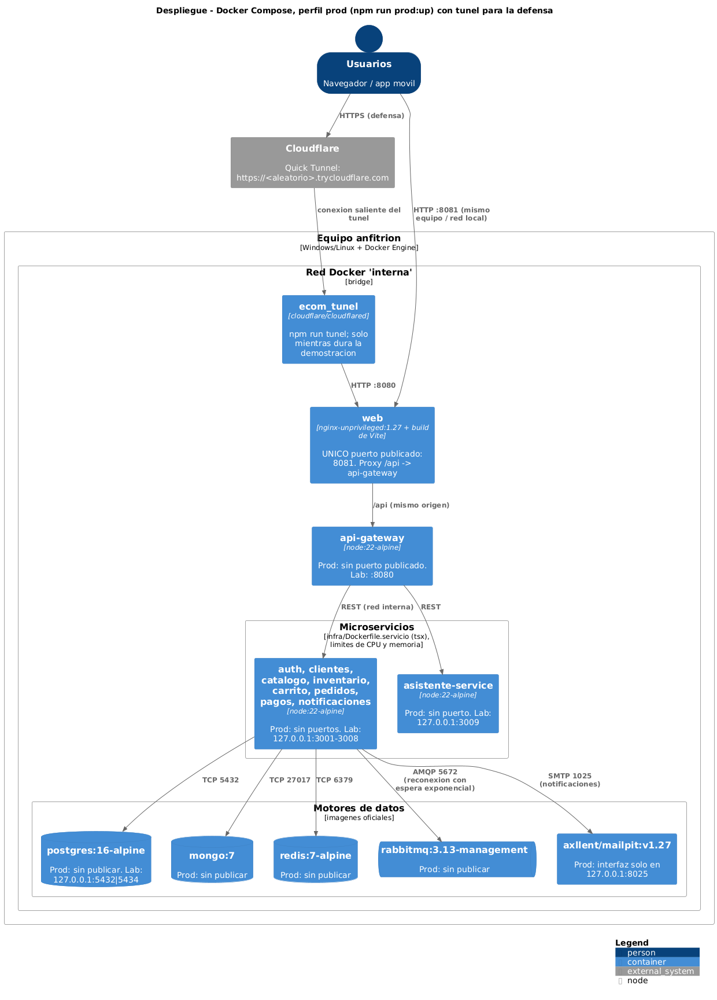

# 2. Especificación de arquitectura

Documento de especificación de la arquitectura del Trabajo Final. Integra, sin repetirlos, los documentos de la Práctica de Laboratorio 2:

| Tema | Detalle en |
|---|---|
| Componentes, responsabilidades y características distribuidas | [`ARQUITECTURA.md`](../ARQUITECTURA.md) |
| Comunicación, timeouts, reintentos, topología del broker | [`COMUNICACION.md`](../COMUNICACION.md) |
| Flujo de compra y saga, paso a paso | [`FLUJO-COMPRA.md`](../FLUJO-COMPRA.md) |
| Justificación de las decisiones (preguntas del análisis) | [`PREGUNTAS-ANALISIS.md`](../PREGUNTAS-ANALISIS.md) |
| Decisiones registradas | [`docs/adr/`](../adr/) |
| Requisitos y escenarios de calidad | [`01-escenario-requisitos.md`](01-escenario-requisitos.md) |

Los diagramas están en [`docs/c4/`](../c4/). Las fuentes son C4-PlantUML con las librerías v2.10.0 copiadas en `docs/c4/lib/`, y los PNG se regeneran con `npm run docs:c4` (imagen Docker `plantuml/plantuml:1.2024.7`). En los diagramas, **el borde discontinuo marca lo planificado**: elementos de la Fase 5 que todavía no existen en el código; el punteado, lo opcional (la IA del asistente).

---

## 2.1 Estilo arquitectónico

**Microservicios detrás de un API Gateway**, con base de datos por servicio y comunicación mixta: REST síncrono donde la respuesta es necesaria para continuar y eventos asíncronos donde basta con avisar. La justificación frente al monolito modular está en el [ADR-0001](../adr/0001-microservicios-con-api-gateway.md).

## 2.2 Descomposición en servicios

| Servicio | Contexto acotado | Responsabilidad | Datos propios | API (prefijo en el gateway) | Publica | Consume |
|---|---|---|---|---|---|---|
| api-gateway :8080 | Borde | Punto de entrada único: saneamiento, `request_id`, rate limit, JWT, proxy, salud agregada | — | `/api/*` | — | — |
| auth-service :3001 | Identidad | Cuentas, login, refresh rotatorio, usuarios internos, recuperación de contraseña (F5d) | `auth_db` (PG) | `/api/auth` | `auth.recuperacion_solicitada` | — |
| clientes-service :3002 | Clientes | Perfiles, direcciones, historial | `clientes_db` (PG) | `/api/clientes` | — | `pedido.confirmado`, `pedido.cancelado` |
| catalogo-service :3003 | Catálogo | Productos, categorías, precio vigente, promociones | `catalogo_db` (Mongo) | `/api/catalogo` | — | — |
| inventario-service :3004 | Inventario | Stock, reservas con vigencia, movimientos, alertas | `inventario_db` (PG) | `/api/inventario` | `inventario.stock_minimo`, `inventario.reserva_expirada` | — |
| carrito-service :3005 | Carrito | Carrito con TTL, cupones, totales | Redis | `/api/carrito` | — | — |
| pedidos-service :3006 | Pedidos | Orquestación del checkout (saga) y ciclo de vida del pedido | `pedidos_db` (PG) | `/api/pedidos` | `pedido.confirmado`, `pedido.cancelado` | — |
| pagos-service :3007 | Pagos | Cobro idempotente; adaptador de la pasarela | `pagos_db` (PG) | `/api/pagos` | `pago.aprobado`, `pago.rechazado` | — |
| notificaciones-service :3008 | Comunicación | Plantillas y envío por canal, sin duplicados | `notificaciones_db` (Mongo) | `/api/notificaciones` | — | `pedido.*`, `pago.rechazado`, `inventario.stock_minimo`, `carrito.abandonado`, `asistente.*`, `auth.recuperacion_solicitada` |
| asistente-service :3009 | Atención al cliente | Motor de intenciones, FAQ, consulta de pedidos con la identidad del usuario, tickets | `asistente_db` (Mongo) | `/api/asistente` | `asistente.escalamiento`, `asistente.consulta_*` | — |

## 2.3 Comunicación

### Matriz síncrona / asíncrona

| Origen → destino | Tipo | Por qué |
|---|---|---|
| auth → clientes | REST | El registro necesita saber ya si el correo y el `cliente_id` coinciden (hallazgo S-01) |
| catálogo → inventario | REST + circuit breaker | La disponibilidad se muestra en la misma respuesta; si inventario falla, el catálogo **degrada** sin stock |
| inventario → catálogo | REST | Nombre del producto en las alertas |
| carrito → catálogo | REST | El precio debe ser el vigente al agregar (invariante 2) |
| pedidos → clientes, carrito, catálogo, inventario, pagos | REST, timeouts por dependencia | La saga necesita cada respuesta para decidir el paso siguiente; consistencia inmediata en stock y cobro |
| pedidos → notificaciones, clientes | AMQP | El cliente ya tiene su pedido; el correo y el historial pueden llegar después |
| pagos, inventario → notificaciones | AMQP | Avisos que no bloquean la operación |
| asistente → catálogo, pedidos | REST + circuit breaker | Respuesta en la conversación; si pedidos cae, el asistente lo dice en lugar de fallar. Pedidos se consulta con el token del usuario |
| asistente → notificaciones | AMQP | El escalamiento se avisa sin esperar al correo |

La decisión general está en el [ADR-0004](../adr/0004-rabbitmq-eventos-rest-consultas.md); timeouts y reintentos en [`COMUNICACION.md`](../COMUNICACION.md).

### Topología del broker (`packages/shared/src/bus-eventos.ts`)

| Elemento | Valor |
|---|---|
| Exchange de eventos | `ecommerce.eventos`, tipo `topic`, durable |
| Exchange de fallidos | `ecommerce.eventos.dlq`, tipo `topic`, durable |
| Cola `notificaciones.envio` | Patrones `pedido.*`, `pago.rechazado`, `inventario.stock_minimo`, `carrito.abandonado`, `asistente.*`, `auth.recuperacion_solicitada`; `maxIntentos: 3` |
| Cola `clientes.historial` | Patrones `pedido.confirmado`, `pedido.cancelado` |
| Dead letter | Cada cola declara `deadLetterExchange: ecommerce.eventos.dlq` y una cola de fallidos ligada con su nombre como *routing key* |
| Consumo | `prefetch(1)`: un mensaje a la vez por consumidor (hallazgo R6 de rendimiento) |
| Publicación | `publicar()` registra el fallo y devuelve `false`; nunca tumba la operación (invariante 12) |

## 2.4 Persistencia

- **Base de datos por servicio** con usuario propio: `auth_user` solo puede abrir `auth_db`, y así cada uno (`infra/postgres/00-bases.sql`, `infra/mongo/init-mongo.js`). Un servicio no puede leer la base de otro aunque quisiera ([ADR-0002](../adr/0002-base-de-datos-por-servicio.md)).
- **Motor por necesidad:**

| Motor | Servicios | Por qué |
|---|---|---|
| PostgreSQL 16 | auth, clientes, inventario, pedidos, pagos | Transacciones ACID, restricciones, funciones con bloqueo (`reservar_stock`) |
| MongoDB 7 | catálogo, notificaciones, asistente 🆕 | Documentos de forma variable (atributos por categoría, plantillas, conversaciones) |
| Redis 7 | carrito | Datos efímeros con TTL de 7 días renovado en cada escritura |

- **Consistencia entre servicios:** no hay transacciones distribuidas. El checkout usa una **saga orquestada** con compensaciones ([ADR-0003](../adr/0003-saga-orquestada.md)); el historial de clientes y las notificaciones son **eventualmente consistentes** vía eventos.
- **Acceso a datos:** 🔶 Drizzle ORM en auth y clientes; SQL nativo parametrizado en inventario, pedidos y pagos ([ADR-0006](../adr/0006-estrategia-orm.md)).

## 2.5 Patrones aplicados

| Patrón | Dónde | Archivo |
|---|---|---|
| API Gateway | Entrada única, autenticación central | `services/api-gateway/src/index.ts` |
| Saga orquestada con compensaciones | Checkout | `services/pedidos-service/src/saga-checkout.ts` |
| Circuit breaker | Catálogo → inventario; pedidos → dependencias | `packages/shared/src/circuit-breaker.ts` |
| Reintentos con espera exponencial y *jitter* | Solo red, 5xx y timeouts; nunca 409 ni el cobro (invariante 7) | `packages/shared/src/cliente-servicio.ts` |
| Idempotencia | Reserva, cobro y checkout con clave obligatoria (invariante 4) | `03-inventario.sql`, `pagos-service`, `pedidos-service` |
| Dead letter queue | Mensajes que fallan 3 veces | `packages/shared/src/bus-eventos.ts` |
| Degradación elegante | Catálogo sin stock si inventario cae; asistente sin pedidos si pedidos cae | `catalogo-service/src/controlador.ts`, `asistente-service/src/dialogo.ts` |
| *Health check* agregado | `/api/health` | gateway |
| Base de datos por servicio | Usuarios de BD aislados | `infra/` |
| Adaptador | Pasarela de pagos; canal de correo; proveedor de IA | `pasarela.ts`, `canales.ts`, `ia.ts` |
| Repositorio | Acceso a datos con Drizzle | `services/{auth,clientes}-service/src/repositorio.ts` |
| Librería transversal | Errores, logs, JWT, bus y cliente HTTP comunes | `packages/shared/` |

### Componentes del orquestador y del gateway

### Vista dinámica del checkout

## 2.6 Seguridad de la arquitectura

| Control | Cómo | Dónde |
|---|---|---|
| Autenticación | JWT HS256 de 15 min + refresh rotatorio de 7 días; secretos obligatorios de ≥ 32 caracteres (invariante 13) | `autenticacion.ts`, [ADR-0005](../adr/0005-jwt-corto-refresh-rotatorio.md) |
| Autorización por rol (RBAC) | `requiereRol()` en cada ruta | routers de los servicios |
| Autorización a nivel de dato | El `cliente_id` sale del JWT (invariante 1); un cliente solo ve lo suyo | controladores |
| Confianza en el borde | El gateway borra las cabeceras de confianza externas y escribe las suyas (invariante 10) | gateway |
| Autenticación mutua interna | Secreto compartido **y** cabecera `x-llamada-interna` (invariante 11) | `autenticacion.ts` |
| Aislamiento de red | Servicios y motores publicados solo en `127.0.0.1`; en producción, sin puertos | `docker-compose.yml` |
| PCI-DSS por ausencia del dato | `pagos_db` sin número, CVV ni vencimiento (invariante 9) | `infra/postgres/05-pagos.sql` |
| Límites de abuso | 300 peticiones/min general, 10 logins/15 min, 10 checkouts/min | gateway |
| Cabeceras de la web | CSP estricta y cabeceras de seguridad | `clients/web/cabeceras-seguridad.js` |

La evaluación OWASP Top 10 2025 y sus correcciones están en [`docs/calidad/SEGURIDAD.md`](../calidad/SEGURIDAD.md).

## 2.7 Despliegue

Hoy hay un único perfil Compose de laboratorio: el gateway publica `:8080` y el resto se publica solo en `127.0.0.1`. La Fase 5 añade la web en nginx, el perfil `docker-compose.prod.yml` sin puertos internos y la exposición por túnel para la defensa ([ADR-0009](../adr/0009-entorno-de-despliegue.md)).

---

## 2.8 Checklist cruzado: diagramas frente al código

Verificado el 2026-11-15 contra `docker-compose.yml`, `DESTINOS` y `RUTAS_PUBLICAS` del gateway, `bus-eventos.ts`, `tipos.ts` (`Eventos`), los `bus.publicar`/`bus.suscribir` de cada servicio, `dependencias.ts` y los `ClienteServicio` de cada servicio.

| Elemento del diagrama | Existe en el código | Evidencia |
|---|---|---|
| Gateway :8080 y 8 destinos | ✅ | `DESTINOS` en `api-gateway/src/index.ts`; `ports: "8080:8080"` |
| 8 microservicios en :3001-3008 | ✅ | `docker-compose.yml` (`127.0.0.1:300N`) |
| PostgreSQL con 5 bases y usuario propio | ✅ | `infra/postgres/00-bases.sql` (`CREATE USER` / `CREATE DATABASE` ×5) |
| MongoDB con `catalogo_db` y `notificaciones_db` | ✅ | `infra/mongo/init-mongo.js` (`getSiblingDB` ×2) |
| Redis para el carrito | ✅ | `carrito-service`, `TTL_CARRITO_SEGUNDOS` |
| RabbitMQ: `ecommerce.eventos` y `.dlq` | ✅ | `bus-eventos.ts`, `assertExchange` ×2 |
| auth → clientes | ✅ | `URL_CLIENTES` en auth-service |
| catálogo ↔ inventario | ✅ | `ClienteServicio` en ambos controladores |
| carrito → catálogo | ✅ | `URL_CATALOGO` en carrito-service |
| pedidos → clientes, carrito, catálogo, inventario, pagos | ✅ | `dependencias.ts` (5 clientes, timeouts 2/2/2/3/10 s) |
| Publicadores de `pedido.*`, `pago.*`, `inventario.*` | ✅ | `saga-checkout.ts`, `pedidos/controlador.ts`, `pagos/controlador.ts`, `inventario/controlador.ts` |
| Colas `notificaciones.envio` y `clientes.historial` con sus patrones | ✅ | `bus.suscribir` en los dos servicios |
| Orden de los middlewares del gateway | ✅ | helmet/CORS → saneamiento → `request_id` → limitadores → JWT → proxy |
| `carrito.abandonado` | ⚠️ **Declarado y consumido, pero nadie lo publica.** `COMUNICACION.md` atribuye la publicación a carrito; el código no la tiene. Queda como punto de extensión (detección de carritos inactivos) y se corrige la tabla de `COMUNICACION.md` | `tipos.ts`, `notificaciones/controlador.ts` |
| Pasarela de pagos como sistema externo | ⚠️ Simulada **en proceso** dentro de pagos-service, no como sistema separado. Se dibuja externa porque así es en producción (adaptador) | `pagos-service/src/pasarela.ts` |
| Mailpit (SMTP :1025, UI :8025) y notificaciones → Mailpit | ✅ (Fase 2) | `docker-compose.yml` (`mailpit`), `notificaciones-service/src/canales.ts` |
| Swagger UI en `/api/docs` | ✅ (Fase 2) | `api-gateway/src/documentacion.ts`; `test:openapi` |
| asistente-service :3009, `asistente_db`, evento `asistente.escalamiento` | ✅ (Fase 3) | `services/asistente-service`, `infra/mongo/asistente.js`, `DESTINOS` |
| Proveedor de IA | ✅ Opcional, apagado por defecto (borde punteado) | `asistente-service/src/ia.ts` |
| web en nginx, túnel | 🔜 Planificados (borde discontinuo): Fase 5 | — |

En sentido inverso, todo contenedor, puerto, cola y exchange del código aparece en el diagrama de contenedores o en el de despliegue.
