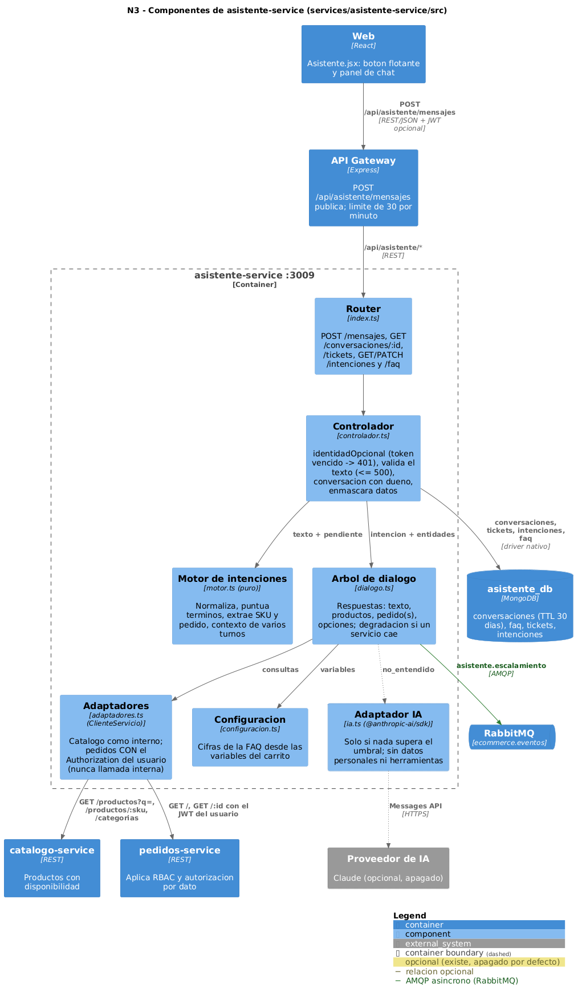
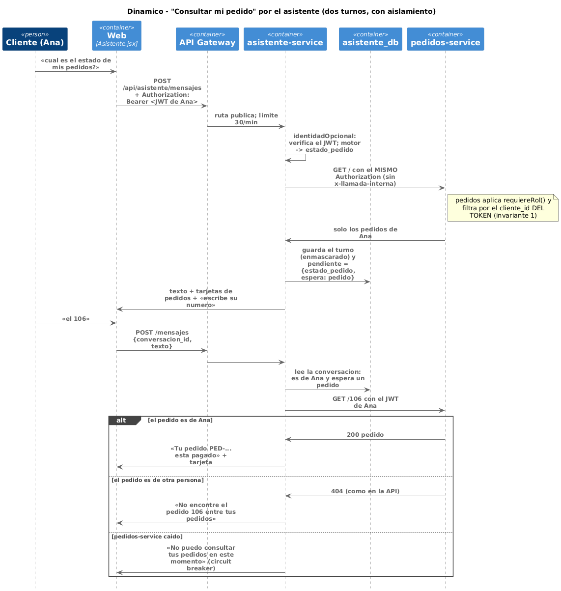
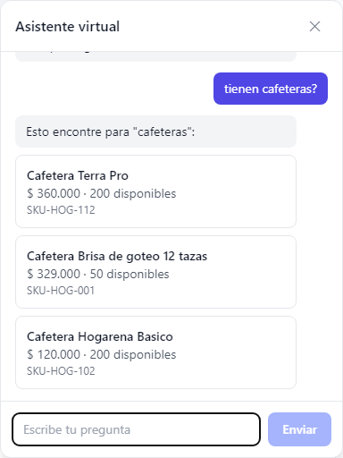
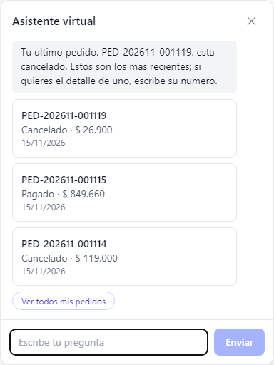

# 3. Asistente virtual

Documentación de la Fase 3 del Trabajo Final: el módulo de automatización conversacional. La decisión de diseño (reglas como núcleo, IA opcional apagada) está en el [ADR-0007](../adr/0007-asistente-reglas-ia-opcional.md); los requisitos, en [`01-escenario-requisitos.md`](01-escenario-requisitos.md) (RF-ASIS-01 a 10 y RNF-20).

| | |
|---|---|
| **Servicio** | `services/asistente-service`, puerto 3009, base `asistente_db` (MongoDB) con usuario propio |
| **Ruta pública** | `POST /api/asistente/mensajes`, con token opcional y un límite propio de 30 mensajes por minuto |
| **Interfaz** | `clients/web/src/componentes/Asistente.jsx`: botón flotante y panel en todas las vistas |
| **Pruebas** | `npm run test:asistente` (46 comprobaciones contra el gateway), `npm run test:unit` (motor, IA simulada, enmascarado) y `npm run asistente:metricas` (tasa de acierto) |

## 3.1 Arquitectura

- **Motor de intenciones (`motor.ts`)**: es puro y determinista.
  1. Normaliza el texto: minúsculas, sin tildes y sin signos.
  2. Suma el peso de los términos de cada intención presentes en el texto; una frase de varias palabras cuenta como un término.
  3. Suma los refuerzos por entidad (SKU y número de pedido).
  4. Elige la intención de mayor puntaje; en un empate gana la de mayor prioridad. Por debajo del umbral responde `no_entendido`.
- **Datos editables**: las intenciones y la FAQ viven en `asistente_db`.
  - El servicio las siembra desde `src/datos/*.json` solo si la colección está vacía.
  - El administrador las cambia con `PATCH /api/asistente/intenciones/:clave` y `/faq/:clave`, y el cambio se ve en segundos, sin desplegar.
- **Cifras de la FAQ**: el texto no tiene números escritos a mano. Usa variables (`{{costo_envio}}`, `{{umbral_envio_gratis}}`, `{{porcentaje_iva}}`), que salen de la misma configuración que usa el carrito.
- **Contexto de varios turnos**: cuando el asistente pide un dato («¿cuál es el número?»), la conversación guarda `pendiente`. Si el mensaje siguiente lo trae sin palabras de otra intención, se resuelve con la intención pendiente.
- **Adaptadores** (`ClienteServicio`, con timeout y circuit breaker): consultan el catálogo para productos, precio y disponibilidad, y pedidos-service para los pedidos.

## 3.2 Intenciones

| Intención | Sesión | Respuesta |
|---|---|---|
| `saludo`, `ayuda`, `despedida` | No | Reglas y menú de opciones rápidas |
| `faq_envio`, `faq_envio_gratis`, `faq_iva`, `faq_pagos`, `faq_entrega`, `faq_devoluciones`, `faq_horario` | No | Colección `faq`, con las cifras tomadas de la configuración |
| `buscar_producto` | No | Catálogo: tarjetas con «Agregar al carrito» para clientes |
| `precio_disponibilidad` | No | Precio vigente del catálogo (invariante 2) y unidades disponibles |
| `estado_pedido` | **Sí** | Pedidos del usuario con **su** token; contexto de dos turnos |
| `cancelar_pedido` | **Sí** | Explica la regla según el estado real del pedido y lleva a «Mis pedidos» |
| `humano` | Para enviar, **sí** | Cliente: formulario de consulta al vendedor en el chat (RF-53, eventos `asistente.consulta_*`). Visitante: se le pide iniciar sesión, sin ticket ni aviso; la opción lleva `retomar` y la web reenvía la petición al volver con la sesión. Personal: se le indica la pestaña Consultas |
| `no_entendido` | — | Pide reformular y muestra el menú; con la IA activa, la usa como respaldo |

## 3.3 Seguridad

- **Identidad del usuario.** Para consultar pedidos, el asistente reenvía el `Authorization` del usuario (`ClienteServicio`, opción `autorizacion`). **Nunca** usa la llamada interna (`x-llamada-interna`), que se saltaría el control de rol (invariante 11).
  - pedidos-service aplica su RBAC y su autorización por dato, igual que si el usuario llamara a la API.
  - Un pedido ajeno responde «no encontrado» (invariante 1).
- **Token vencido.** Responde 401 `TOKEN_EXPIRADO`, para que la web renueve la sesión; un token vencido no se trata como visitante.
- **Conversaciones.** Una conversación con dueño no se continúa con otra identidad: se empieza una nueva. `GET /conversaciones/:id` solo la ve su dueño o un administrador; cualquier otro recibe 404.
- **Privacidad.** Al guardar se enmascaran correos, números de tarjeta y teléfonos; los números de pedido se conservan. Las conversaciones vencen tras 30 días sin actividad (índice TTL).
- **Entradas y salidas.**
  - Texto de 1 a 500 caracteres, y debe ser una cadena: un objeto responde 400.
  - Un `conversacion_id` que no es un UUID se ignora.
  - La web pinta todas las respuestas como texto: React escapa todo y nunca se inserta HTML crudo.
- **IA opcional** (`ASISTENTE_IA=anthropic`): solo recibe la pregunta y la información pública de la tienda. No recibe datos personales ni herramientas; su salida es texto y se recorta. Si falla o declina, el asistente responde como sin IA.
- **Abuso.** El límite propio del gateway es de 30 mensajes por minuto (`LIMITE_ASISTENTE`). El chat es público y cada mensaje puede consultar otros servicios.

## 3.4 Resiliencia

| Falla | Comportamiento | Verificado |
|---|---|---|
| pedidos-service detenido | «No puedo consultar tus pedidos en este momento»; las preguntas frecuentes siguen funcionando | `test:asistente` con `ASISTENTE_PROBAR_DEGRADACION=1` (`docker stop ecom_pedidos`) |
| Catálogo caído | «No puedo consultar el catálogo…» | Mismo mecanismo (`esServicioCaido`) |
| RabbitMQ caído | El ticket se registra igual; solo falta el aviso (invariante 12). En `/health`, la dependencia no es crítica | Por diseño |
| asistente-service caído | La tienda no depende de él. La web muestra «El asistente no está disponible» y sigue funcionando | Por diseño |

## 3.5 Resultados

### Tasa de acierto de intenciones (RNF-20: ≥ 85 %)

Las 62 frases de `tests/asistente/frases.json` se escribieron antes de la primera medición, en dos conjuntos:
- **desarrollo** (26 frases): se usa para ajustar los términos;
- **evaluación** (36 frases): no se usa para ajustar.

| Medición | Desarrollo | **Evaluación** |
|---|---:|---:|
| Primera (2026-11-15) | 25/26 (96,2 %) | 32/36 (88,9 %) |
| Tras corregir el defecto de contexto encontrado con desarrollo | 26/26 (100 %) | **33/36 (91,7 %)** |

El defecto era de lógica: los refuerzos por entidad contaban como palabras. Un número de pedido suelto, que respondía a «¿cuál quieres cancelar?», se clasificaba como `cancelar_pedido` aunque la pregunta pendiente fuera otra. Se corrigió el motor, no los términos.

Los 3 errores restantes son de vocabulario y quedan documentados, sin ajustar contra el conjunto de evaluación:
- «me puedes ayudar?»: no hay término para el verbo «ayudar»;
- «muéstrame el menú»: «muéstrame» empata con la búsqueda de productos;
- «me quiero retractar…»: solo está el sustantivo «retracto».

Matriz de confusión y detalle: [`evidencia/trabajo-final/asistente-metricas.md`](../evidencia/trabajo-final/asistente-metricas.md).

### Pruebas

- **`test:asistente`: 46 comprobaciones, 46 pasan** ([`evidencia/07-asistente.txt`](../evidencia/07-asistente.txt)).
  - Cubren una frase por intención, sinónimos y tildes, entidades, contexto de dos turnos y aislamiento: Bruno no ve los pedidos de Ana ni por número, ni por id, ni por la guía de cancelación, ni con el id de la conversación de Ana.
  - También: conversaciones ajenas, enmascarado, consultas al vendedor con correo en Mailpit (el visitante inicia sesión primero, sin ticket), edición de la FAQ, validaciones, token inválido, degradación y rate limit.
- **Interfaz** (`scripts/capturas/asistente.ts`, Chromium):
  - el foco va al campo al abrir, y Esc cierra el panel y devuelve el foco al botón;
  - Ana ve solo sus 3 pedidos recientes;
  - axe sobre el panel: **0 violaciones WCAG 2.2 AA**, tras corregir un contraste insuficiente (`text-gray-400`) que encontró la propia prueba.

| Visitante: búsqueda | Cliente: sus pedidos |
|---|---|
|  |  |

## 3.6 Operación

- **Volumen de Mongo existente:** `npm run infra:asistente` crea el usuario de `asistente_db` y borra la plantilla del escalamiento de los volúmenes anteriores a F5e. Es idempotente; en un volumen nuevo lo hace Mongo al inicializarse.
- **Activar la IA:** `ASISTENTE_IA=anthropic` y `ANTHROPIC_API_KEY` en `.env`. El modelo por defecto es `claude-opus-5-5` (`ASISTENTE_IA_MODELO`) con esfuerzo bajo y respaldo de rechazos del lado del servidor (`fallbacks: "default"`).
- **Analítica:** cada turno guarda la intención y la confianza. Con eso se ve qué preguntas terminan en `no_entendido` y conviene agregar como términos.
