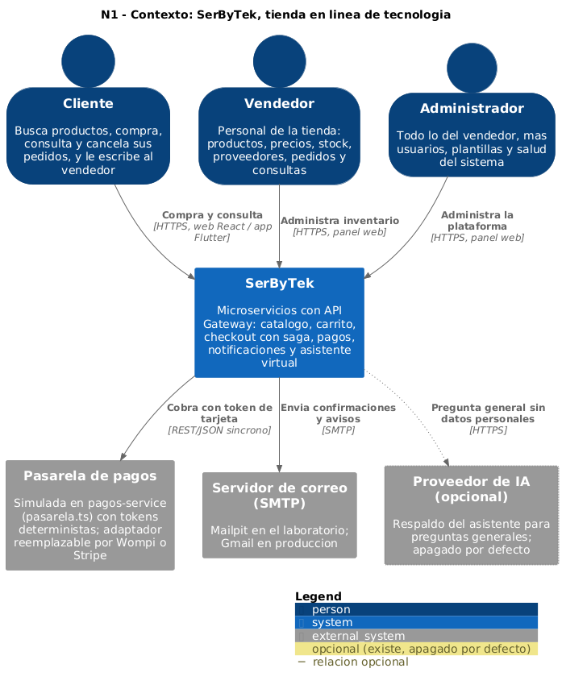
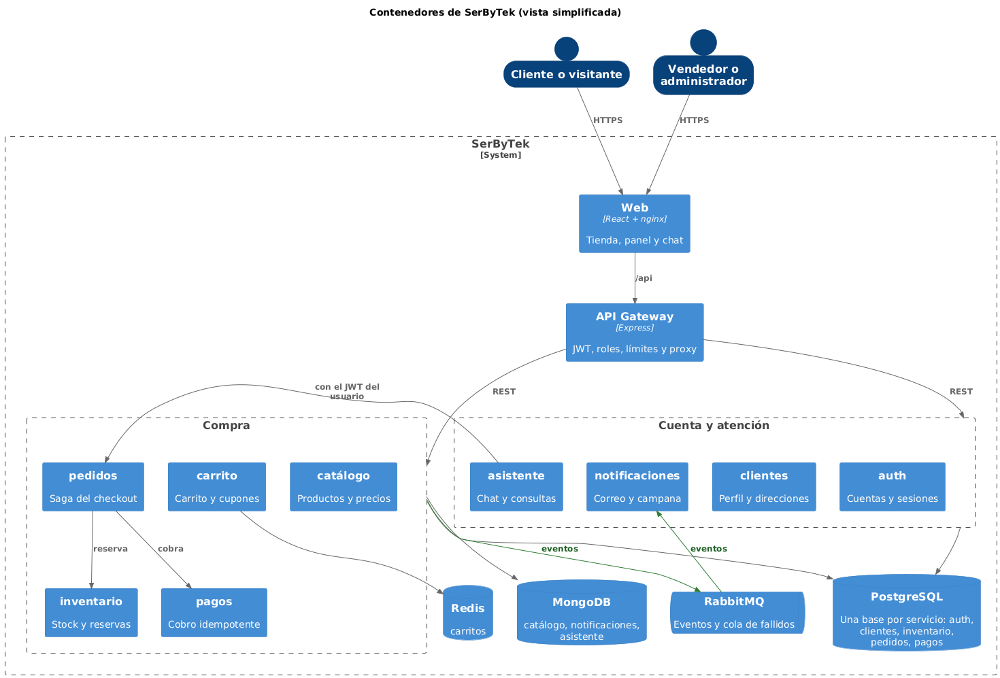
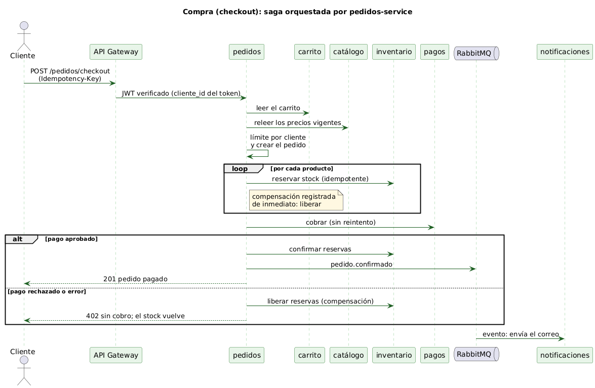

# 2. Fase 1: análisis y diseño arquitectónico

Este capítulo resume la especificación del sistema (`docs/especificacion/`), el modelo C4 (`docs/c4/`) y las decisiones de arquitectura (`docs/adr/`). Los diagramas de este informe son vistas simplificadas; las versiones completas, con cada relación y su protocolo, están en el repositorio.

## 2.1 Escenario y problema de negocio

<!-- incluir: docs/especificacion/01-escenario-requisitos.md :: 1.1 Problema y contexto de negocio -->

## 2.2 Actores y requisitos funcionales

<!-- incluir: docs/especificacion/01-escenario-requisitos.md :: 1.2 Actores -->

La especificación define **74 requisitos funcionales**: RF-01 a RF-62 para la plataforma y RF-ASIS-01 a RF-ASIS-12 para el asistente. Cada uno nombra su endpoint y el rol que puede usarlo. Los requisitos marcados F5b a F5e surgieron de las revisiones de la tienda por el equipo en la Fase 5.

Tabla: Requisitos funcionales por área

| Área | Servicio | Requisitos | Ejemplos |
|---|---|---|---|
| Autenticación y usuarios | auth | 9 | Registro, login con JWT y refresh rotatorio, usuarios internos, eliminar la cuenta, recuperar la contraseña por correo |
| Clientes | clientes | 5 | Perfil, direcciones con departamento oficial, historial |
| Catálogo | catálogo | 8 | Búsqueda tolerante, secciones, ofertas con fecha de fin, fotos, creación de productos |
| Inventario | inventario | 6 | Stock por bodega, reservas, alertas de reposición, proveedores y entradas de mercancía |
| Carrito | carrito | 4 | Carrito con vigencia, cupones y totales con IVA y envío |
| Pedidos | pedidos | 8 | Checkout con saga, límite de compra por cliente, cancelación, cambio de dirección |
| Pagos | pagos | 2 | Cobro idempotente y reembolso |
| Notificaciones | notificaciones | 6 | Correos por plantilla, campana con bandeja, registro de envíos |
| Plataforma | gateway | 2 | Salud agregada y documentación OpenAPI |
| Interfaz web | web | 11 | Identidad visual, tema oscuro, salud del sistema, validación junto al campo |
| Asistente virtual | asistente | 13 | Preguntas frecuentes, búsqueda de productos, estado de mis pedidos, consultas al vendedor |

## 2.3 Atributos de calidad

Los 23 requisitos no funcionales se escribieron como **escenarios medibles** (estímulo, entorno, respuesta y medida), para que la Fase 4 los evaluara sin reinterpretarlos. La última columna es el resultado medido en la versión final (capítulo 5).

Tabla: Atributos de calidad y su resultado

| ID | Atributo | Escenario | Medida | Resultado |
|---|---|---|---|---|
| RNF-01 | Rendimiento | 50 usuarios buscan en el catálogo | p95 < 500 ms; errores < 1 % | ✅ 74 ms; 0 % |
| RNF-02 | Rendimiento | 100 compradores concurrentes | p95 del checkout < 1 500 ms | ✅ 1 414 ms (en el límite) |
| RNF-03 | Rendimiento | 50 usuarios inician sesión | p95 < 1 000 ms | ✅ 981 ms (en el límite) |
| RNF-04 | Rendimiento | Agregar al carrito y listar mis pedidos | p95 < 500 ms | ✅ 40 y 28 ms |
| RNF-05 | Escalabilidad | La carga sube de 50 a 300 usuarios | 0 respuestas sin código; salud verde al terminar | ✅ solo 503 explícitos de la cola de auth |
| RNF-06 | Escalabilidad | Crece solo el tráfico del catálogo | Rendimiento con 1 y N réplicas | No medido (un solo equipo) |
| RNF-07 | Disponibilidad | Inventario se detiene durante la carga | 0 errores del catálogo; recuperación < 30 s | ✅ 0 errores; 7 s |
| RNF-08 | Disponibilidad | Notificaciones se detiene durante el checkout | 0 compras fallidas; eventos entregados al volver | ✅ 7 429 compras; cola vacía en 84 s |
| RNF-09 | Tolerancia a fallos | La pasarela rechaza o falla | Stock igual al de antes; pedido cancelado | ✅ `test:e2e` |
| RNF-10 | Tolerancia a fallos | Un servicio no responde | 504 en ≤ 15,1 s, sin cortar la conexión | ✅ `test:http` |
| RNF-11 | Disponibilidad | Arranque en frío del despliegue completo | 10/10 servicios sanos | ✅ 16 contenedores en 276 s |
| RNF-12 | Consistencia | 20 compradores por las últimas 5 unidades | 0 unidades sobrevendidas | ✅ exactamente 5 ganan |
| RNF-13 | Consistencia | Doble clic o reintento del checkout | 1 pedido y 1 transacción | ✅ `test:e2e`, `test:http` |
| RNF-14 | Seguridad | Un cliente intenta leer datos de otro, también por el chat | 403/404 siempre | ✅ `test:http`, `test:asistente` |
| RNF-15 | Seguridad | Cabeceras de confianza inyectadas o token forjado | 0 escaladas | ✅ `test:seguridad` |
| RNF-16 | Seguridad | Escaneo del OWASP Top 10 2025 | 0 alertas altas; 0 respuestas 500 | ✅ ZAP: 0 fallos en 174 URL |
| RNF-17 | Seguridad | Auditoría de la base de pagos | 0 columnas de tarjeta | ✅ PCI-DSS por ausencia del dato |
| RNF-18 | Usabilidad | Un usuario nuevo completa una compra | ≥ 90 % de tareas; SUS ≥ 68 | Tareas 9/9; SUS sin aplicar |
| RNF-19 | Usabilidad | Auditoría de accesibilidad | 0 violaciones graves | ✅ 0 en 48 pantallas |
| RNF-20 | Usabilidad | Preguntas al asistente | Acierto ≥ 85 % | ✅ 91,7 % (100 % en la tienda) |
| RNF-21 | Mantenibilidad | Se agrega un servicio | Cambios solo en el servicio y 5 registros | ✅ revisión del PR |
| RNF-22 | Mantenibilidad | Se cambia una ruta de la API | La prueba falla si no está documentada | ✅ `test:openapi` |
| RNF-23 | Mantenibilidad | Un cambio rompe un componente común | Cobertura medida; CI en cada PR | ✅ 75,7 % de líneas; CI |

## 2.4 Estilo arquitectónico y contexto

**Microservicios detrás de un API Gateway**, con base de datos por servicio y comunicación mixta: REST síncrono donde la respuesta es necesaria para continuar y eventos asíncronos donde basta con avisar (ADR-0001). Frente a un monolito modular, la decisión paga complejidad (saga, consistencia eventual, más piezas que operar) a cambio de lo que el escenario pide: escalar y fallar por partes, y desplegar cada contexto por separado.

El diagrama de contexto muestra el sistema como una caja negra con sus usuarios y los sistemas externos:
- la pasarela de pagos (simulada, con un adaptador reemplazable);
- el servidor de correo (Mailpit en el laboratorio, Gmail en producción);
- un proveedor de IA opcional para el asistente, apagado por defecto.

## 2.5 Contenedores y servicios

La vista de contenedores abre la caja. Se lee de arriba hacia abajo:
1. **Los usuarios** entran por la web, servida por nginx.
2. **La web** envía todo lo de `/api` al **gateway**, el único punto de entrada.
3. **El gateway** valida el JWT y el rol, aplica los límites de peticiones y enruta a los servicios. Los servicios se agrupan en dos dominios:
   - **compra:** catálogo, carrito, pedidos, inventario y pagos;
   - **cuenta y atención:** auth, clientes, asistente y notificaciones.
4. **Cada servicio** tiene su propia base, en el motor que mejor se ajusta a su dato.
5. **Los eventos** viajan por RabbitMQ hasta notificaciones, que envía los correos.

Las tres flechas con texto son las relaciones que sostienen la compra:
- pedidos **reserva** en inventario y **cobra** en pagos;
- el asistente consulta pedidos **con el JWT del usuario**, para no ver datos ajenos.

<!-- incluir: docs/especificacion/02-especificacion-arquitectura.md :: 2.2 Descomposición en servicios :: sin-figuras -->

## 2.6 Comunicación síncrona y asíncrona

<!-- incluir: docs/especificacion/02-especificacion-arquitectura.md :: 2.3 Comunicación -->

## 2.7 Persistencia y consistencia

<!-- incluir: docs/especificacion/02-especificacion-arquitectura.md :: 2.4 Persistencia -->

## 2.8 La compra como saga orquestada

La compra toca cinco servicios y no puede ser una transacción distribuida. Es una **saga orquestada** por pedidos-service (ADR-0003). Cada paso con efecto lateral registra **de inmediato** cómo deshacerse. Así, si falla el tercer producto, los dos primeros ya tienen su liberación anotada. El diagrama se lee de arriba hacia abajo:

1. El cliente envía el checkout con una **clave de idempotencia**: un doble clic devuelve el mismo pedido, sin un segundo cobro.
2. Pedidos **relee los precios** en el catálogo (el precio nunca lo pone el cliente) y aplica el **límite de compra por cliente**.
3. **Reserva el stock** de cada producto en inventario. La reserva es una sola sentencia condicional en PostgreSQL, así que dos compras simultáneas de la última unidad no pueden ganar las dos.
4. **Cobra una sola vez:** el cobro nunca se reintenta.
5. **Si el pago se aprueba**, confirma las reservas y publica `pedido.confirmado`, que termina en el correo de confirmación.
6. **Si se rechaza**, libera las reservas: el cliente no paga y el stock vuelve.

Si el cobro se aprobó y lo que falla es la confirmación de la reserva, **no** se devuelve el dinero. El fallo queda en la bitácora `saga_pasos` para resolverlo hacia adelante.

## 2.9 Patrones de diseño y de resiliencia

<!-- incluir: docs/especificacion/02-especificacion-arquitectura.md :: 2.5 Patrones aplicados :: sin-figuras -->

## 2.10 Seguridad de la arquitectura

<!-- incluir: docs/especificacion/02-especificacion-arquitectura.md :: 2.6 Seguridad de la arquitectura -->

## 2.11 Decisiones de arquitectura

Cada decisión importante se registró como un ADR; los textos completos están en `docs/adr/`.

<!-- incluir: docs/adr/README.md :: * -->
