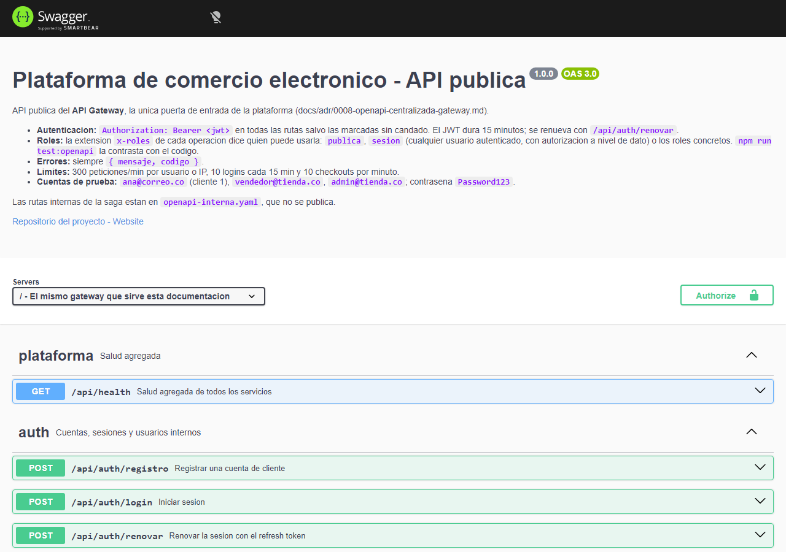

# 3. Fase 2: construcción del núcleo

## 3.1 Tecnologías y estructura del monorepo

Tabla: Tecnologías por capa

| Capa | Tecnología | Versión | Por qué |
|---|---|---|---|
| Servicios | Node.js con TypeScript, ejecutado con `tsx` (sin compilar) | Node 22, TypeScript 5.6 | Un solo lenguaje para los diez servicios; los cambios en la librería común se reflejan sin construirla |
| HTTP | Express, `helmet`, `express-rate-limit` | Express 4.21 | Middleware maduro para el gateway y los servicios |
| Proxy del gateway | `http-proxy-middleware` | 3.0 | Enrutamiento con *keep-alive* y tiempos máximos |
| PostgreSQL | Drizzle ORM (auth, clientes) y `pg` con SQL nativo (inventario, pedidos, pagos) | Drizzle 0.45, pg 8.13 | ORM donde aporta; SQL donde está la concurrencia (ADR-0006) |
| MongoDB | Driver oficial | 6.10 | Catálogo, notificaciones y asistente |
| Redis | `ioredis` | 5.4 | Carrito con vigencia |
| Mensajería | RabbitMQ con `amqplib` | 3.13 / 0.10 | Eventos con cola de mensajes fallidos |
| Seguridad | `jsonwebtoken`, `bcryptjs` en un pool de hilos | 9.0 / 2.4 | JWT HS256 y contraseñas con bcrypt sin bloquear el hilo principal |
| Correo | `nodemailer` | 10.2 | SMTP: Mailpit en el laboratorio, Gmail en producción |
| Web | React, Vite y Tailwind, servida por nginx | React 18.3, Vite 5.4 | Tienda, panel de administración y chat |
| Móvil | Flutter | 3 | App de la tienda para clientes |
| Documentación de la API | OpenAPI 3 con Swagger UI | swagger-ui-express 5.0 | Especificación centralizada en el gateway (ADR-0008) |
| Pruebas | Vitest, Playwright, k6, OWASP ZAP, axe-core | Vitest 4.1, Playwright 1.48 | Unitarias, E2E de interfaz, carga, seguridad y accesibilidad |

El repositorio es un monorepo con npm workspaces: `packages/shared` es la librería común que usan los diez servicios; `services/` contiene el gateway y los nueve microservicios; `clients/` la web y la app móvil; `infra/` los esquemas de las bases; `tests/` las suites de integración, y `docs/` toda la documentación.

## 3.2 Patrones de código

- **Librería transversal** (`packages/shared`): el arranque común de cada servicio (`crearServicio()`), los errores tipados y su traducción uniforme, el JWT y el control por rol, el cliente HTTP con tiempo máximo, reintentos y circuit breaker, y el bus de eventos.
- **Repositorio:** el acceso a datos de auth y clientes pasa por `repositorio.ts`, con Drizzle; el resto del código no conoce la base.
- **Adaptador:** la pasarela de pagos (`pasarela.ts`), el canal de correo (`canales.ts`) y el proveedor de IA del asistente (`ia.ts`) son reemplazables sin tocar el resto del servicio.
- **Middleware:** `asincrono()` envuelve cada controlador para que una promesa rechazada llegue al manejador de errores; `requiereRol()` aplica el control de acceso en cada ruta.
- **Invariantes explícitas:** 18 reglas documentadas en `CLAUDE.md` (por ejemplo, «el `cliente_id` sale siempre del JWT» o «nunca compensar hacia atrás un pago aprobado»), cada una con su prueba.

## 3.3 Persistencia: ORM y SQL nativo

La decisión (ADR-0006) fue un **ORM parcial**:
- **Drizzle ORM en auth-service y clientes-service**, donde las operaciones son CRUD con validaciones y el ORM aporta tipos y legibilidad.
- **SQL nativo parametrizado en inventario, pedidos y pagos**, donde está la concurrencia. Ahí el control fino importa más que la comodidad. La reserva de stock es una función de PostgreSQL (`reservar_stock`) con descuento condicional, número de versión y bloqueo por SKU, y la saga necesita transacciones y claves de idempotencia explícitas.

El esquema lo definen solo los scripts SQL de `infra/postgres`, y `esquema.ts` los refleja. Una prueba unitaria detecta cualquier diferencia entre los dos. La medición mostró que el ORM no empeoró el login: su p95 pasó de 1 280 ms a 981 ms, porque bcrypt domina el costo.

## 3.4 Seguridad de las sesiones

<!-- incluir: docs/adr/0005-jwt-corto-refresh-rotatorio.md :: Decisión -->

Además:
- **Autorización a nivel de dato:** un cliente solo ve sus pedidos, su carrito y su perfil, porque el `cliente_id` sale del token y nunca del cuerpo de la petición.
- **Llamadas internas:** exigen dos cosas a la vez, el secreto compartido y la cabecera `x-llamada-interna`. El gateway envía solo la primera, así que el tráfico de un usuario nunca pasa por interno.
- **Secretos obligatorios:** sin `JWT_SECRET`, `JWT_REFRESH_SECRET` e `INTERNAL_TOKEN` de 32 caracteres o más, ningún servicio arranca. Antes había un valor de respaldo publicado con el que se podía forjar un token de administrador (hallazgo S-01).
- **Recuperación de contraseña:** enlace de un solo uso que vence en 30 minutos. auth guarda solo su hash, y notificaciones lo envía sin guardarlo.

## 3.5 Integraciones externas

**Pasarela de pagos (adaptador).** pagos-service cobra con un *token* de tarjeta, nunca con el número: `pagos_db` no tiene columnas de número, CVV ni vencimiento (cumplimiento PCI-DSS por ausencia del dato). La pasarela simulada responde de forma determinista según el token, lo que permite probar los cuatro desenlaces:

Tabla: Tokens de la pasarela simulada

| Token | Resultado | Qué prueba |
|---|---|---|
| `tok_ok_*` | Aprobado | La compra feliz |
| `tok_rechazo_*` | Rechazado por fondos insuficientes | La compensación: se liberan las reservas y no se cobra |
| `tok_error_*` | Error técnico (502) | El cobro no se reintenta (invariante 7) y la saga compensa |
| `tok_lento_*` | Aprobado tras 5 segundos | Los tiempos máximos de cada dependencia |

Reemplazar la pasarela por una real (Wompi o Stripe) solo cambia `pasarela.ts`.

**Correo (SMTP).** notificaciones-service consume los eventos de RabbitMQ, elige la plantilla y envía el correo por SMTP. Si el envío falla, el mensaje se reintenta en su cola y, al tercer intento, pasa a la cola de mensajes fallidos: nunca se pierde. En el laboratorio el correo llega a Mailpit; en producción, a Gmail.

## 3.6 Documentación de la API

La especificación OpenAPI 3 está dividida por servicio en `docs/openapi/`. `npm run docs:openapi` la valida con Redocly y la empaqueta para el gateway, que la sirve con Swagger UI en `/api/docs`; en producción está apagada. `npm run test:openapi` compara la especificación con las rutas reales del código: **86 rutas, 517 comprobaciones**. Una ruta sin documentar, o documentada con un rol distinto del que exige el código, hace fallar la prueba.

Tabla: Rutas de la API por servicio

| Prefijo | Servicio | Ejemplos |
|---|---|---|
| `/api/auth` | auth | `POST /login`, `POST /renovar`, `POST /recuperar`, `GET /usuarios` |
| `/api/clientes` | clientes | `GET/PATCH /:id`, `/:id/direcciones` |
| `/api/catalogo` | catálogo | `GET /productos?q=`, `GET /categorias`, `PATCH /productos/:sku`, imágenes |
| `/api/inventario` | inventario | `GET /stock/:sku`, alertas, proveedores, entradas |
| `/api/carrito` | carrito | `/:clienteId/items`, cupones |
| `/api/pedidos` | pedidos | `POST /checkout`, `GET /`, cancelación, cambio de dirección, límites |
| `/api/pagos` | pagos | transacciones (personal), cobro y reembolso internos |
| `/api/notificaciones` | notificaciones | bandeja, plantillas, registro de envíos |
| `/api/asistente` | asistente | `POST /mensajes`, consultas al vendedor, intenciones y FAQ |
| `/api/health`, `/api/docs` | gateway | salud agregada y documentación |

## 3.7 Scripts de base de datos

<!-- incluir: infra/README.md :: * -->

## 3.8 Pruebas unitarias y cobertura

**187 pruebas unitarias** en 18 archivos, con Vitest (`npm run test:unit`). No necesitan Docker ni servicios en marcha. Cubren:
- la saga y sus compensaciones;
- el circuit breaker, incluido el estado semiabierto con una sola llamada de prueba;
- el bus de eventos y su reconexión;
- los totales del carrito;
- el motor de intenciones del asistente y la búsqueda tolerante del catálogo;
- el límite de compra por cliente;
- la coherencia de la semilla de datos y del esquema de Drizzle con los scripts SQL;
- los proxies de confianza del gateway;
- que las validaciones de la web sean las mismas del servidor.

Con `npm run test:unit:cobertura`, la cobertura de la librería común y de los módulos de cálculo medidos (15 archivos) es de **75,7 % de líneas, 70,2 % de funciones y 65,5 % de ramas**. El reporte HTML queda en `docs/evidencia/cobertura/`. La lógica que coordina servicios (la saga completa, el gateway) se verifica además con las suites de integración del capítulo 6.
