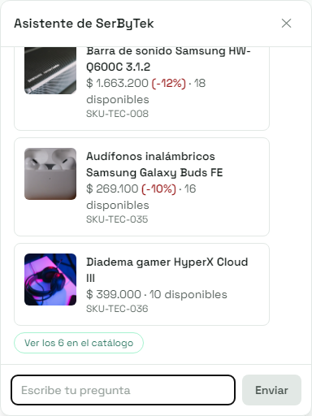
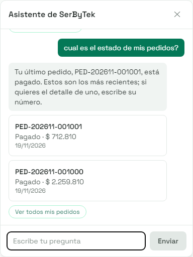

# 4. Fase 3: asistente virtual

El asistente de SerByTek atiende a visitantes y clientes desde un botón flotante presente en toda la tienda (**¿Necesitas ayuda?**):
- responde preguntas frecuentes;
- busca productos y ofertas;
- informa el precio y la disponibilidad;
- consulta el estado de los pedidos del usuario y guía su cancelación;
- deja escribirle al vendedor.

Es un microservicio más (asistente-service, puerto 3009), con su propia base de datos.

## 4.1 Decisión de diseño: reglas frente a IA

<!-- incluir: docs/adr/0007-asistente-reglas-ia-opcional.md :: Decisión -->

## 4.2 Arquitectura del módulo

<!-- incluir: docs/especificacion/03-asistente-virtual.md :: 3.1 Arquitectura -->

## 4.3 Intenciones y diálogo

<!-- incluir: docs/especificacion/03-asistente-virtual.md :: 3.2 Intenciones -->

## 4.4 Integración con el backend y seguridad

<!-- incluir: docs/especificacion/03-asistente-virtual.md :: 3.3 Seguridad -->

## 4.5 Resiliencia

<!-- incluir: docs/especificacion/03-asistente-virtual.md :: 3.4 Resiliencia -->

## 4.6 Interfaz de chat

El chat es un panel accesible: el historial es una región viva para los lectores de pantalla, el foco va al campo al abrirlo y Esc lo cierra y devuelve el foco al botón. Las respuestas pueden ser texto, tarjetas de productos con «Agregar al carrito», tarjetas de pedidos u opciones rápidas. Un visitante que pide escribirle al vendedor recibe la invitación a iniciar sesión; al volver con la sesión, el chat se abre solo con el formulario de la consulta. Con una cuenta de vendedor o administrador, el chat muestra la franja «Modo demostración»: se ve cómo responde a los clientes, pero no se compra ni se envían consultas.

## 4.7 Resultados: tasa de acierto de intenciones

<!-- incluir: docs/especificacion/03-asistente-virtual.md :: Tasa de acierto de intenciones -->

Con el catálogo de SerByTek (marcas reales, secciones y sinónimos leídos del catálogo en vivo) se escribieron tres conjuntos más, siempre **antes** de ajustar el motor y sin usarlos para ajustar:

Tabla: Acierto del asistente por conjunto de frases (`npm run asistente:metricas`)

| Conjunto | Frases | Aciertos | Tasa |
|---|---:|---:|---:|
| Evaluación general (Fase 3) | 36 | 33 | 91,7 % |
| Evaluación SerByTek: búsquedas, ofertas, envíos, pedidos | 50 | 50 | 100 % |
| Evaluación de marcas | 27 | 27 | 100 % |
| Validación de «contactar al vendedor» | 15 | 13 | 86,7 % |

Los dos errores de la última validación son frases ambiguas. «Atención al cliente» se interpreta como la pregunta frecuente del horario, y «tengo una inquietud sobre una garantía, con quién hablo» como la de devoluciones, en lugar de un pedido de hablar con una persona. Quedaron documentados y no se ajustaron, para no sobreajustar a la validación. La matriz de confusión completa está en `docs/evidencia/trabajo-final/asistente-metricas.md`.

**Pruebas del asistente.** `npm run test:asistente` hace 57 comprobaciones contra el gateway. Incluyen una frase por intención, contexto de varios turnos, **aislamiento** (un cliente no ve por el chat los pedidos de otro), consultas al vendedor con su correo, edición de la FAQ por el administrador, validaciones, límite de mensajes y degradación con pedidos-service detenido.
