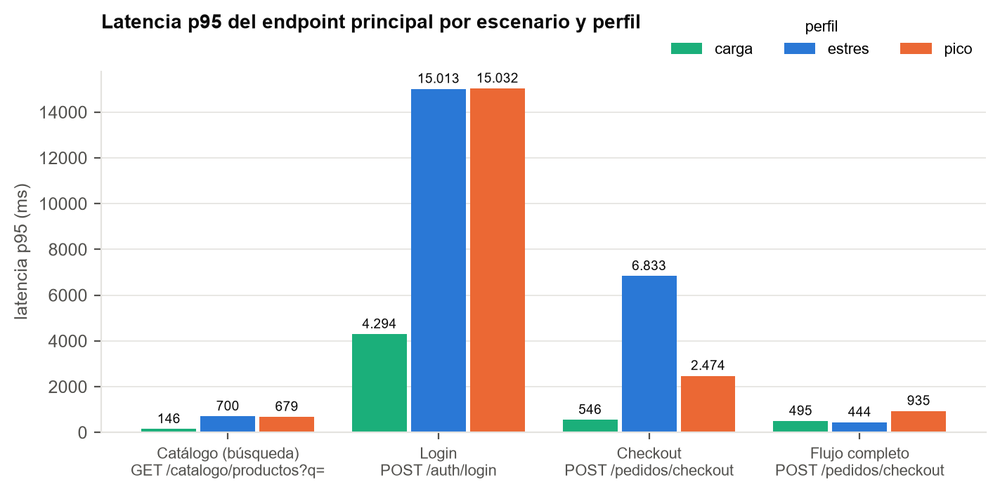
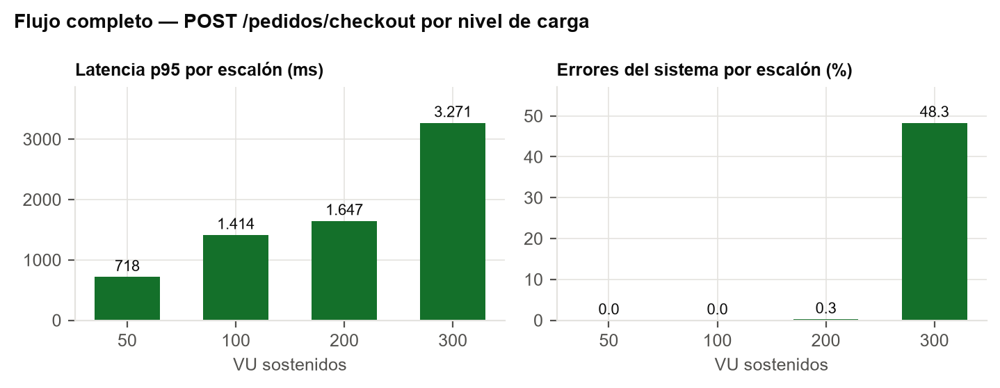
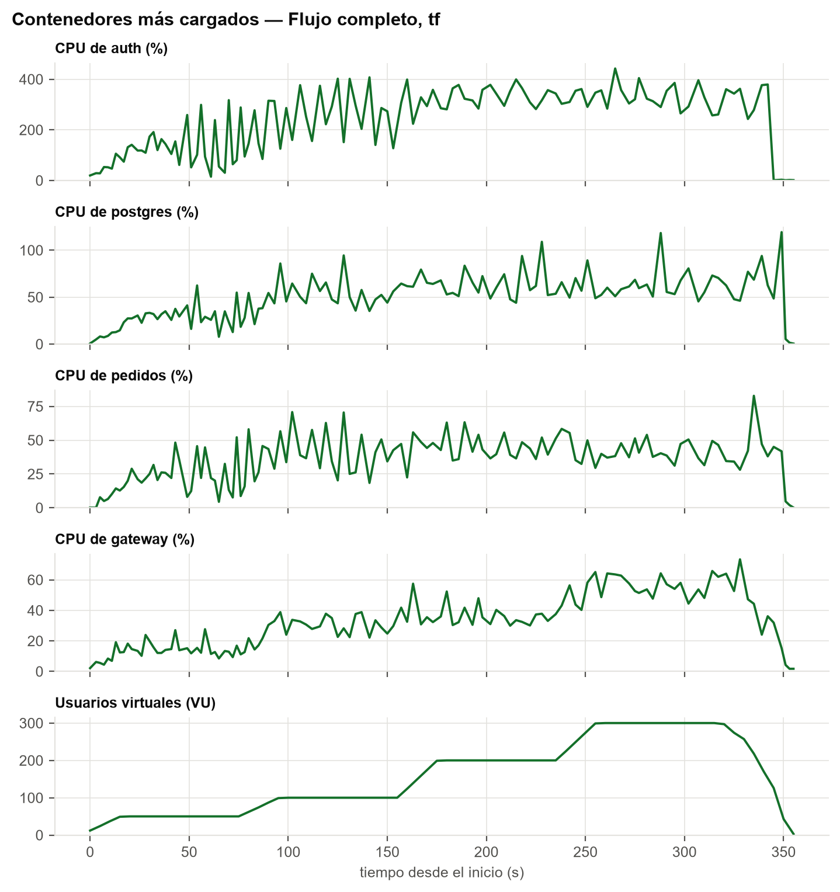
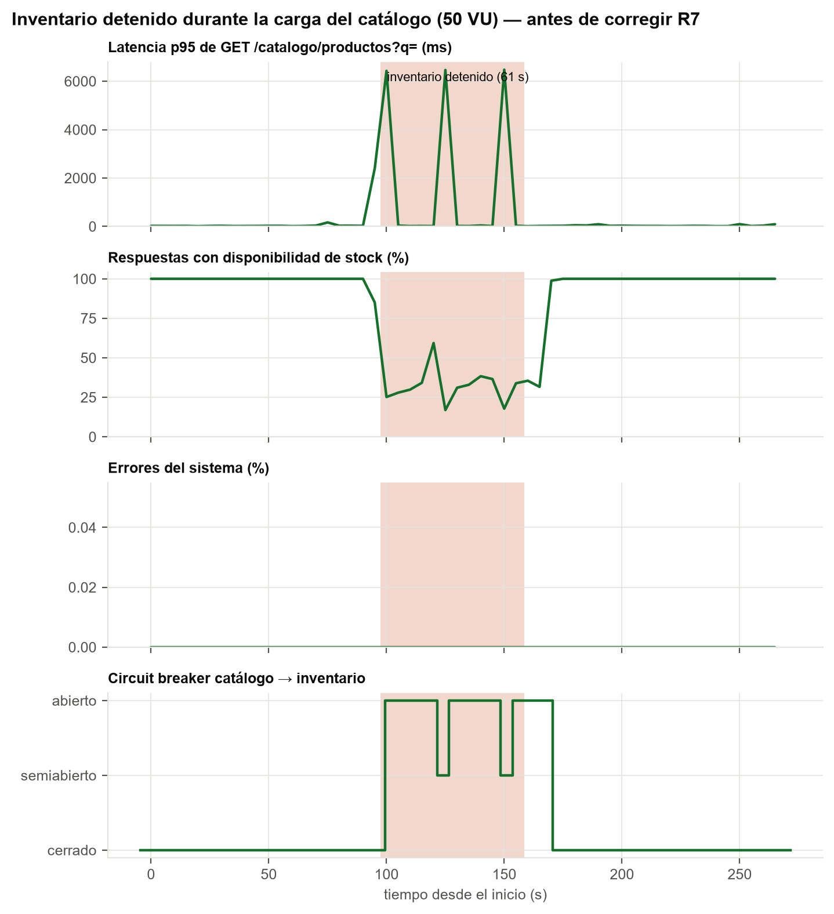
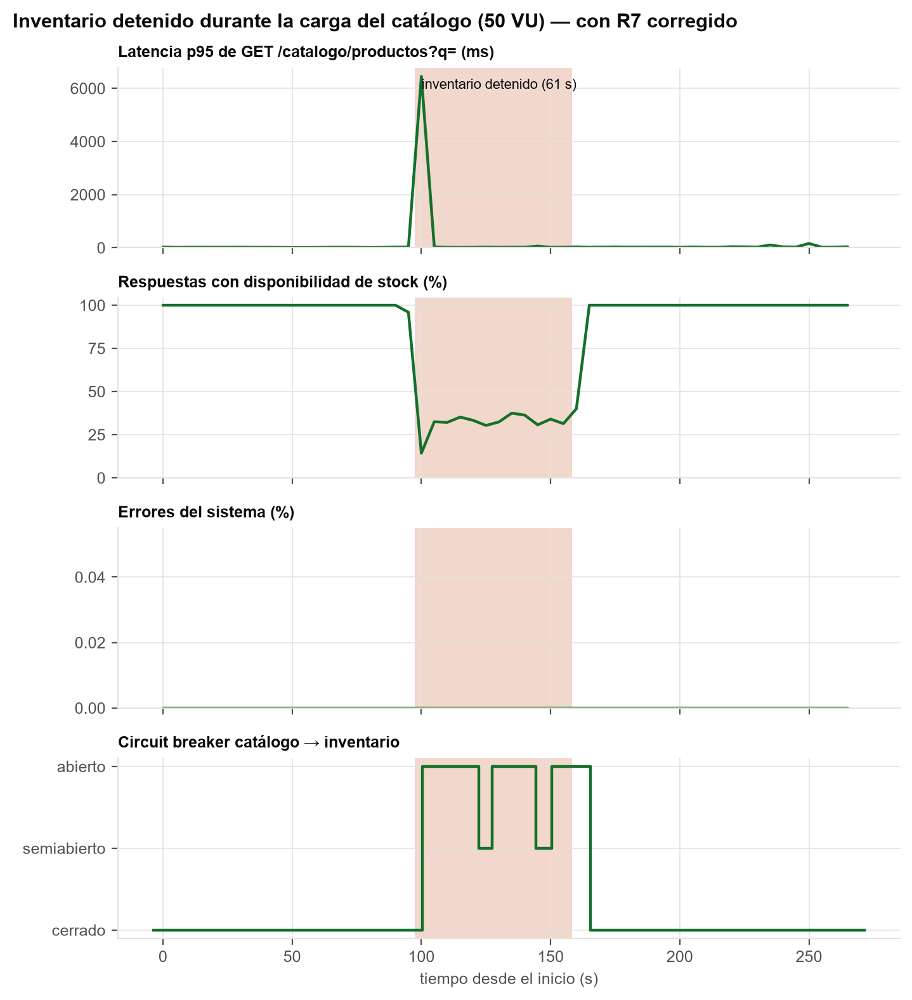
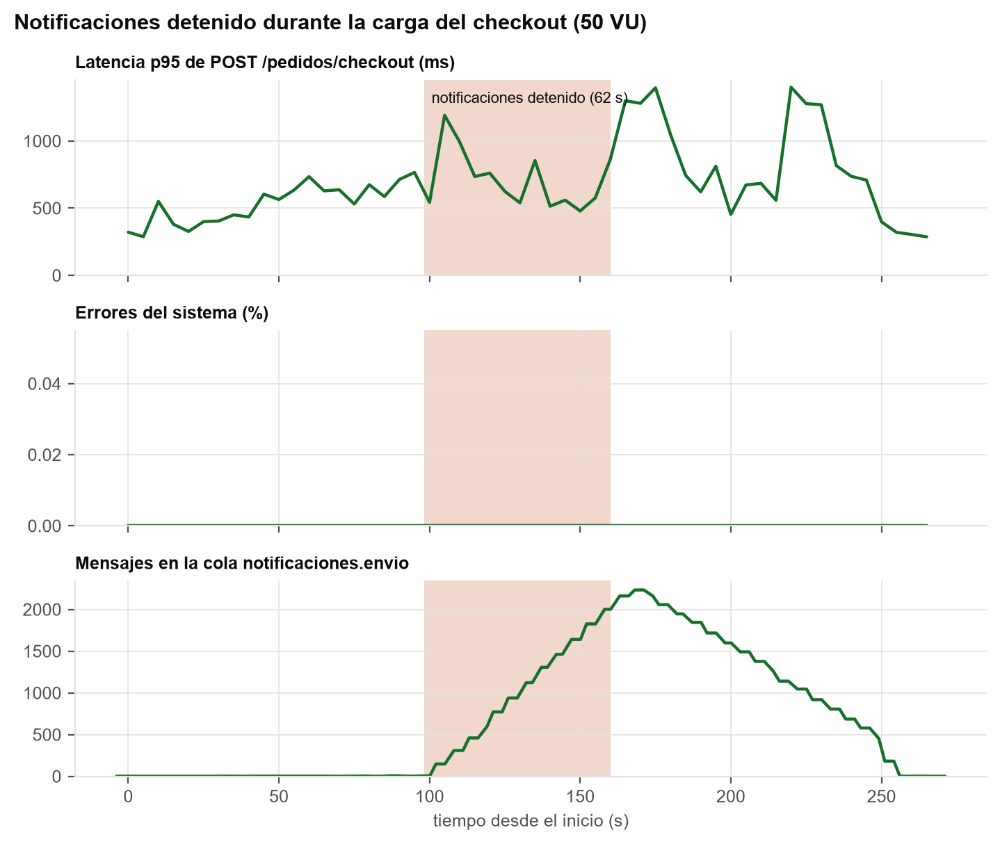

# 5. Fase 4: aseguramiento de calidad

La calidad no funcional se midió en tres dimensiones, con herramientas reales y sobre el sistema completo:
- **rendimiento** con k6;
- **seguridad** con OWASP ZAP y verificaciones manuales automatizadas, contra el OWASP Top 10 2025;
- **usabilidad** con inspección experta: recorrido cognitivo, KLM, heurísticas de Nielsen y accesibilidad con axe-core.

La medición se hizo en dos momentos, siempre con el mismo método. La práctica de Estrategias de validación midió la versión de laboratorio, priorizó los hallazgos y corrigió los críticos, y cada corrección se verificó con **la misma prueba que encontró el problema**. El Trabajo Final volvió a medir la versión final, con el ORM, el correo SMTP y el asistente, y agregó pruebas con fallos inyectados en plena carga. El detalle completo está en `docs/calidad/`.

## 5.1 Entorno y método de las pruebas de rendimiento

**Herramienta.** k6 v1.5, elegido frente a JMeter por cuatro razones:
- los escenarios son JavaScript versionado junto a las demás pruebas;
- sus umbrales hacen fallar la corrida si no se cumplen;
- su salida JSON se grafica con un script propio;
- es un binario liviano. Esto importa porque el generador comparte la máquina con el sistema bajo prueba.

**Escenarios.**

| Escenario | Qué hace cada usuario virtual |
|---|---|
| Catálogo | Un visitante busca por texto; a veces filtra por categoría o pasa a la página 2 |
| Login | Inicia sesión, con una cuenta distinta en cada iteración |
| Checkout | Agrega una unidad al carrito y compra (con su clave de idempotencia) |
| Flujo completo | Login, búsqueda, detalle, carrito, checkout y mis pedidos |
| Asistente | Preguntas frecuentes, búsquedas y consulta de sus pedidos en varios turnos |

**Perfiles de carga.**

| Perfil | Usuarios virtuales (VU) | Qué mide |
|---|---|---|
| Humo | 2 | Que el escenario funciona |
| Carga sostenida | 50 | El comportamiento con la carga esperada |
| Estrés | Escalones de 50 hasta 300 | Dónde se degrada el sistema |
| Pico | De 10 a 300 en 10 s | Cómo resiste un aumento repentino |

**Entorno.** Un equipo con Intel Core i5-9300H y 16 GB de RAM, con los 16 contenedores en Docker Desktop. El perfil `.env.carga` sube los límites del gateway para medir la capacidad del sistema y no la del limitador. El consumo de cada contenedor se registró con `docker stats`.

Cada usuario virtual usa su propia cuenta y espera 1 s entre acciones. Los 409 de stock y los 402 de pago rechazado no cuentan como errores, porque son respuestas de negocio válidas.

**Cómo leer las cifras.** La **p95** es el tiempo por debajo del cual quedan el 95 % de las respuestas: es lo que vive casi todo usuario, sin el ruido de los casos extremos. Como la carga se genera en la misma máquina que el sistema, las cifras absolutas son cotas conservadoras: valen para comparar escenarios y para el antes y el después. Una diferencia menor del 20 % no se interpreta.

## 5.2 Rendimiento: diagnóstico inicial

**Qué muestra.**
- Cada grupo de barras es un escenario, y cada color un perfil: verde carga, azul estrés, naranja pico.
- La altura es la p95 en milisegundos; las metas eran 500 ms para el catálogo, 1 000 ms para el login y 1 500 ms para el checkout.

**Qué se concluye.**
- **El catálogo y el flujo completo cumplen** en todos los perfiles: 146 ms con 50 usuarios y menos de 1 s con 300.
- **El login es el problema:** 4,3 s con solo 50 usuarios, cuatro veces su meta, y 15 s en estrés y en pico. Esos 15 s eran el tiempo máximo del gateway: las peticiones no eran lentas, se cortaban.
- **El checkout cumple con 50 usuarios** (546 ms), pero sube a 6,8 s en estrés.

La causa del login se encontró al mirar la CPU. bcrypt, el algoritmo de las contraseñas, es costoso a propósito, y calcularlo en el hilo principal de Node.js bloqueaba todo el servicio: auth atendía unos 10 inicios de sesión por segundo, y el resto esperaba en la fila.

## 5.3 Rendimiento: correcciones y su efecto

<!-- incluir: docs/calidad/RENDIMIENTO.md :: 7.1 Qué se cambió -->

**Qué muestra.** Cada panel compara una métrica antes (verde claro) y después (verde oscuro) de las correcciones, medida con el mismo escenario y el mismo perfil.

**Qué se concluye.**
- **Login, 50 usuarios: de 10,0 a 26,4 inicios de sesión por segundo** (×2,6), y la p95 baja de 4 328 a 1 300 ms. bcrypt ahora corre en un pool de hilos, en paralelo y sin bloquear el servicio.
- **Login en estrés: de 2 535 a 11 793 inicios de sesión exitosos** (×4,7). La cola acotada rechaza el exceso con un 503 inmediato en lugar de dejar esperar al cliente 15 s, y las tareas de clientes que ya se fueron se descartan sin calcularse.
- **Catálogo con 300 usuarios: de 14 % de errores a 0 %.** El gateway abría dos conexiones TCP por petición; con *keep-alive* las reutiliza.
- **Checkout, 50 usuarios: p95 de 1 076 a 734 ms**, por la misma reutilización de conexiones, medida en una prueba A/B.

## 5.4 Rendimiento de la versión final

Con la versión final (ORM, correo SMTP real y el asistente) se repitieron todos los escenarios y se agregaron tres pruebas nuevas: el asistente bajo carga, el estrés del flujo completo con el consumo de cada contenedor y dos fallos inyectados.

Tabla: Carga sostenida de 50 usuarios en la versión final (ms)

| Escenario | Endpoint | p50 | p95 | p99 | Peticiones/s | Errores | Meta p95 |
|---|---|---:|---:|---:|---:|---:|---:|
| Catálogo | `GET /catalogo/productos?q=` | 11 | **74** | 187 | 40,6 | 0 % | 500 |
| Login | `POST /auth/login` | 665 | **981** | 1 396 | 25,5 | 0 % | 1 000 |
| Checkout | `POST /pedidos/checkout` | 342 | **621** | 862 | 60,1 | 0 % | 1 500 |
| Flujo completo | `POST /pedidos/checkout` | 272 | 392 | 655 | 38,6 | 0 % | 1 500 |
| Asistente | `POST /asistente/mensajes` | 12 | **36** | 55 | 41,0 | 0 % | 500 |

**Todos los escenarios cumplen su meta.**
- **El login** quedó en 981 ms, justo bajo el límite de 1 000. Con el criterio del 20 %, la conclusión prudente es que está **en el límite**, no que sobre margen.
- **El asistente** es el endpoint más barato del sistema después de las consultas directas.
- **El ORM no empeoró nada:** el login bajó de 1 280 a 981 ms respecto de la última medición de la práctica.

### Estrés del flujo completo: dónde se rompe

**Qué muestra.** El escenario más realista (iniciar sesión, navegar, comprar y revisar los pedidos) con la carga subiendo por escalones de 1 minuto: 50, 100, 200 y 300 usuarios simultáneos. A la izquierda, la p95 del checkout en cada escalón; a la derecha, el porcentaje de errores del sistema.

**Qué se concluye.**
- **Hasta 100 usuarios** el checkout cumple su meta (1 414 ms frente a 1 500), sin errores.
- **Con 200 usuarios** se vuelve lento (1,6 s), pero casi sin errores (0,3 %).
- **Con 300 usuarios**, el 48 % de las peticiones falla. Todos esos errores son **503 del login**: la cola de auth rechazando carga a propósito, no conexiones cortadas ni compras perdidas.

El sistema se degrada de forma controlada: primero se vuelve lento, luego rechaza con un código claro, y nunca vende de más ni cobra dos veces.

**Qué muestra.** El consumo de CPU de los contenedores que más trabajan, durante la misma corrida. El eje horizontal es el tiempo, y el panel de abajo marca los escalones de usuarios. Un 100 % equivale a un núcleo completo, así que 400 % son cuatro núcleos.

**Qué se concluye.**
- **El primer servicio en saturarse es auth.** Sube con cada escalón hasta oscilar entre 300 % y 440 %: bcrypt ocupa los cuatro hilos del pool. Promedia 237 %.
- **Detrás vienen postgres** (49 % de promedio) **y pedidos** (35 %), el camino del checkout.
- **El gateway**, aunque recibe todas las peticiones, se queda en 31 %.
- **El asistente** no aparece entre los consumidores relevantes.

La palanca para más capacidad es escalar auth horizontalmente (más réplicas detrás del gateway), no optimizar el resto.

### Fallo inyectado: inventario detenido durante la carga del catálogo

Para probar la tolerancia a fallos, se detuvo inventario durante 61 s con 50 usuarios buscando en el catálogo. El catálogo le pide la disponibilidad a inventario a través de un **circuit breaker**: tras 5 fallos seguidos se *abre* y deja de llamar; cada cierto tiempo pasa a *semiabierto* y prueba si inventario volvió.

**Qué muestra.** La franja sombreada es el tiempo con inventario detenido. Los cuatro paneles, de arriba abajo, son:
1. la p95 del catálogo;
2. el porcentaje de respuestas que traen la disponibilidad;
3. los errores del sistema;
4. el estado del circuit breaker.

**Qué se concluye.**
- **Lo bueno:** 0 errores en 10 287 respuestas. Con el circuito abierto, el catálogo responde sin la disponibilidad (degradación elegante) y el circuito se cierra 12 s después de que inventario vuelve.
- **Lo malo, el hallazgo R7:** la latencia salta a **6,4 s** tres veces, al caer inventario y **en cada paso a semiabierto**. En ese estado, el breaker dejaba pasar todas las peticiones (unas 40 por segundo) contra el servicio caído. Cada una esperaba su tiempo máximo y dos reintentos.

**Qué cambió.** En semiabierto ahora pasa **una sola** llamada de prueba, y las demás reciben la respuesta degradada al instante.

**Qué se concluye.**
- La p99 con inventario caído pasa de **6 373 a 76 ms**, con 0 errores en 10 849 respuestas, y la recuperación de 12 a 7 s.
- Queda un único pico, en los primeros 2 segundos de la caída. Ningún breaker lo evita: necesita fallos para decidir abrirse.

Esta prueba encontró un defecto que la carga normal no podía ver.

### Fallo inyectado: notificaciones detenido durante el checkout

**Qué muestra.** Con 50 usuarios comprando, se detuvo notificaciones (el servicio que envía los correos) durante 62 s, en la franja sombreada. De arriba abajo:
1. la p95 del checkout;
2. los errores;
3. los mensajes acumulados en la cola `notificaciones.envio` de RabbitMQ.

**Qué se concluye.**
- **Las compras no se enteran:** 7 429 compras pagadas y 0 errores. Publicar el evento es asíncrono y nunca bloquea la compra.
- **Los eventos esperan en la cola sin perderse:** suben a unos 32 por segundo hasta 2 233. Cuando notificaciones vuelve, la cola se vacía en 84 s, a unos 50 por segundo, y todos los correos salen.
- **Mientras se drena la cola**, el checkout sube a unos 1,4 s, porque notificaciones compite por CPU. Sigue bajo la meta de 1,5 s.

## 5.5 Seguridad

**Herramientas y alcance.**
- **ZAP:** OWASP ZAP 2.17 hizo un escaneo pasivo de la web y un escaneo activo de la API a partir de su especificación OpenAPI, como visitante y con la sesión de un cliente.
- **Verificaciones manuales:** `npm run test:seguridad` las automatiza. Eran 16 en la práctica y hoy son 27, con las del asistente, las revisiones de la tienda y la recuperación de contraseña.
- **Clasificación:** cada hallazgo se clasificó por CWE, categoría del OWASP Top 10 2025 y puntaje CVSS v3.1.
- **Alcance:** todo se ejecutó solo contra `localhost`.

Tabla: Hallazgos de seguridad, clasificación y estado

| ID | Hallazgo | OWASP 2025 | CVSS v3.1 | Estado |
|---|---|---|---|---|
| S-01 | Registro público vinculado a un `cliente_id` ajeno: acceso a los datos de otro cliente | A01 | 8,2 Alto | ✅ El correo y el cliente deben coincidir |
| S-02 | Secreto JWT por defecto y público: cualquiera forjaba tokens de administrador | A02 | 9,8 Crítico | ✅ Secretos obligatorios, largos y nunca publicados |
| S-03 | Token interno por defecto y puertos internos publicados: se saltaba el gateway | A02 | 8,3 Alto | ✅ Secretos propios; en producción, ningún puerto interno |
| S-04 | Los 4xx abrían el circuit breaker: un cliente dejaba a todos sin carrito | A10 | 6,5 Medio | ✅ Solo cuentan red, 5xx y tiempos agotados |
| S-05 | Inyección de operadores NoSQL en los filtros del catálogo | A05 | 5,3 Medio | ✅ Solo se aceptan cadenas |
| S-06 | Entradas inválidas que llegaban a la base y devolvían 500 | A10 | 4,3 Medio | ✅ 400 con un mensaje claro |
| S-07 | El rechazo de CORS respondía 500 | A10 | Bajo | ✅ 403 |
| S-08 | La web sin cabeceras de seguridad | A02 | 4,3 Medio | ✅ CSP, anti-clickjacking y políticas cross-origin |
| S-09 | Tokens en `localStorage`, legibles ante un XSS | A07 | 6,9 Medio | ⚠️ Riesgo aceptado: mitigado por la CSP estricta |
| S-10 | Correo sin validar en el registro | A06 | Bajo | ✅ Validado |
| S-11 | XSS almacenado latente en los correos | A05 | Informativo | ✅ Escape de HTML en el canal de correo |
| S-12 | Dependencias de producción con vulnerabilidades conocidas | A03 | Alto | ✅ 0 vulnerabilidades; auditoría en cada CI |
| S-13 | Aviso de `picomatch` sin corrección, en una ruta que el gateway no usa | A03 | — | ⚠️ Aceptado con revisión el 2027-01-31 |

Tabla: Seguridad antes y después

| Medida | Antes | Después |
|---|---|---|
| Verificaciones manuales con hallazgo | 11 de 16 | 1 de 27 (S-09, aceptado) |
| Respuestas 500 en el escaneo activo de ZAP | 781 | 0 |
| Respuestas 503 en el escaneo activo | 1 030 | 0 |
| Fallos de ZAP en la API (con el asistente, 174 URL) | — | 0 |
| Vulnerabilidades de producción (`npm audit`) | 2 altas y 1 moderada | 0 |

**Qué resistió desde el principio:**
- las consultas parametrizadas;
- el almacenamiento de contraseñas con bcrypt;
- el aislamiento entre clientes, también por el chat;
- el saneamiento de las cabeceras de confianza;
- la verificación del JWT (rechaza `alg:none`, la firma alterada y el token vencido).

Las vulnerabilidades graves estaban en la **configuración** (secretos por defecto) y en un endpoint, no en el diseño.

## 5.6 Usabilidad

La práctica pedía una prueba con evaluadores externos y el cuestionario SUS. Por decisión del equipo no se hicieron, y quedan declarados como limitación con sus materiales listos. En su lugar se aplicaron tres métodos de **inspección experta** sobre la web real, automatizados con Playwright:

| Método | Qué aporta |
|---|---|
| Recorrido cognitivo | En cada paso de cada tarea, si un usuario nuevo sabría qué hacer y entendería la respuesta |
| *Keystroke-Level Model* (KLM) | El tiempo estimado de un usuario experto, a partir de cada acción, más la respuesta real del sistema |
| Heurísticas de Nielsen | Los problemas clasificados por heurística y severidad (0 a 4) |
| axe-core (WCAG 2.2 A y AA) | Los incumplimientos de accesibilidad, en los temas claro y oscuro |

Tabla: Usabilidad antes y después de las correcciones

| Verificación | Antes | Después |
|---|---|---|
| Quién puede iniciar sesión | Solo 4 cuentas de demostración, en un desplegable | Cualquier cuenta, con correo y contraseña |
| Productos alcanzables navegando | 20 de 71 | 71 de 71, con paginación |
| Cancelar un pedido | Un clic, sin confirmación, con el error tapado por el modal | Confirmación explícita y el error visible dentro del diálogo |
| Tareas completadas | 8/8 | 9/9 (con la del asistente: KLM de 43,4 s frente a 60 s esperados) |
| Incumplimientos de WCAG 2.2 AA | 0 en 13 pantallas | 0 en 48 pantallas, temas claro y oscuro |

**El KLM subió en tres tareas, y es lo esperado.**
- El inicio de sesión pasó de 6,9 a 17,8 s porque ahora se escriben el correo y la contraseña: el antes era rápido porque no era un inicio de sesión real.
- Cancelar un pedido suma un paso de confirmación, que es el costo deliberado de prevenir un error irreversible.

El KLM mide la eficiencia de un experto; la prevención de errores y el acceso universal se evalúan con el recorrido cognitivo.

## 5.7 Matriz de calidad unificada

<!-- incluir: docs/calidad/MATRIZ-CALIDAD.md :: 1. Cómo se calcula la prioridad -->

### Matriz de la práctica

<!-- incluir: docs/calidad/MATRIZ-CALIDAD.md :: 2. Matriz -->

### Re-medición con la versión final

<!-- incluir: docs/calidad/MATRIZ-CALIDAD.md :: 4.1 Re-medición -->

<!-- incluir: docs/calidad/MATRIZ-CALIDAD.md :: 4.3 Resumen tras el Trabajo Final -->

## 5.8 Plan de mitigación

<!-- incluir: docs/calidad/MATRIZ-CALIDAD.md :: 4.2 Hallazgos nuevos y re-priorizados -->

<!-- incluir: docs/calidad/PLAN-CORRECCION.md :: Siguiente iteración -->
