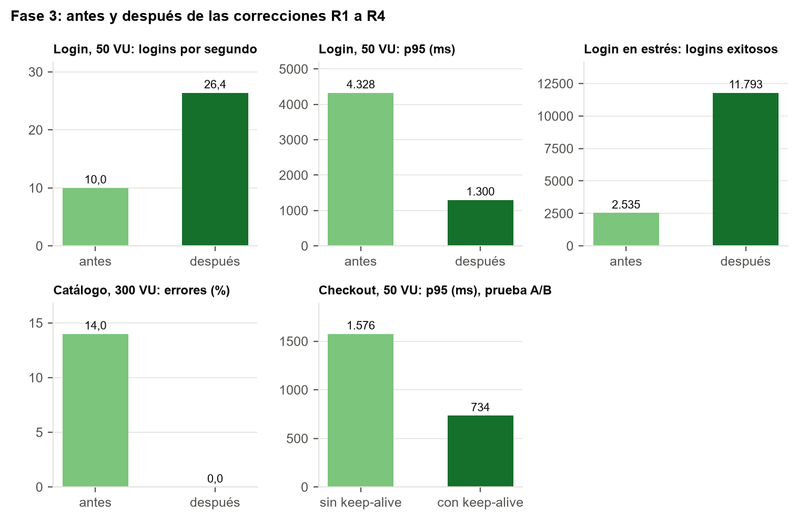

# 5. Fase 4: aseguramiento de calidad

La calidad no funcional se midió en tres dimensiones con herramientas reales:
- **rendimiento** con k6;
- **seguridad** con OWASP ZAP y verificaciones manuales automatizadas, contra OWASP Top 10 2025;
- **usabilidad** con inspección experta: recorrido cognitivo, KLM, heurísticas de Nielsen y accesibilidad con axe-core.

La medición se hizo en dos momentos. La práctica de Estrategias de validación midió la versión de laboratorio y corrigió sus hallazgos críticos. El Trabajo Final volvió a medir la versión final, con el ORM, el correo SMTP y el asistente, y amplió el alcance con fallos inyectados en plena carga. El detalle está en `docs/calidad/`.

## 5.1 Cómo se priorizan los hallazgos

<!-- incluir: docs/calidad/MATRIZ-CALIDAD.md :: 1. Cómo se calcula la prioridad -->

## 5.2 Rendimiento

**Herramienta y entorno.** k6 v1.5 ejecutó cinco escenarios (catálogo, login, checkout, flujo completo y asistente) con cuatro perfiles: humo, carga sostenida de 50 usuarios virtuales (VU), estrés en escalones de 50 a 300 VU y pico de 10 a 300 VU en 10 s. Corrió sobre un equipo con Intel Core i5-9300H y 16 GB de RAM, con los 16 contenedores en Docker Desktop. El perfil `.env.carga` sube los límites del gateway para medir la capacidad del sistema y no la del limitador. El consumo de cada contenedor se registró con `docker stats`.

### 5.2.1 Correcciones de la práctica: antes y después

<!-- incluir: docs/calidad/RENDIMIENTO.md :: 7.1 Qué se cambió -->

### 5.2.2 Versión final: carga, cuello de botella y fallos inyectados

<!-- incluir: docs/calidad/RENDIMIENTO.md :: 9. Trabajo Final -->

## 5.3 Seguridad

**Herramientas y alcance.** OWASP ZAP 2.17 hizo un escaneo pasivo (*baseline*) de la web y un escaneo activo de la API a partir de su especificación OpenAPI, como visitante y con la sesión de un cliente. `npm run test:seguridad` automatiza las verificaciones manuales del plan. Eran 16 en la práctica y hoy son 27: el asistente agregó 5, las revisiones de la tienda en la Fase 5 otras 5 y la recuperación de contraseña 1. Todo se ejecutó solo contra `localhost`.

### 5.3.1 Hallazgos y su estado

Tabla: Hallazgos de seguridad, clasificación y estado

| ID | Hallazgo | OWASP 2025 | CVSS v3.1 | Estado |
|---|---|---|---|---|
| S-01 | Registro público vinculado a un `cliente_id` ajeno: acceso a los datos de otro cliente | A01 | 8,2 Alto | ✅ Corregido: el correo y el cliente deben coincidir y el cliente no puede tener cuenta |
| S-02 | Secreto JWT por defecto y público: cualquiera forjaba tokens de administrador | A02 | 9,8 Crítico | ✅ Corregido: secretos obligatorios, largos y nunca publicados |
| S-03 | Token interno por defecto y puertos internos publicados: se saltaba el gateway | A02 | 8,3 Alto | ✅ Corregido: secretos propios y puertos solo en `127.0.0.1` (en producción, ninguno) |
| S-04 | Los 4xx abrían el circuit breaker: un cliente dejaba a todos sin carrito | A10 | 6,5 Medio | ✅ Corregido: solo cuentan red, 5xx y tiempos agotados |
| S-05 | Inyección de operadores NoSQL en los filtros del catálogo | A05 | 5,3 Medio | ✅ Corregido: solo se aceptan cadenas |
| S-06 | Entradas inválidas que llegaban a la base y devolvían 500 | A10 | 4,3 Medio | ✅ Corregido: 400 con un mensaje claro |
| S-07 | El rechazo de CORS respondía 500 | A10 | Bajo | ✅ Corregido: 403 |
| S-08 | La web sin cabeceras de seguridad | A02 | 4,3 Medio | ✅ Corregido: CSP, anti-clickjacking, nosniff y políticas cross-origin |
| S-09 | Tokens en `localStorage`, legibles ante un XSS | A07 | 6,9 Medio | ⚠️ Riesgo aceptado: mitigado por la CSP estricta y el escapado de React; la cookie `HttpOnly` queda como trabajo futuro |
| S-10 | Correo sin validar en el registro | A06 | Bajo | ✅ Corregido |
| S-11 | XSS almacenado latente en los correos | A05 | Informativo | ✅ Corregido: escape de HTML en el canal de correo |
| S-12 | Dependencias de producción con vulnerabilidades conocidas (`body-parser`, `follow-redirects`, `qs`) | A03 | Alto | ✅ Corregido: 0 vulnerabilidades de producción; auditoría en cada CI |
| S-13 | Aviso de `picomatch` sin corrección disponible, en una ruta que el gateway no usa | A03 | — | ⚠️ Aceptado con fecha de revisión (2027-01-31) |

**Lo que resistió desde el principio:**
- las consultas parametrizadas;
- el almacenamiento de contraseñas con bcrypt;
- el aislamiento entre clientes;
- el saneamiento de las cabeceras de confianza;
- la verificación del JWT (rechaza `alg:none`, la firma alterada y el token vencido);
- la rotación del refresh token.

ZAP no encontró inyección SQL, XSS reflejado, *path traversal* ni ejecución remota.

### 5.3.2 Versión final con el asistente

<!-- incluir: docs/calidad/SEGURIDAD.md :: 10.1 Verificaciones manuales -->

<!-- incluir: docs/calidad/SEGURIDAD.md :: 10.2 Escaneo activo de ZAP -->

### 5.3.3 Controles frente al OWASP Top 10 2025

<!-- incluir: docs/calidad/OWASP-CONTROLES.md :: * -->

## 5.4 Usabilidad

<!-- incluir: docs/calidad/USABILIDAD.md :: 1. Alcance y método -->

### 5.4.1 Correcciones: antes y después

<!-- incluir: docs/calidad/USABILIDAD.md :: 10.2 Resultados -->

### 5.4.2 El asistente y las revisiones de la Fase 5

<!-- incluir: docs/calidad/USABILIDAD.md :: 11.1 Resultados -->

En las revisiones de la Fase 5 (F5b a F5e) se agregaron vistas nuevas: el panel de productos, el inventario con proveedores, la campana de notificaciones, la salud del sistema, la recuperación de contraseña y la validación junto al campo. Cada una pasó por axe en los temas claro y oscuro: **48 pantallas, 0 incumplimientos de WCAG 2.2 AA** (`tests/usabilidad/axe-f5c.ts`, `axe-f5d.ts` y `axe-f5e.ts`).

## 5.5 Matriz de calidad unificada

<!-- incluir: docs/calidad/MATRIZ-CALIDAD.md :: 4.1 Re-medición -->

<!-- incluir: docs/calidad/MATRIZ-CALIDAD.md :: 4.3 Resumen tras el Trabajo Final -->

## 5.6 Plan de mitigación

<!-- incluir: docs/calidad/MATRIZ-CALIDAD.md :: 4.2 Hallazgos nuevos y re-priorizados -->

<!-- incluir: docs/calidad/PLAN-CORRECCION.md :: Siguiente iteración -->
