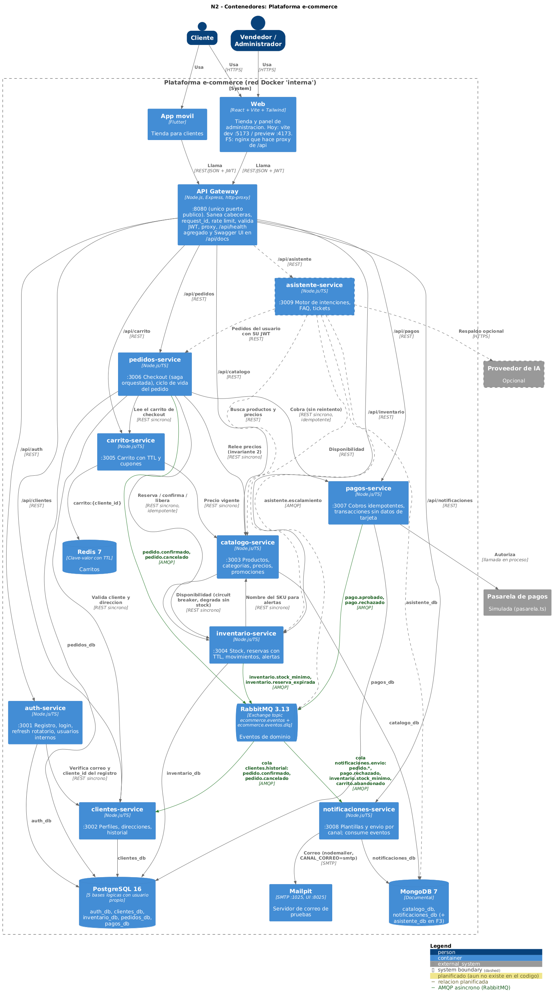

# Manual técnico

**SerByTek: tienda en línea de tecnología con arquitectura de microservicios.** Trabajo Final de la Electiva Ingeniería de Software II, Universidad Surcolombiana.

Este manual está dirigido a quien instala, opera, prueba, despliega o extiende el sistema. El diseño completo está en la [especificación de arquitectura](../especificacion/02-especificacion-arquitectura.md), los [diagramas C4](../c4/README.md) y los [ADR](../adr/README.md). Las reglas de trabajo del repositorio y sus invariantes están en [`CLAUDE.md`](../../CLAUDE.md).

| Necesito… | Capítulo |
|---|---|
| Entender las piezas y cómo se conectan | 1. Arquitectura y componentes |
| Levantar el sistema en mi equipo | 2, 3 y 4 |
| Saber qué configura cada variable | 5. Configuración |
| Modificar el código sin romper nada | 6. Estructura del código y convenciones, y 14. Extender el sistema |
| Consultar o cambiar los datos | 7. Base de datos |
| Probarlo | 10. Pruebas y 11. Integración continua |
| Operarlo y resolver fallas | 12. Operación y monitoreo, y 15. Solución de problemas |
| Publicarlo en internet | 4.5 (Dokploy, en uso) y 16. Despliegue en la nube (máquina virtual propia, alternativa) |

---

## 1. Arquitectura y componentes

SerByTek es una tienda en línea de una sola empresa (el vendedor es personal interno). Un **API Gateway** es el único punto de entrada: valida el JWT, aplica el control de acceso por rol y la limitación de peticiones, y enruta a **nueve microservicios**, cada uno con **su propia base de datos**. La compra es una **saga orquestada** por pedidos-service, con compensaciones, idempotencia, circuit breakers y reintentos. Los eventos de dominio (pedido pagado, stock mínimo, consulta nueva…) viajan por **RabbitMQ** y los consume notificaciones-service, que envía los correos.



| Componente | Tecnología | Puerto (laboratorio) | Datos |
|---|---|---|---|
| web | React 18, Vite y Tailwind, servida por nginx | 8081 (5173 con `dev:web`) | — |
| api-gateway | Node 22, Express y http-proxy-middleware | 8080 | — |
| auth-service | Node 22 y Drizzle | 3001 | PostgreSQL `auth_db` |
| clientes-service | Node 22 y Drizzle | 3002 | PostgreSQL `clientes_db` |
| catalogo-service | Node 22 | 3003 | MongoDB `catalogo_db` |
| inventario-service | Node 22, SQL nativo | 3004 | PostgreSQL `inventario_db` |
| carrito-service | Node 22 | 3005 | Redis |
| pedidos-service | Node 22, SQL nativo (saga) | 3006 | PostgreSQL `pedidos_db` |
| pagos-service | Node 22, SQL nativo | 3007 | PostgreSQL `pagos_db` |
| notificaciones-service | Node 22 | 3008 | MongoDB `notificaciones_db` |
| asistente-service | Node 22 | 3009 | MongoDB `asistente_db` |
| RabbitMQ | 3.13-management | 5672 / 15672 | eventos y DLQ |
| Mailpit | v1.27 | 8025 / 1025 | correos de prueba |
| Caddy (solo en la nube) | 2.8 | 80 / 443 | certificados |
| App móvil | Flutter (`clients/mobile/`) | — | — |

Todos los servicios se ejecutan con `tsx` directamente sobre TypeScript: no hay paso de compilación. `@ecommerce/shared` (`packages/shared/`) agrupa el arranque común, JWT y RBAC, el cliente HTTP con circuit breaker, el bus de eventos y los errores.

### 1.1 Estructura del repositorio

```
packages/shared/        libreria comun de los diez servicios
services/               api-gateway y los 9 microservicios (incluido el asistente)
clients/web/            React + Vite + Tailwind; Dockerfile y nginx.conf
clients/mobile/         Flutter (lib/ y pubspec.yaml)
infra/                  esquemas de PostgreSQL, inicio de Mongo, Caddy y Dockerfile de los servicios
tests/                  salud, http, concurrencia, e2e, e2e-ui, asistente, seguridad, usabilidad, rendimiento (k6)
scripts/                tunel, capturas, sembrado de carga, informes .docx
docs/                   especificacion, c4, adr, openapi, calidad, aceptacion, manuales, evidencia
.github/workflows/      CI
```

## 2. Requisitos del equipo

- Docker Desktop o Docker Engine con Compose v2.24 o superior (el perfil de producción usa `!reset`).
- Node.js 22.9 o superior (`--env-file-if-exists`) y npm 10.
- Unos 6 GB de RAM libres para el sistema completo (en reposo usa unos 1,3 GB; la compilación de las imágenes pide más).
- Para el túnel: solo Docker; cloudflared corre en un contenedor.
- Para la app móvil: Flutter 3.

---

## 3. Instalación

```bash
git clone https://github.com/SerBy48/Proyecto-EIS-II.git serbytek && cd serbytek
npm install                       # todos los workspaces
cp .env.example .env
```

Llene en `.env` los tres secretos **obligatorios**, cada uno con un valor nuevo:

```bash
openssl rand -hex 32   # JWT_SECRET
openssl rand -hex 32   # JWT_REFRESH_SECRET
openssl rand -hex 32   # INTERNAL_TOKEN
```

Sin ellos, con menos de 32 caracteres o con un valor publicado, **ningún servicio arranca** (`verificarSecretos()`, invariante 13). Si ya hay un PostgreSQL local en 5432, use `POSTGRES_PUERTO_HOST=5434`.

---

## 4. Formas de ejecutar el sistema

| Forma | Comando | Para qué | Cuentas |
|---|---|---|---|
| Desarrollo | `npm run infra:up`, `npm run dev`, `npm run dev:web` | Programar con recarga en caliente | de prueba |
| Laboratorio | `docker compose up -d --build --wait` | Pruebas automáticas y CI | de prueba |
| Producción local | `npm run prod:up` | Demostración con el túnel | de producción (`.env`) |
| Nube | `npm run nube:up` (en la VM) | Publicación con HTTPS | de producción (`.env` del servidor) |

### 4.1 Desarrollo: servicios en el host y recarga en caliente

```bash
npm run infra:up       # PostgreSQL, MongoDB, Redis, RabbitMQ y Mailpit en Docker
npm run dev            # los diez servicios con recarga (o dev:pedidos, dev:catalogo…)
npm run dev:web        # web en http://localhost:5173
```

### 4.2 Laboratorio: todo en contenedores, con puertos publicados

```bash
docker compose up -d --build --wait
```

- La web queda en `http://localhost:8081`, compilada en modo *pruebas* (con el selector de respuestas de la pasarela simulada).
- El gateway queda en `http://localhost:8080`, con Swagger UI en `/api/docs`.
- Los servicios publican puertos en `127.0.0.1`.
- Las **cuentas de prueba** (`Password123`) están en [`infra/README.md`](../../infra/README.md).

Es el perfil que usan el CI y todas las suites de pruebas.

### 4.3 Producción: perfil `prod`

```bash
npm run prod:up        # docker compose -f docker-compose.yml -f docker-compose.prod.yml up -d --build --wait
npm run prod:logs      # registros en JSON
npm run prod:down
```

Diferencias con el laboratorio (`docker-compose.prod.yml`):

| Aspecto | Producción |
|---|---|
| Puertos publicados | **Solo la web** (`WEB_PUERTO`, 8081). El gateway, los servicios y los motores quedan en la red interna; la interfaz de Mailpit, solo en `127.0.0.1:8025` |
| API | Por el proxy `/api` de nginx, en el mismo origen que la web |
| Servicios | `NODE_ENV=production`, `LOG_FORMATO=json`, `EXPONER_DOCS=false` |
| Recursos | Límites de CPU y memoria por contenedor (auth tiene 2 CPU por bcrypt) |
| Web | Compilada en modo `production`: sin el selector de la pasarela simulada (`MODO_VITE=pruebas` lo muestra, para demostrar un pago rechazado) |
| **Cuentas** | Al crear el volumen, `infra/postgres/07-cuentas-produccion.sh` cambia las cuentas de prueba por un administrador, un vendedor y un cliente con los correos y contraseñas de `.env` (`CORREO_*`, `CLAVE_*`, `NOMBRE_CLIENTE`, `APELLIDO_CLIENTE`). Sin esas variables, Compose no arranca ni se detiene |
| Correo | Mailpit, o un SMTP real con `SMTP_HOST_PROD` y sus variables (Gmail, capítulo 16) |

Las suites de pruebas usan las cuentas de prueba: se ejecutan contra el **laboratorio**, no contra este perfil.

**Arranque en frío (RNF-11).** Se probó con `docker compose down -v` y luego `npm run prod:up`: los 16 contenedores quedaron sanos en 276 s, compilando las imágenes y sin intervención (`docs/evidencia/trabajo-final/arranque-en-frio-prod.txt`). Los servicios toleran que RabbitMQ tarde, por tres mecanismos:
- el bus reintenta con espera exponencial;
- al reconectar, vuelve a declarar sus consumidores;
- si un servicio falla al iniciar, termina el proceso y Docker lo reinicia.

### 4.4 Publicación temporal con túnel (defensa)

```bash
npm run prod:up        # con las cuentas de produccion en .env
npm run tunel          # imprime https://<palabras>.trycloudflare.com
```

- `scripts/tunel.sh` corre `cloudflare/cloudflared` dentro de la red de Compose, apuntando a `web:8080`.
- La URL cambia en cada ejecución y deja de existir con Ctrl+C.
- No hay que tocar CORS: nginx quita la cabecera `Origin` cuando coincide con el `Host` de la petición (mismo origen), y deja que el gateway rechace los orígenes ajenos.
- Para que el límite de peticiones cuente a cada persona, ponga `PROXIES_CONFIANZA=2` en `.env` (el túnel es un proxy más delante de nginx).
- Para que el correo de recuperación enlace al túnel, ponga su URL en `URL_WEB` y recree auth-service.

Alternativa con ngrok: `ngrok http 8081`, con su cuenta y su token.

### 4.5 Nube

Dos formas, con el mismo perfil de producción:
- **Dokploy** en un VPS (la que está en uso, <https://149-130-169-209.sslip.io>): `docker-compose.dokploy.yml`, generado con `npm run dokploy:compose`. Guía: `docs/manuales/DESPLIEGUE-DOKPLOY.md`.
- **Una máquina virtual propia** de Azure u Oracle Cloud, con Caddy delante (HTTPS automático): `docker-compose.nube.yml` y `npm run nube:up`. Es la **alternativa** (plan B si el VPS deja de estar disponible), no lo que está en uso: capítulo 16.

---

## 5. Configuración: variables de entorno

La lista completa y comentada está en [`.env.example`](../../.env.example). Las principales:

| Variable | Para qué | Valor por defecto |
|---|---|---|
| `JWT_SECRET`, `JWT_REFRESH_SECRET`, `INTERNAL_TOKEN` | Firmas y autenticación entre servicios | **ninguno: obligatorios** |
| `POSTGRES_PUERTO_HOST` | Puerto de PostgreSQL en el host | 5432 |
| `WEB_PUERTO` | Puerto de la web en contenedor | 8081 |
| `MODO_VITE` | `pruebas` o `production` | pruebas (lab) / production (prod) |
| `CORS_ORIGENES` | Orígenes permitidos (laboratorio) | 5173, 4173 y 8081 |
| `CORS_ORIGENES_PROD` | Orígenes permitidos (producción) | `http://localhost:${WEB_PUERTO}` |
| `EXPONER_DOCS` | Swagger UI en `/api/docs` | true (prod: false) |
| `LIMITE_GENERAL`, `LIMITE_LOGIN`, `LIMITE_CHECKOUT`, `LIMITE_ASISTENTE`, `LIMITE_IMAGENES`, `LIMITE_RECUPERACION` | Límites de peticiones en el gateway (por minuto; login: intentos fallidos en 15 min, que comparte `restablecer`; recuperación: enlaces pedidos por IP en 15 min). Las fotos de `/api/catalogo/imagenes` tienen su propio límite y no gastan el general | 300, 10, 10, 30, 1500, 5 |
| `PROXIES_CONFIANZA` | Proxies delante del gateway: 1 = nginx; 2 = Caddy o el túnel delante de nginx (de 1 a 3) | 1 (nube: 2) |
| `PROXY_TIMEOUT_MS` | Tiempo máximo del gateway antes de responder 504 | 15000 |
| `HTTP_TIMEOUT_MS`, `HTTP_REINTENTOS` | Cliente HTTP entre servicios | 3000, 2 |
| `CB_UMBRAL_FALLOS`, `CB_ESPERA_MS` | Circuit breaker | 5, 15000 |
| `PORCENTAJE_IVA`, `COSTO_ENVIO_BASE`, `UMBRAL_ENVIO_GRATIS` | Reglas del carrito (y respuestas del asistente) | 19, 15000, 500000 |
| `MINUTOS_RESERVA` | Vigencia de una reserva de stock | 15 |
| `STOCK_RESERVA_CLIENTE` | Unidades que cada cliente debe dejar para los demás (límite por cliente, RF-47; mínimo 1 por cliente). La leen inventario y pedidos | 5 |
| `CANAL_CORREO`, `SMTP_*` | `smtp` (Mailpit o un proveedor real) o `registro` | smtp |
| `URL_WEB` | Dirección pública de la web: el correo de recuperación de contraseña (RF-54) enlaza a `URL_WEB/#restablecer=<token>` | `http://localhost:8081` |
| `ASISTENTE_IA`, `ANTHROPIC_API_KEY` | IA opcional del asistente (`desactivada` o `anthropic`) | desactivada |
| `CORREO_ADMIN`, `CLAVE_ADMIN`, `CORREO_VENDEDOR`, `CLAVE_VENDEDOR`, `CORREO_CLIENTE`, `CLAVE_CLIENTE`, `NOMBRE_CLIENTE`, `APELLIDO_CLIENTE` | Cuentas de producción (perfil prod; contraseñas de 12 caracteres o más) | **ninguno: obligatorias en prod** |
| `SMTP_HOST_PROD`, `SMTP_PUERTO_PROD`, `SMTP_SEGURO_PROD`, `SMTP_USUARIO_PROD`, `SMTP_CLAVE_PROD`, `CORREO_REMITENTE_PROD`, `CORREO_OPERACIONES_PROD` | Correo real en producción | sin definir: Mailpit |
| `DOMINIO` | Dominio público en la nube (Caddy pide su certificado) | **obligatorio en la nube** |

El archivo `.env.carga` (`npm run infra:carga`) sube los límites del gateway para las pruebas de rendimiento.

---

## 6. Estructura del código y convenciones

**Idioma.** Todo el código, los identificadores y los comentarios están en español, sin tildes en los identificadores. Los mensajes de error que ve el usuario también están en español.

**Un servicio por dentro.** Cada servicio tiene la misma forma:

| Archivo | Qué contiene |
|---|---|
| `src/index.ts` | Llama a `crearServicio()` de la librería común: Express, cabeceras, `request_id`, salud, manejo de errores y cierre ordenado. Monta las rutas con su `requiereRol()` |
| `src/controlador.ts` | Los controladores. Se montan **siempre** envueltos en `asincrono()`: sin eso, una promesa rechazada no llega al middleware de errores y la petición queda colgada |
| `src/repositorio.ts` / `src/db.ts` | Acceso a datos: Drizzle en auth y clientes; SQL nativo parametrizado en inventario, pedidos y pagos (ADR-0006); el driver de MongoDB en catálogo, notificaciones y asistente |
| `test/*.test.ts` | Pruebas unitarias con Vitest (`npm run test:unit`) |

**Errores.** Se lanzan con los constructores de `packages/shared/src/errores.ts` (`errorSolicitud`, `errorProhibido`, `errorConflicto`…), nunca con `res.status().json()` a mano: el middleware central los traduce siempre igual (`{ mensaje, codigo, detalle }`). Para leer el código de PostgreSQL de un error se usa `errorDePostgres()`, porque Drizzle envuelve el error del driver.

**Comunicación entre servicios.** Con `ClienteServicio` (`cliente-servicio.ts`): tiempo máximo, reintentos solo ante errores de red y 5xx, y circuit breaker. Los eventos se publican con `bus.publicar()`, que nunca tumba la operación principal.

**Invariantes.** `CLAUDE.md` enumera 18 reglas que ningún cambio debe romper. Las más importantes:

| Regla | Por qué |
|---|---|
| El `cliente_id` sale siempre del JWT | Es la base del aislamiento entre clientes |
| El precio lo pone el catálogo; el carrito y el orquestador lo releen | Si se aceptara el del cliente, cualquiera compraría un portátil por mil pesos |
| Inventario es el único dueño del stock | Sin esa exclusividad, ningún mecanismo de concurrencia funciona |
| La clave de idempotencia es obligatoria al reservar, cobrar y hacer checkout | Sin ella, un reintento duplica el efecto |
| Cada paso de la saga registra su compensación apenas se ejecuta; un pago aprobado nunca se compensa hacia atrás | Si falla el tercer ítem, los dos primeros ya tienen su liberación; devolverle el dinero a quien sí compró es peor que un ajuste manual |
| Los reintentos solo aplican a errores de red y 5xx | Un 409 de stock insuficiente es una respuesta de negocio válida |
| Consultas parametrizadas siempre | Nunca se concatena SQL |
| `pagos_db` no tiene columnas de tarjeta, CVV ni vencimiento | El cumplimiento PCI-DSS se logra no teniendo el dato |
| El gateway borra las cabeceras de confianza que llegan de fuera | Los servicios confían en `x-usuario-rol` |
| Los secretos no tienen valor por defecto | Con un valor publicado se podía forjar un token de administrador |
| El asistente consulta los pedidos con el token del usuario | Con una llamada interna, cualquiera vería por el chat los pedidos de otro |

**Documentación de la API.** Se escribe en `docs/openapi/`; una ruta nueva sin documentar, o con `x-roles` distinto de su `requiereRol()`, hace fallar `test:openapi`.

---

## 7. Base de datos

Cada servicio tiene su propia base y nadie más la toca (base de datos por servicio, ADR-0002).

| Base | Motor | Tablas o colecciones |
|---|---|---|
| `auth_db` | PostgreSQL | `usuarios`, `tokens_renovacion`, `restablecimientos_contrasena`, `auditoria_accesos` |
| `clientes_db` | PostgreSQL | `clientes`, `direcciones`, `historial_compras` |
| `inventario_db` | PostgreSQL | `bodegas`, `stock`, `reservas`, `movimientos`, `proveedores`, `entradas`; funciones `reservar_stock`, `confirmar_reserva`, `liberar_reserva`, `expirar_reservas` |
| `pedidos_db` | PostgreSQL | `pedidos`, `pedido_items`, `historial_estados`, `saga_pasos`; funciones `generar_numero_pedido` y el disparador que registra cada cambio de estado |
| `pagos_db` | PostgreSQL | `transacciones`, `reembolsos`, `auditoria_pasarela` (sin datos de tarjeta) |
| `catalogo_db` | MongoDB | `productos`, `categorias`, `promociones`, `historial_precios`; fotos subidas en GridFS (`imagenes`) |
| `notificaciones_db` | MongoDB | `mensajes` (bandeja y registro de envíos), `plantillas` |
| `asistente_db` | MongoDB | `intenciones`, `faq`, `conversaciones`, `tickets` (consultas al vendedor) |
| carrito | Redis | un carrito por cliente, con vigencia de 7 días |

**La concurrencia del stock** vive en la función `reservar_stock` (`infra/postgres/03-inventario.sql`): descuento condicional, versión y bloqueo por SKU. Con 20 compradores simultáneos por 5 unidades, exactamente 5 ganan (`npm run test:concurrencia`).

| Tarea | Cómo |
|---|---|
| Esquemas de PostgreSQL | `infra/postgres/*.sql` (y el script de cuentas de producción), en orden alfabético y solo al crear el volumen. Detalle en [`infra/README.md`](../../infra/README.md) |
| Cambiar un esquema | Edite el SQL y el `esquema.ts` del servicio (`test:unit` detecta la diferencia), y luego `npm run infra:reset` (borra los volúmenes). No hay migraciones versionadas |
| Datos iniciales de Mongo, plantillas de correo incluidas | `infra/mongo/init-mongo.js`, solo con volumen nuevo |
| Cambiar una plantilla en un volumen existente | `PATCH /api/notificaciones/plantillas/:clave` como administrador |
| Fotos subidas desde el panel | GridFS de `catalogo_db`; se borran con el volumen de Mongo. Las de la semilla están en el repositorio |
| Base del asistente en un volumen anterior a la Fase 3 | `npm run infra:asistente` |
| Datos para pruebas de carga | `CLIENTES_CARGA=300 npm run sembrar:carga` |
| Volver a los datos de demostración | Las suites crean cuentas, pedidos, productos y notificaciones de prueba con nombres únicos. Antes de una demostración, `npm run infra:reset` y `docker compose up -d` dejan solo la semilla |
| Copia de seguridad | `docker exec ecom_postgres pg_dumpall -U postgres > respaldo.sql` y `docker exec ecom_mongo mongodump --archive > respaldo.mongo` (con las credenciales de `.env`) |

---

## 8. API

- La especificación OpenAPI 3 está en `docs/openapi/`, dividida por servicio; las rutas internas de la saga están en `openapi-interna.yaml`.
- `npm run docs:openapi` la valida y la empaqueta para el gateway, que la sirve con Swagger UI en `http://localhost:8080/api/docs` (laboratorio; en producción, `EXPONER_DOCS=false`).
- `docs/api.http` tiene ejemplos para la extensión REST Client.

---

## 9. Asistente virtual

| Qué | Dónde | Cómo cambiarlo |
|---|---|---|
| Intenciones (términos, prioridad) | `services/asistente-service/src/datos/intenciones.json` | Al arrancar se agregan las nuevas y se actualizan las que el administrador no editó; `PATCH /api/asistente/intenciones/:clave` (administrador, sin desplegar) las marca como editadas y desde entonces se respetan |
| Preguntas frecuentes | `src/datos/faq.json` | Igual, con las rutas de FAQ del asistente |
| Productos y secciones | Catálogo: `infra/mongo/init-mongo.js` (subcategorías con `sinonimos`) o la pestaña **Productos** del panel | Un producto nuevo usa la foto de su sección hasta que se le suba una. **No se toca el asistente**: lee las secciones, los sinónimos y las marcas de `GET /api/catalogo/categorias` cada minuto y busca los productos en vivo |
| Cifras (envío, IVA, plazos) | `.env` (`COSTO_ENVIO_BASE`, `DIAS_ENTREGA`…) | Son las mismas que usa el carrito |
| Consultas al vendedor (RF-53) | `/api/asistente/consultas*`, colección `tickets` | El cliente las crea desde el formulario del chat (un visitante debe iniciar sesión primero); el personal responde en la pestaña Consultas. Cada mensaje publica `asistente.consulta_*` |
| Tasa de acierto | `npm run asistente:metricas` | Matriz de confusión con los conjuntos de SerByTek (50 frases), marcas (27) y la validación de contactar al vendedor (15), que no se usan para ajustar |
| IA opcional | `ASISTENTE_IA=anthropic` y `ANTHROPIC_API_KEY` | Solo para preguntas generales; nunca recibe datos personales |

Los términos van sin tildes y en minúsculas, porque el motor normaliza el texto. Un término terminado en `*` coincide por prefijo. El motor acepta el plural y un error de tipeo (solo en palabras que no conoce), y reconoce rangos de precio, «barato» y «oferta». Si no reconoce la intención, busca en el catálogo con las palabras del mensaje y luego sugiere las intenciones más cercanas.

---

## 10. Pruebas

| Comando | Qué verifica | Requiere |
|---|---|---|
| `npm run typecheck` | Tipos de todos los paquetes | — |
| `npm run test:unit` (`:cobertura`) | 187 pruebas unitarias con Vitest: saga, circuit breaker, bus, totales, asistente, búsqueda, coherencia de la semilla, límite por cliente, proxies de confianza, y que las validaciones de la web sean las del servidor | — |
| `npm run test:openapi` | La especificación cubre exactamente las rutas del código y sus `x-roles` (517 comprobaciones) | — |
| `npm run test:salud` | Los diez servicios responden | laboratorio |
| `npm run test:http` | 73 casos: auth, RBAC, aislamiento, idempotencia, pasarela, PCI-DSS (**borra los pedidos**) | laboratorio |
| `npm run test:concurrencia` | 20 compradores por 5 unidades: exactamente 5 ganan (33 comprobaciones) | laboratorio |
| `npm run test:e2e` | Flujo de compra completo por la API, con el correo en Mailpit (53 comprobaciones) | laboratorio |
| `npm run test:asistente` | 55 comprobaciones del asistente, incluido el aislamiento por chat (57 con `ASISTENTE_PROBAR_DEGRADACION=1`). Agota a propósito el límite del chat al final: espere un minuto antes de repetirla | laboratorio |
| `npm run test:seguridad` | 27 verificaciones de seguridad | laboratorio, Mailpit y `vite preview` en 4173 |
| `npm run test:e2e:ui` | **29 criterios de aceptación en la web** (Playwright), con capturas | laboratorio (web en modo pruebas, 8081) |
| `npx tsx tests/usabilidad/axe-f5c.ts`, `axe-f5d.ts`, `axe-f5e.ts` | axe (WCAG 2.2 AA) en 48 pantallas, temas claro y oscuro | laboratorio |
| `npm run usabilidad:recorrido` | 9 tareas, KLM y axe | `build:web:pruebas` y `vite preview` |
| k6 (`tests/rendimiento/`) | Carga, estrés y fallos inyectados | `infra:carga` |

- Los criterios de aceptación están en [`docs/aceptacion/CRITERIOS.md`](../aceptacion/CRITERIOS.md) y su relación con los requisitos, en la [matriz de trazabilidad](../aceptacion/TRAZABILIDAD.md).
- La evidencia de cada ejecución de `test:e2e:ui` queda en `docs/evidencia/trabajo-final/e2e-ui/`: una captura por criterio, `resultados.json` y una traza de Playwright por cada fallo (`npx playwright show-trace <archivo>`).
- El historial de las ejecuciones y de los defectos corregidos está en [`docs/PRUEBAS.md`](../PRUEBAS.md).

---

## 11. Integración continua

`.github/workflows/ci.yml` tiene tres trabajos:

1. **`estatico`** (cada push y PR): typecheck, pruebas unitarias con cobertura, OpenAPI y su lint, auditoría de las dependencias de producción y compilación de la web.
2. **`integracion`** (cada push y PR):
   - genera secretos propios en cada ejecución;
   - levanta el laboratorio con `docker compose up --build --wait`;
   - ejecuta salud, `http`, concurrencia, `e2e`, asistente, seguridad y `e2e:ui`;
   - sube las capturas y, si algo falla, los registros de los contenedores.
3. **`no-funcionales`** (manual, desde *Run workflow*): humo de k6 y baseline de ZAP.

---

## 12. Operación y monitoreo

### 12.1 Salud y registros

- `GET /api/health` agrega la salud de los diez servicios y sus dependencias. También se ve en la web, solo con una cuenta de administrador: **Administración → Salud del sistema**. Cada tarjeta dice qué hace el servicio, el impacto en la tienda si cae y los pasos de recuperación.
- Cada petición lleva un `request_id`, que el gateway propaga a todos los servicios. Para seguir una petición:

```bash
npm run prod:logs | grep <request_id>
```

- `docker compose ps` muestra el estado de cada contenedor; `docker stats` su consumo de CPU y memoria.

### 12.2 Eventos y dead letter queue

- Los eventos viajan por el exchange `ecommerce.eventos`.
- Si un consumidor falla, por ejemplo con el SMTP caído, el mensaje se reintenta en su propia cola. Al tercer intento pasa a `<cola>.fallidos`, sin perderse.
- Ver las colas: consola de RabbitMQ en `http://localhost:15672` (solo en el laboratorio).

### 12.3 Qué se pierde si cae cada pieza

| Pieza caída | Efecto en la tienda |
|---|---|
| inventario | El catálogo se sigue viendo (sin la disponibilidad); no se puede comprar |
| pagos | No se puede pagar; nada queda reservado (la saga compensa) |
| notificaciones o SMTP | Las compras siguen; los correos esperan en la cola y salen al volver |
| asistente | El chat avisa que no está disponible; la tienda sigue igual |
| RabbitMQ | Las operaciones siguen; los eventos de ese intervalo se registran como no publicados |
| gateway o web | La tienda no responde |

---

## 13. Seguridad operativa

| Tema | Práctica |
|---|---|
| Secretos | Únicos por entorno, de 32 caracteres o más, generados con `openssl rand -hex 32`. Nunca en el repositorio |
| Rotación de secretos | Genere valores nuevos, reemplácelos en `.env` y recree los servicios. Al cambiar `JWT_SECRET` o `JWT_REFRESH_SECRET`, todas las sesiones dejan de valer |
| Cuentas | Laboratorio: cuentas de prueba con contraseña publicada, nunca expuestas a internet. Producción: tres cuentas con contraseñas del `.env` del servidor (12 caracteres o más). Las cuentas del personal se crean y desactivan en **Administración → Usuarios** |
| Contraseñas olvidadas | **¿Olvidaste tu contraseña?**: enlace de un solo uso que vence en 30 minutos; solo existe en el correo |
| Accesos | Cada inicio de sesión, exitoso o no, queda en `auditoria_accesos` |
| Exposición | En producción solo la web (o Caddy en la nube) publica puertos; Mailpit y la consola de RabbitMQ no salen del equipo |
| Cabeceras | nginx envía `Content-Security-Policy`, `X-Content-Type-Options`, `X-Frame-Options`, `Referrer-Policy`, `Permissions-Policy` y las políticas `Cross-Origin-*` (`clients/web/cabeceras-seguridad.conf`); en la nube, Caddy agrega HTTPS y redirige HTTP a HTTPS |
| Bloqueo de cuentas | Tras 5 intentos fallidos seguidos la cuenta se bloquea un tiempo; restablecer la contraseña la desbloquea |
| Dependencias | `npm run auditar:dependencias` en cada CI, con los avisos aceptados y su fecha de revisión |
| Riesgos aceptados | S-09 (token en `localStorage`, mitigado por la CSP) y S-13 (aviso de `picomatch` que no aplica). Ver [`docs/calidad/SEGURIDAD.md`](../calidad/SEGURIDAD.md) |
| Verificación | `npm run test:seguridad` (27 verificaciones) contra el laboratorio; los escaneos de ZAP solo contra `localhost` |

---

## 14. Extender el sistema

**Un servicio nuevo:**
1. Copie la estructura de uno existente: `package.json` con `@ecommerce/shared`, un `tsconfig.json` que extienda `tsconfig.base.json`, y un `src/index.ts` con `crearServicio()`.
2. Regístrelo en `DESTINOS` del gateway, en `docker-compose.yml` (y con `ports: !reset []` en `docker-compose.prod.yml`) y en los scripts `dev:*`.

**Una ruta nueva:**
1. Monte el controlador con `asincrono()` y use los constructores de error de `shared/src/errores.ts`.
2. Documéntela en `docs/openapi/` con su `x-roles`. Si no, `test:openapi` falla.

**Un producto, una marca o una sección nuevos:** desde la pestaña **Productos** del panel; el asistente los reconoce solo.

**Un campo de formulario nuevo:** la regla de validación va en el servicio dueño del dato y la misma en `clients/web/src/servicios/reglas.js`; `clients/web/test/reglas.test.ts` comprueba que coincidan.

---

## 15. Solución de problemas

| Síntoma | Causa probable | Solución |
|---|---|---|
| Compose se niega a arrancar, o los servicios registran «Configuracion insegura: …» | Falta un secreto en `.env`, es corto o es un valor publicado | Genérelo con `openssl rand -hex 32` |
| `Defina CORREO_ADMIN en .env` (u otra variable) con `prod:up` o `prod:down` | El perfil prod exige las cuentas de producción | Agréguelas a `.env` (capítulo 5) |
| `port is already allocated` en 5432 | PostgreSQL local | `POSTGRES_PUERTO_HOST=5434` |
| `up --wait` termina con `container ecom_notificaciones is unhealthy` | RabbitMQ tardó en iniciar en el primer arranque | Se recupera solo en uno o dos minutos; si no, `docker compose restart notificaciones-service` |
| La web muestra «Origen no permitido por la politica de CORS» | Se abrió desde un origen que no está en `CORS_ORIGENES` (laboratorio, `vite dev` o `preview`) | Agréguelo a `CORS_ORIGENES`; la web en contenedor no lo necesita |
| Las compras se confirman pero no llegan correos | notificaciones o el SMTP caídos; los eventos esperan en la cola | Reinicie el contenedor; los mensajes pendientes se procesan solos |
| Respuestas 504 `TIEMPO_AGOTADO` | Un servicio no responde en 15 s | `docker compose ps` y los registros de ese servicio |
| Respuestas 429 para todos a la vez detrás del túnel o de Caddy | El gateway no ve la IP de cada persona | `PROXIES_CONFIANZA=2` |
| Respuestas 429 | Límite de peticiones del gateway | Espere un minuto; para carga, `npm run infra:carga` |
| El correo de recuperación enlaza a `localhost` | `URL_WEB` no apunta a la dirección pública | Póngale la URL pública (o la del túnel) y recree `auth-service` |
| `test:e2e:ui` falla en CA-06, o las suites no pueden iniciar sesión | Se ejecutaron contra el perfil prod (sin selector de la pasarela ni cuentas de prueba) | Ejecútelas contra el laboratorio |
| `test:asistente` falla con `LIMITE_ASISTENTE` | Se repitió dentro del mismo minuto | Espere un minuto entre corridas |
