# Manual de usuario

**SerByTek, tienda en línea de tecnología.** Trabajo Final de la Electiva Ingeniería de Software II, Universidad Surcolombiana.

Este manual explica cómo usar la tienda según el tipo de usuario:

| Rol | Qué puede hacer | Sección |
|---|---|---|
| Visitante | Ver el catálogo, buscar productos, usar el asistente y crear una cuenta | 2 |
| Cliente | Todo lo anterior, más comprar, ver, cancelar y cambiar la dirección de sus pedidos, y administrar su perfil | 3 |
| Vendedor | Registrar entradas de mercancía, ver alertas de reposición y avanzar los pedidos | 4 |
| Administrador | Ver la salud del sistema, gestionar los pedidos, revisar las notificaciones y administrar las cuentas del personal | 5 |

SerByTek es **una sola tienda**: el vendedor es personal de la tienda, no un comerciante con su propio catálogo. Las cuentas de vendedor las crea el administrador (sección 5.5).

Todas las imágenes son capturas reales del sistema (actualizadas para SerByTek el 16 de noviembre de 2026). Se generan con `npx tsx scripts/capturas/manual-usuario.ts`.

---

## 1. Antes de empezar

- **Dirección.** En el equipo donde corre el sistema, la tienda está en `http://localhost:8081`. Durante la defensa se publica en una dirección `https://….trycloudflare.com` que el equipo comparte en el momento.
- **Navegador.** Cualquier navegador actual: Chrome, Edge, Firefox o Safari. La tienda se adapta a la pantalla del celular.
- **Modo oscuro.** El botón de la luna, arriba a la derecha, cambia entre tema claro y oscuro. La primera vez se usa el tema del sistema operativo; después, la tienda recuerda la elección en ese navegador.

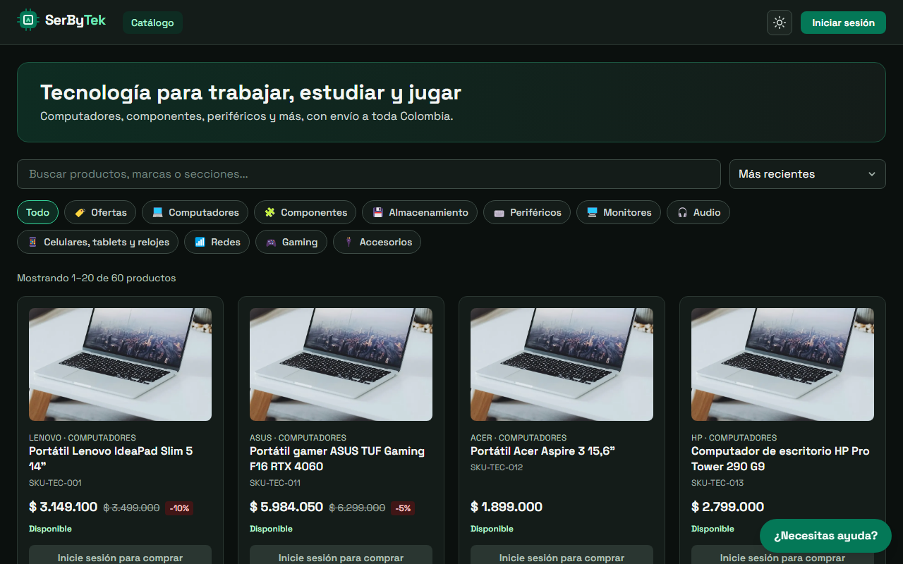
- **Cuentas de prueba.** Todas usan la contraseña `Password123`.

| Correo | Rol |
|---|---|
| `ana@correo.co`, `bruno@correo.co`, `carla@correo.co` | cliente |
| `vendedor@tienda.co` | vendedor |
| `admin@tienda.co` | administrador |

---

## 2. Visitante

### 2.1 Ver y buscar productos

La página principal es el catálogo: 60 productos de tecnología de marcas reconocidas (precios de referencia: es una tienda de demostración) en 10 secciones (computadores, componentes, almacenamiento, periféricos, monitores, audio, celulares/tablets/relojes, redes, gaming y accesorios).

- **Buscar productos…**: escriba el nombre, la marca o la sección (por ejemplo, «mouse» o «audífonos»). La lista se filtra mientras escribe y encuentra también palabras incompletas («portat») y sin tildes.
- **Secciones**: los botones bajo el buscador muestran una sola sección; **Todo** vuelve al catálogo completo y **Ofertas** muestra solo los productos con descuento.
- **Orden**: más recientes (o más relevantes si buscó algo), precio, mayor descuento o nombre.

Cada tarjeta muestra una foto ilustrativa de la sección (no es la foto del modelo exacto) y además:
- el precio vigente, con el descuento si tiene uno;
- la disponibilidad: «Disponible», «Últimas N unidades» o «Agotado».

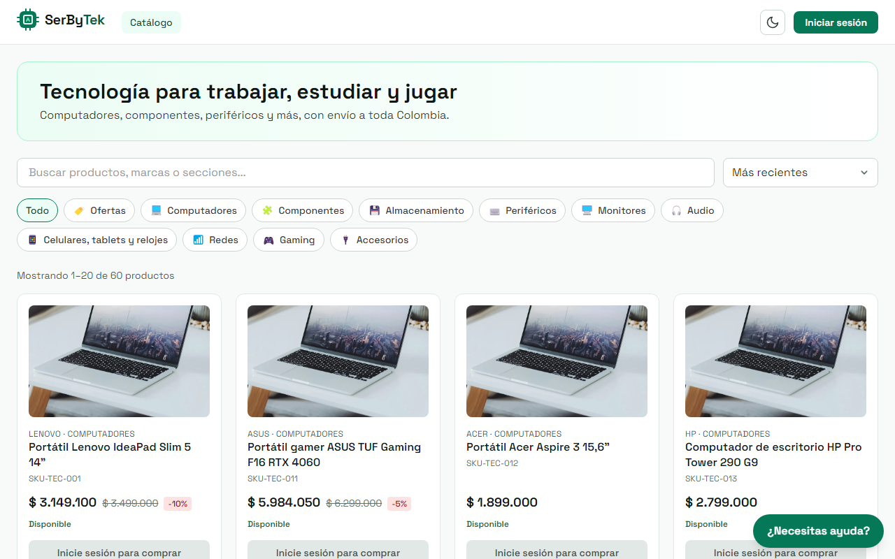

### 2.2 Crear una cuenta

1. Pulse **Iniciar sesión** (arriba a la derecha) y luego **¿No tienes cuenta? Crear cuenta**.
2. Llene su nombre, apellido, correo, una contraseña de al menos 8 caracteres y la dirección de envío: dirección, departamento (de la lista) y ciudad. El apartamento, el nombre de la dirección y el código postal son opcionales.
3. Pulse **Crear cuenta**. La sesión queda iniciada y ya puede comprar: la dirección queda guardada como predeterminada.

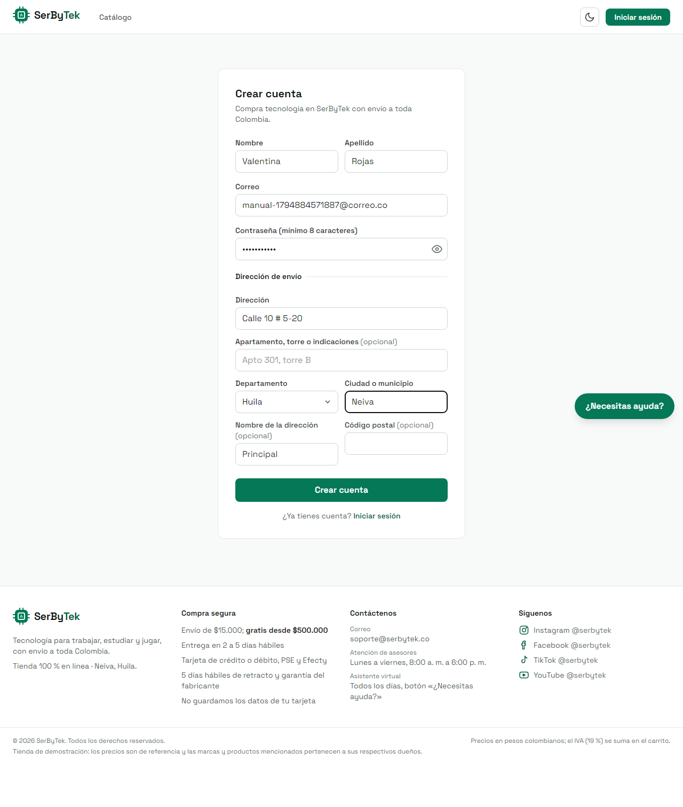

Si el correo ya está registrado, la tienda se lo indica y conserva lo que llenó.

Si su sesión vence o deja de ser válida, la tienda se lo avisa («Tu sesión expiró») y vuelve a mostrar **Iniciar sesión**; el catálogo y el asistente siguen funcionando.

### 2.3 Iniciar sesión

Escriba su correo y su contraseña y pulse **Ingresar**. El botón del **ojo**, dentro del campo, muestra u oculta la contraseña para revisar lo que escribió. Si se equivoca, verá «Credenciales invalidas.». Tras varios intentos fallidos seguidos, el sistema le pide esperar un momento; es una protección contra el robo de cuentas.

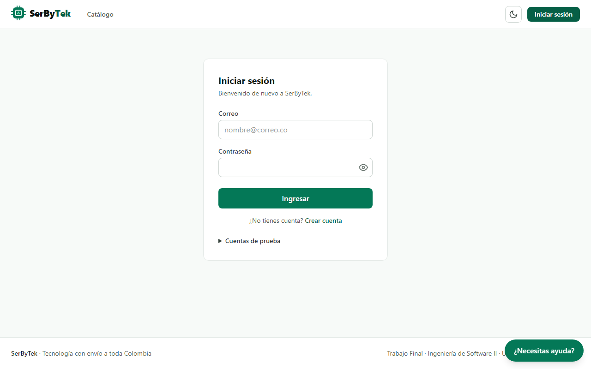

### 2.4 El asistente virtual

El botón **¿Necesitas ayuda?** (abajo a la derecha) abre el asistente, que se puede usar con o sin sesión.

El asistente funciona con reglas, sin inteligencia artificial: entiende frases naturales, el plural y los errores de tipeo, y conoce las secciones del catálogo en vivo (un producto nuevo aparece en el chat sin cambiar nada).

**Puede preguntarle:**
- **El costo del envío**, los medios de pago, los plazos de entrega, las devoluciones, el horario, los cupones, cómo crear la cuenta o cambiar la dirección, la seguridad de los pagos o quiénes somos.
- **Por productos o marcas**, como lo diría a un vendedor: «¿hay audífonos disponibles?», «busco un mouse Logitech», «¿qué tienen de Samsung?», «portátiles Lenovo de menos de 4 millones», «quiero un celular barato» o «¿qué ofertas hay en monitores?». Responde con las tarjetas de los productos, su precio y su disponibilidad, y un botón para ver todos en el catálogo.
- **Por sus pedidos**, solo si inició sesión. Por ejemplo, «estado del pedido PED-202611-001035». Si el pedido es de otra persona, responde que no lo encontró: nunca muestra pedidos ajenos.
- **Por un asesor humano**: escriba «hablar con un asesor». Queda un ticket y el equipo de la tienda recibe el aviso.

Los botones de opciones rápidas ahorran escribir. La tecla **Esc** cierra el asistente.

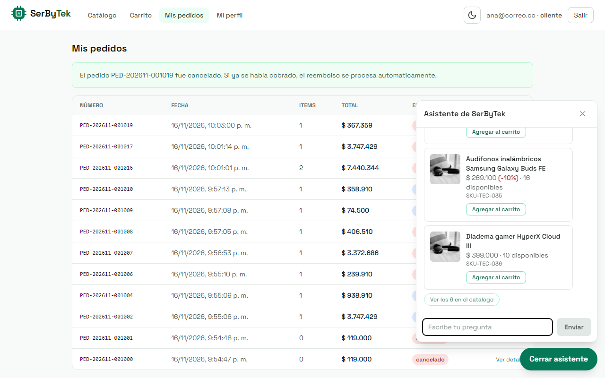

---

## 3. Cliente

### 3.1 Agregar productos al carrito

Pulse **Agregar al carrito** en la tarjeta del producto. Un aviso verde confirma que se agregó y el contador de **Carrito (N)** sube.

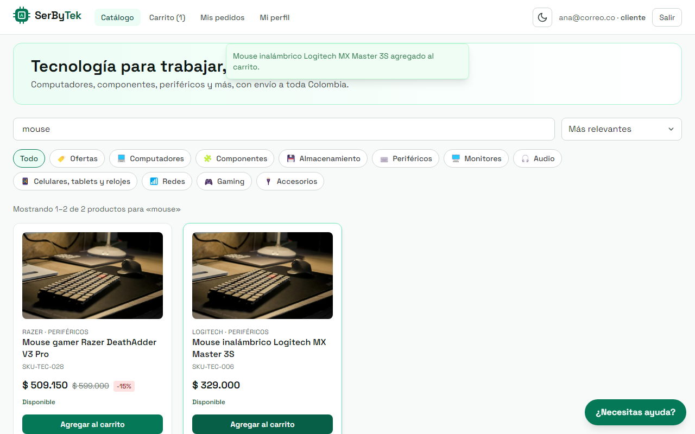

### 3.2 Revisar el carrito y aplicar un cupón

En **Carrito** puede:

- cambiar la cantidad con **−** y **+**, o quitar el producto con **×**;
- escribir un cupón (por ejemplo `BIENVENIDA10`) y pulsar **Aplicar**. El descuento aparece como una línea aparte.

El resumen muestra el subtotal, el descuento, el IVA (19 %), el envío y el total. El envío cuesta $15.000 y es **gratis** desde $500.000 de subtotal.

En **Dirección de envío** aparece marcada su dirección predeterminada. Puede elegir otra de las guardadas o pulsar **+ Agregar otra dirección** y escribirla ahí mismo: queda guardada en su perfil y elegida para esta compra.

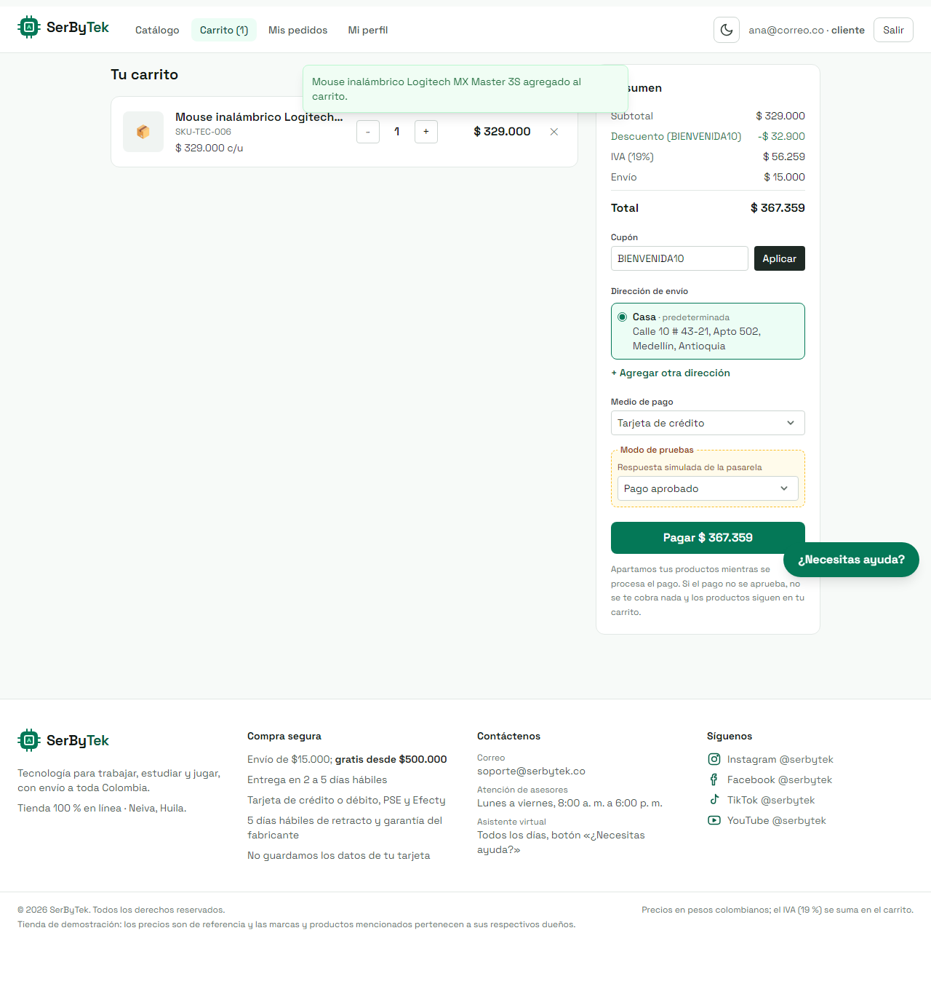

> El recuadro amarillo **Modo de pruebas** solo aparece en la versión de pruebas: permite simular que el banco aprueba, rechaza o tarda. En la versión de producción no se muestra.

### 3.3 Pagar

Elija el medio de pago y pulse **Pagar $…**. La tienda:

1. aparta los productos;
2. cobra;
3. confirma el pedido.

El botón se desactiva mientras tanto, para que un doble clic no compre dos veces. Si el pago se aprueba, verá **Compra confirmada** con el número de su pedido, y le llega un correo de confirmación.

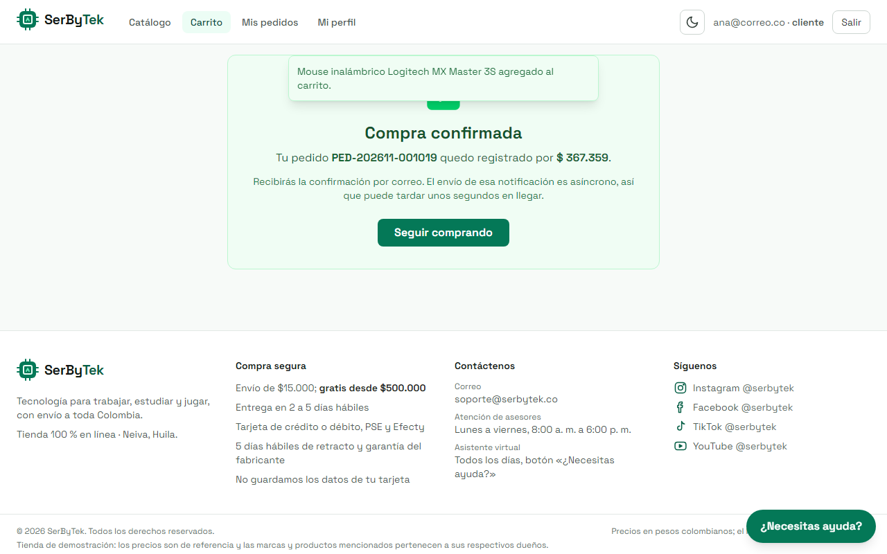

**Si algo sale mal**, la tienda se lo explica sin cobrarle:

| Lo que ve | Qué pasó | Qué hacer |
|---|---|---|
| «El pago fue rechazado… no se realizó ningún cobro» | El banco no aprobó el pago | Intente con otro medio de pago; sus productos siguen en el carrito |
| «Se agotó el producto … mientras completaba la compra» | Otra persona compró la última unidad | Quite ese producto o cambie la cantidad |
| «El precio de un producto cambió mientras compraba» | El catálogo actualizó un precio | Revise el carrito, que ya muestra el precio nuevo, y pague de nuevo |
| Otro mensaje en rojo | Falla temporal de un servicio | Intente de nuevo en unos minutos; no se le cobró |

### 3.4 Correo de confirmación

Cada compra, cancelación o cambio de estado genera un correo. En el entorno de pruebas los correos no salen a Internet: se ven en **Mailpit** (`http://localhost:8025`, solo en el equipo anfitrión).

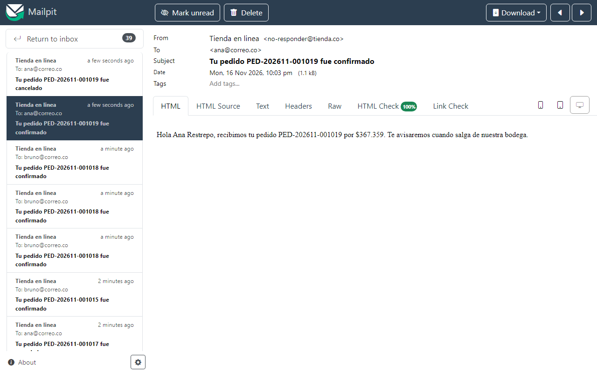

### 3.5 Mis pedidos y cancelación

En **Mis pedidos** está la lista de sus compras con su estado. **Ver detalle** muestra los productos, los totales y la dirección de envío.

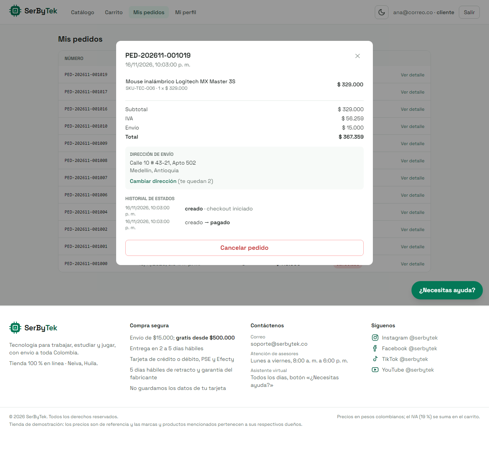

Puede **cancelar** un pedido mientras esté *creado* o *pagado*, es decir, antes de que salga de la bodega:

1. Pulse **Cancelar pedido** en el detalle.
2. Confirme con **Sí, cancelar pedido**.

Si ya se había cobrado, el reembolso se procesa automáticamente y se le informa por correo. Cuando el pedido ya está en preparación, comuníquese con la tienda; el asistente puede escalar su caso.

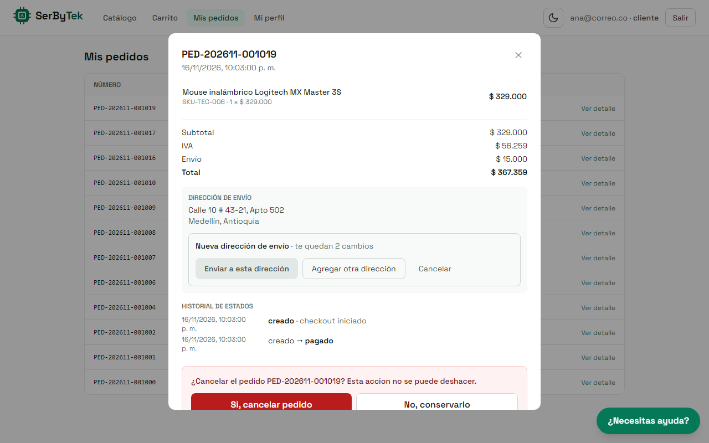

### 3.6 Cambiar la dirección de un pedido

Si se equivocó de dirección, en el detalle del pedido pulse **Cambiar dirección** y elija otra de sus direcciones o agregue una nueva. Se puede hacer **dos veces por pedido** y solo mientras esté creado, pagado o en preparación (antes de que salga de la bodega). Recibe un correo con la dirección nueva; el botón indica cuántos cambios le quedan.

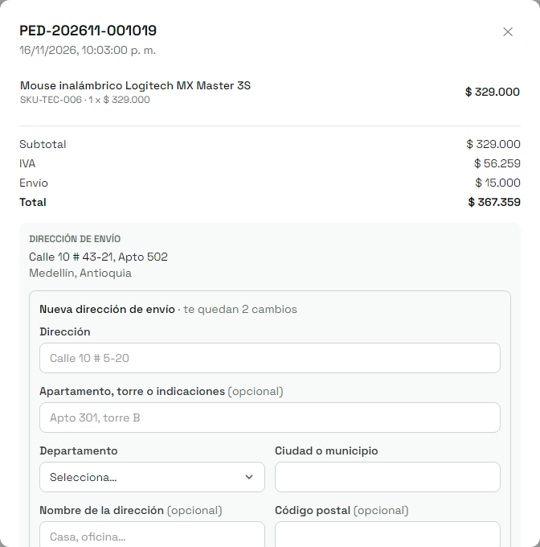

### 3.7 Mi perfil y eliminar la cuenta

En **Mi perfil** puede:

- cambiar su nombre, apellido, teléfono y documento (el correo es su usuario y no se cambia);
- agregar, editar o eliminar direcciones, y elegir la **predeterminada**, que es la que aparece marcada al pagar;
- **eliminar su cuenta**, confirmando con su contraseña.

La eliminación está **bloqueada** mientras tenga pedidos pendientes de pago, pagados, en preparación o enviados: la página le muestra cuáles. Cuando se eliminan, se borran sus datos personales y direcciones y se cierran sus sesiones; los pedidos anteriores se conservan sin sus datos, por obligaciones contables. No se puede deshacer.

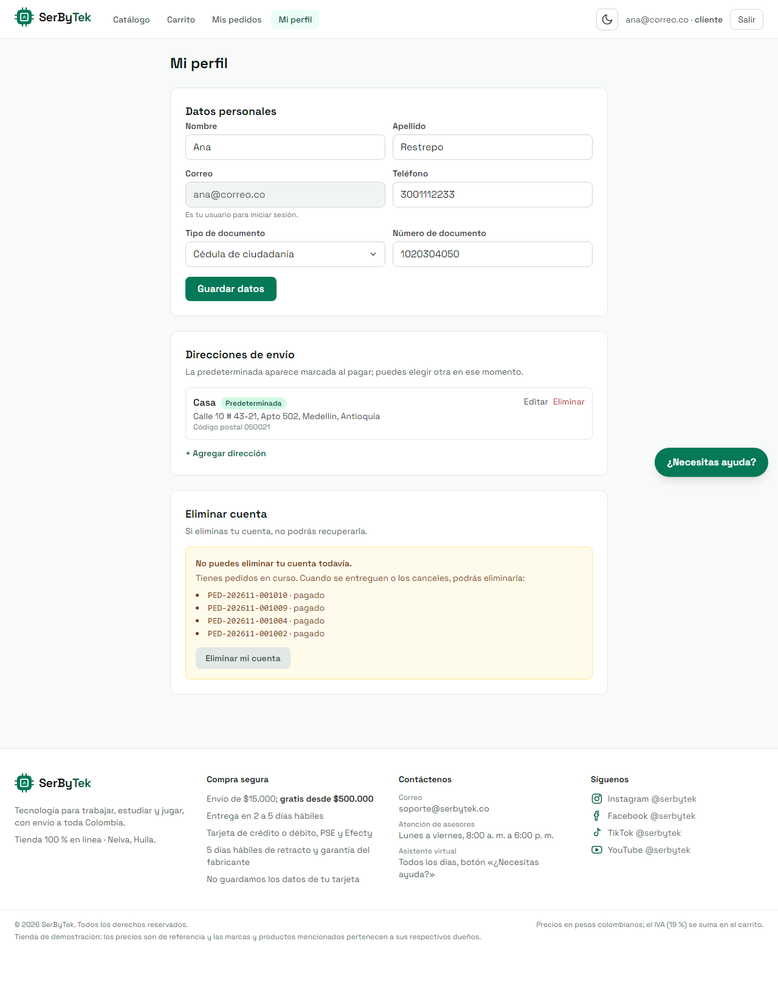

---

## 4. Vendedor

Al iniciar sesión como vendedor se abre **Administración**. El vendedor trabaja en **Inventario** y **Pedidos**; la bitácora de las compras y las notificaciones son del administrador.

### 4.1 Registrar una entrada de mercancía

1. En **Inventario → Registrar entrada**, escriba el SKU (por ejemplo `SKU-TEC-007`) y la cantidad recibida.
2. Pulse **Registrar**. La confirmación indica cuántas unidades hay ahora.

La lista **Alertas de reposición** muestra los productos que están por debajo de su stock mínimo. El equipo también recibe esas alertas por correo.

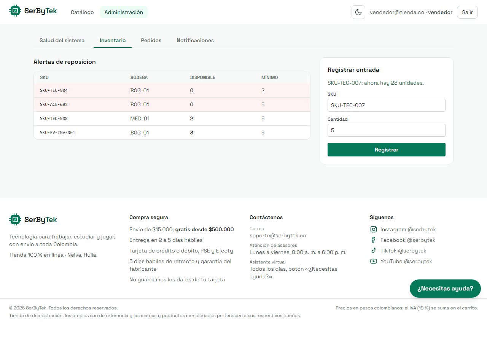

### 4.2 Avanzar los pedidos

En **Pedidos**, cada fila ofrece la siguiente acción permitida:

| Estado actual | Acción |
|---|---|
| pagado | **Marcar en preparación** |
| en preparación | **Marcar enviado** |
| enviado | **Marcar entregado** |

El cliente recibe un correo con cada cambio.

---

## 5. Administrador

El administrador ve todo lo del vendedor, más lo siguiente.

### 5.1 Salud del sistema

La primera sección muestra cada servicio con su estado y sus dependencias (base de datos, broker). Si uno está caído, se ve en rojo, y el resto de la tienda sigue funcionando en lo que no dependa de él.

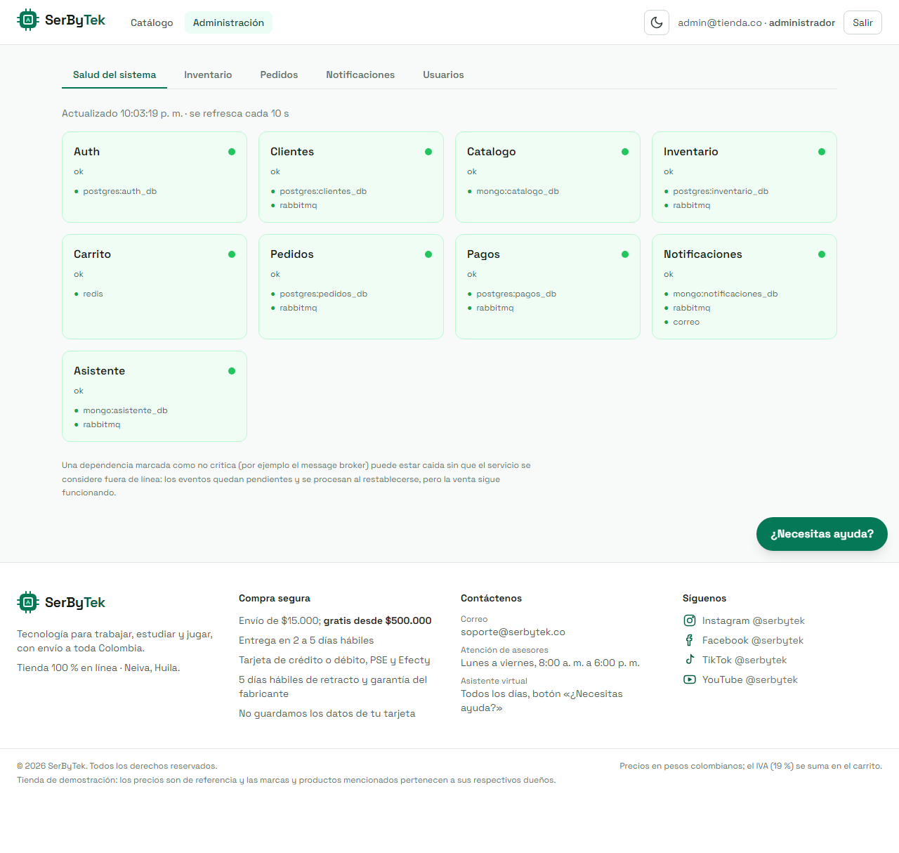

### 5.2 Pedidos y bitácora de la compra

En **Pedidos** están los pedidos de todos los clientes.

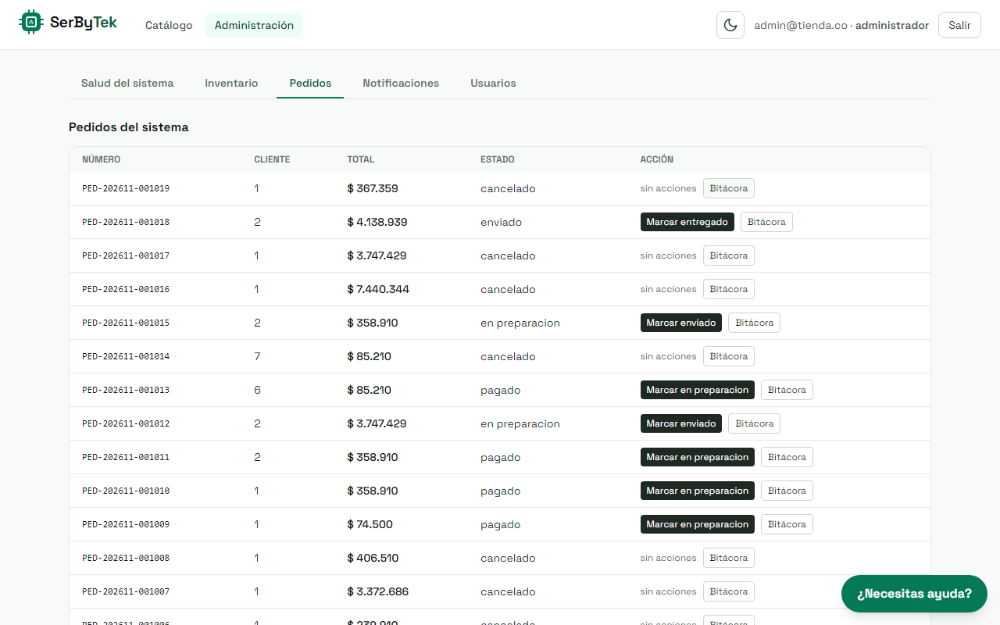

El botón **Bitácora** muestra los pasos internos de esa compra con su hora:
- validar el cliente;
- leer el carrito;
- verificar los precios;
- reservar el stock;
- crear el pedido;
- cobrar;
- confirmar la reserva.

Sirve para responder «¿qué pasó con mi compra?». Si un paso falló, aparece marcado como *fallido* o *compensado*.

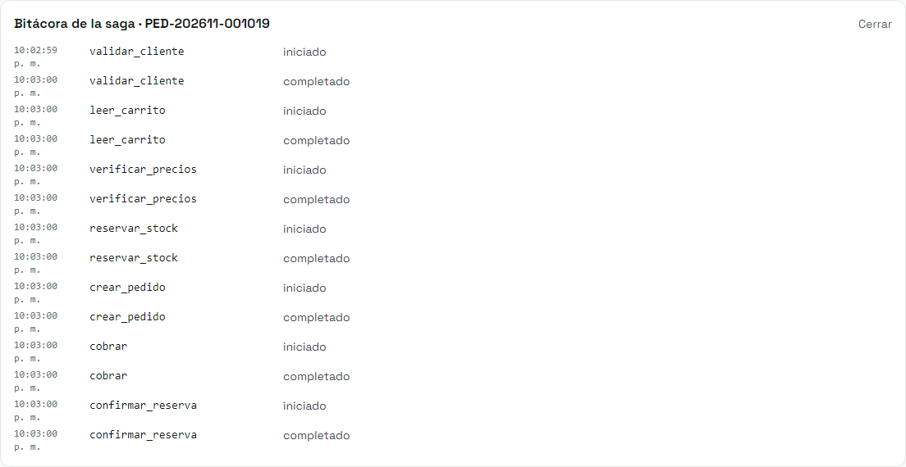

### 5.3 Notificaciones

**Notificaciones** lista los mensajes enviados: a quién, con qué asunto y si se entregaron.

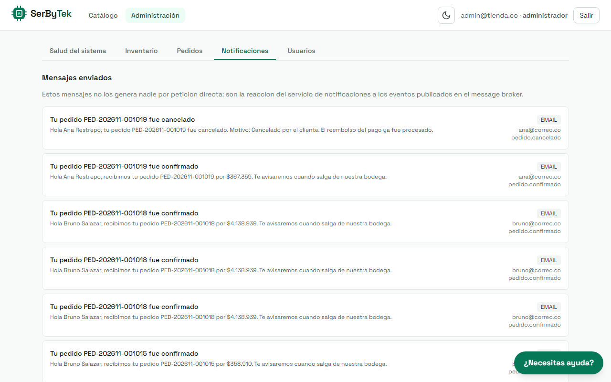

### 5.4 Plantillas de correo y tickets del asistente

Estas dos tareas no tienen pantalla en la web. El administrador las hace desde la documentación interactiva de la API (Swagger UI, en `/api/docs` del entorno de laboratorio), con su sesión:

- **Plantillas:** `GET /api/notificaciones/plantillas` las lista y `PATCH /api/notificaciones/plantillas/{clave}` cambia el asunto o el texto. Los textos entre `{{ }}` (por ejemplo `{{numero}}`) se reemplazan por los datos del pedido.
- **Tickets:** `GET /api/asistente/tickets` muestra las conversaciones que pidieron un asesor humano. El vendedor también puede verlos.

### 5.5 Cuentas del personal

En **Usuarios** el administrador:

- **crea** cuentas de vendedor o de administrador, con una contraseña inicial que debe compartir por un canal seguro;
- **cambia el rol** de una cuenta interna (vendedor ↔ administrador);
- **desactiva** o reactiva una cuenta; la persona pierde sus sesiones al instante.

Las cuentas de cliente no cambian de rol, y nadie puede desactivarse ni cambiarse el rol a sí mismo.

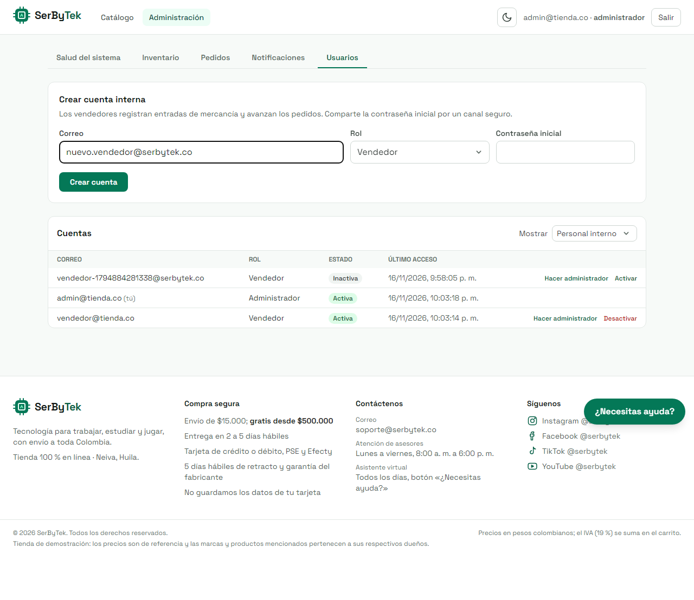

---

## 6. Contacto

El pie de cada página reúne la información de compra (envío, entrega, medios de pago y retracto), el contacto de la tienda (correo y horario de los asesores) y las redes sociales de SerByTek.

## 7. Preguntas frecuentes

**¿Me pueden cobrar dos veces si pulso «Pagar» dos veces?**
No. Cada intento de compra lleva una clave única: el segundo clic recibe la misma respuesta que el primero, sin un cobro nuevo.

**¿Guardan los datos de mi tarjeta?**
No. La tienda solo recibe un *token* de la pasarela de pagos; el número, el CVV y el vencimiento nunca llegan a la base de datos.

**¿Cuánto tiempo dura mi sesión?**
El acceso se renueva solo mientras usa la tienda. Al pulsar **Salir**, la sesión se cierra también en el servidor.

**El asistente no me entiende.**
Reformule la pregunta con otras palabras, use los botones de opciones rápidas o escriba «hablar con un asesor».
